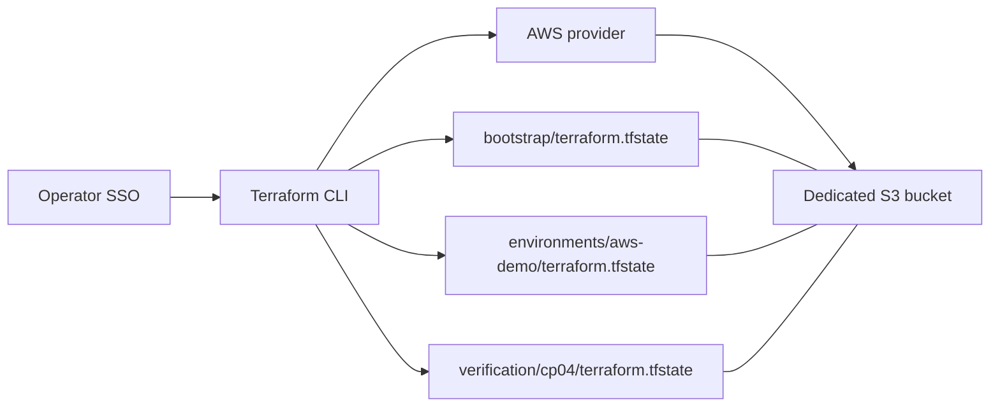

# CP04 — Configuration, state và S3 backend

## Bài toán thực tế của Lynk

CP03 đã có nguồn phục hồi secrets bằng Vault, nhưng repository chưa có Terraform backend. Ngày 2026-10-16, kiểm tra mới xác nhận CloudFormation vẫn sở hữu hai stack `lynk-k3s-dev` và `lynk-cicd`, đều `UPDATE_COMPLETE`. EC2 `i-03bb7dcb94ec8bd21` vẫn chạy `t3.small`, EIP `3.1.88.80`, EBS `vol-09662942cb90152da`; SSM `Online`. Public `/health/ready` trả `ready`, database `ok`. Đây là quan sát thời điểm, chưa phải audit toàn bộ cluster.

CP04 cần một nơi lưu state an toàn trước khi mô hình hóa/import AWS. Kết quả mong muốn: bucket riêng private, encryption, versioning, khóa ghi đồng thời và bootstrap state đã chuyển từ local lên S3. CP04 chưa chuyển ownership của tài nguyên ứng dụng khỏi CloudFormation.

## Kiến thức nền

**Configuration** là mã mô tả trạng thái mong muốn. **Resource thực** là đối tượng AWS, có ID và vòng đời riêng. **State** ghi quan hệ giữa địa chỉ trong mã và ID thực, cùng thuộc tính Terraform biết ở lần gần nhất. Có file `.tf` không có nghĩa Terraform đã quản lý EC2 đang tồn tại. Ngược lại, xóa binding khỏi state không xóa EC2 nhưng có thể khiến plan đề nghị tạo máy mới.

**Backend** quyết định state được lưu ở đâu và cách phối hợp người ghi. Backend S3 dùng key để phân biệt state. **Provider** thực thi API quản lý tài nguyên; backend S3 do Terraform CLI cung cấp, không phải AWS provider. Vì vậy credentials phải dùng được cho cả hai, và provider `allowed_account_ids` không thay thế kiểm tra account ở backend.

**Locking** ngăn hai thao tác Terraform ghi cùng state đồng thời. **Versioning** giữ các thế hệ object để phục hồi khi ghi sai. Lock không chặn người sửa AWS trực tiếp; versioning không backup database hoặc EBS. File `.terraform.lock.hcl` pin dependencies và checksum provider; nó khác object `.tflock` dùng cho concurrency.

## Câu hỏi dẫn dắt

| Câu hỏi                                  | Áp dụng vào Lynk                                                                                                              |
| ---------------------------------------- | ----------------------------------------------------------------------------------------------------------------------------- |
| What: state chứa gì?                     | Binding bucket bootstrap; từ CP06 mới có binding tài nguyên đã import. State có thể chứa thông tin nhạy cảm nên không commit. |
| Why: vì sao không dùng artifact bucket?  | Artifact có vòng đời dọn dẹp và quyền phục vụ deploy; state cần retention và quyền riêng.                                     |
| How: bucket chưa có thì lưu state ở đâu? | Bootstrap dùng local state trong lần tạo đầu, sau đó migrate chính state đó vào key `bootstrap/terraform.tfstate`.            |
| When: khi nào được import?               | Sau khi backend, locking và phục hồi cách ly đã được kiểm chứng; ownership transfer có gate riêng ở CP06–07.                  |
| Who: ai có quyền ghi?                    | Operator AWS SSO hiện tại; chưa cấp thêm quyền backend cho app, node hoặc legacy CI.                                          |
| What if: mất laptop sau migration?       | Lấy source và đăng nhập AWS từ máy khác để init cùng backend; vẫn cần nguồn credentials và Vault password riêng.              |

## Cơ chế hoạt động



Bootstrap root quản lý bucket và các controls. Environment root sau này quản lý AWS đã import; không đọc bootstrap state để chia sẻ secrets. Mỗi key có lock riêng. Hai roots trong cùng bucket không tự khóa lẫn nhau; muốn tránh thay bucket trong khi environment thao tác phải phối hợp operator.

S3 Public Access Block và BucketOwnerEnforced ngăn các cơ chế chia sẻ công khai thông thường. Bucket policy từ chối transport không TLS; IAM vẫn quyết định ai được truy cập. AES256 mã hóa object khi lưu, TLS bảo vệ đường truyền. Không dùng credentials trong file backend hoặc `-backend-config`.

## Các phương án và đánh đổi

Local state đơn giản nhưng dễ mất và khó phối hợp nhiều operator. S3 đã có trong AWS đang dùng nên giảm số hệ thống cần vận hành. Native lockfile tránh thêm DynamoDB; phiên bản CLI phải hỗ trợ. SSE-S3 tránh vòng đời KMS key và chi phí requests bổ sung; không đáp ứng nhu cầu quản lý signing/encryption key riêng nếu sau này có yêu cầu đó. CP04 chưa có yêu cầu này.

Versioning tăng chi phí lưu các phiên bản cũ. Không đặt expiry cho state trong CP04 để tránh tự mất điểm phục hồi. `prevent_destroy` chặn plan destroy khi resource block còn trong cấu hình; người có quyền AWS vẫn có thể xóa bucket trực tiếp. `force_destroy=false` không bảo vệ object khỏi một operator có quyền xóa phiên bản.

## Kế hoạch trước implementation

Kế hoạch này được ghi trước lần apply đầu tiên. Không viết lại phần dự kiến để che khác biệt với kết quả.

1. **Preflight:** xác minh account `231136241975`, region `ap-southeast-1`, gate `paused` và reviewer gate; kiểm tra stacks, EC2, SSM, CI. Snapshot metadata không chứa UserData, Secret hoặc connection string. Đăng nhập SSO hết hạn là lỗi môi trường; operator đã đăng nhập lại và STS xác minh thành công.
2. **Dependencies:** user cho phép chọn pin stable vì số phiên bản kế hoạch gốc không có trong repository. Chọn Terraform `1.16.6`, AWS provider `6.69.1` từ API chính thức. ArgoCD `v3.5.5` là candidate CP12, chưa kết luận tương thích cluster. Kiểm tra checksum CLI, init provider và commit `.terraform.lock.hcl`.
3. **Files:** `infra/terraform/bootstrap/` quản lý duy nhất bucket state; `environments/aws-demo/` dành cho CP05; `backends/` giữ config không có credentials. Bootstrap ban đầu không có active S3 backend; `backend.tf.example` được kích hoạt sau khi bucket sẵn sàng.
4. **Plan:** `fmt`, `init`, `validate`, lưu plan trong `.recovery/` mode 0700; review resource actions. Chỉ chấp nhận tạo bucket dedicated và controls. Không sửa EC2/network/IAM/workload, không cấp quyền CI mới. Tên dự kiến `lynk-tfstate-231136241975-ap-southeast-1-aws-demo`; nếu trùng phải xác minh owner hoặc chọn suffix mới và ghi lý do.
5. **Apply và tác động:** tạo bucket/control, phát sinh phí S3 nhỏ theo dung lượng/requests thực tế; không ước lượng hóa đơn thành số đo. Không cần bảo trì ứng dụng. Sau apply audit live versioning, encryption, public access, ownership và TLS policy.
6. **Migration:** giữ local state backup riêng; kích hoạt `backend.tf`, chạy `init -migrate-state` với key bootstrap. So sánh lineage, serial và resource IDs trước/sau; plan phải no-op. Khởi tạo backend environment riêng, chưa import hoặc apply tài nguyên ứng dụng.
7. **Kiểm chứng cách ly:** root tạm chỉ dùng `terraform_data`, backend key `verification/cp04/terraform.tfstate`; thử concurrent lock, versioned state phục hồi vào key cách ly khác và so sánh metadata. Không dùng state production làm fixture; không apply state cũ vào resource AWS.
8. **Tiêu chí đạt:** controls live đúng, migration không mất binding, lock thật chặn writer thứ hai, recovery đọc đúng phiên bản fixture và không đổi key chính; no-op bootstrap, readiness public, lint/test và CI đạt. Mỗi claim cần evidence riêng, không coi validate là bằng chứng runtime.
9. **Recovery:** apply lỗi một phần thì giữ local state, đọc AWS và plan lại để reconcile; không tạo bucket thứ hai mù quáng. Migration lỗi thì giữ cả nguồn lẫn đích, đọc lineage/serial và object versions trước khi chọn authoritative copy. Không `state push -force`, không xóa bucket hoặc state để thử lại. Bucket đã có state thì giữ bucket ngay cả khi revert mã CP04.
10. **Git:** commit riêng CP04 sau verification, push branch chạy CI, kiểm tra gate ngay trước tích hợp main, không tạo PR. Giữ thay đổi `.gitignore`/`.agents/` của user ngoài commit. Không sang CP05 nếu các gate CP04 chưa đạt.

## Implementation có giải thích

`bootstrap/main.tf` dùng `allowed_account_ids` và region cố định để giảm nguy cơ chạy nhầm account. Các resource versioning, encryption, ownership, public access và policy tham chiếu bucket ID/ARN nên Terraform tự biết dependency. Trước migration cần đợi toàn bộ controls sẵn sàng; riêng resource dependency không thay thế audit live.

Đây là phần backend thực tế, không chứa credentials:

```hcl
key                 = "bootstrap/terraform.tfstate"
region              = "ap-southeast-1"
encrypt             = true
use_lockfile        = true
allowed_account_ids = ["231136241975"]
```

`encrypt` yêu cầu mã hóa object; `use_lockfile` mới là cơ chế khóa thao tác Terraform. `allowed_account_ids` từ chối caller thuộc account khác. Mỗi root dùng `backend "s3" {}` để nhận các giá trị này khi init. Sau migration, `bootstrap/backend.tf` đã active; template được giữ để giải thích giai đoạn local ban đầu, không copy đè vào root đã khởi tạo.

Ví dụ lệnh tái khởi tạo root đã migrate, dùng CLI đúng pin trên PATH:

```bash
AWS_PROFILE=ngqkhai-dev terraform -chdir=infra/terraform/bootstrap init \
  -backend-config=../backends/bootstrap.s3.tfbackend
AWS_PROFILE=ngqkhai-dev terraform -chdir=infra/terraform/bootstrap plan -detailed-exitcode
```

Exit 0 của `plan -detailed-exitcode` nghĩa là không có diff; exit 2 nghĩa là có thay đổi cần review; exit 1 là lỗi. Không chạy `apply` vì một plan có thay đổi là “bình thường”.

Hai roots pin CLI/provider bằng constraint `=`, không dùng `latest` hoặc range nâng cấp tự động. Profile được truyền bằng `AWS_PROFILE=ngqkhai-dev`; credentials vẫn ở SSO cache ngoài Git. Các backend cùng bật `encrypt=true`, `use_lockfile=true` và account guard; key bootstrap khác key môi trường. Bản template backend bootstrap chỉ được đổi thành `.tf` sau khi bucket được tạo.

Quyền backend tối thiểu sau này gồm ListBucket theo prefix, GetObject/PutObject cho state; GetObject/PutObject/DeleteObject cho lockfile. Quyền phục hồi đọc version cũ là quyền riêng, không mặc định cấp cho deploy role. Phiên SSO hiện tại là AdministratorAccess, không phải bằng chứng đã có role Terraform least privilege; việc thu hẹp quyền vận hành cần được ghi nhận khi ownership ổn định.

## Verification, troubleshooting và recovery

Apply thực tế: **6 added, 0 changed, 0 destroyed**. Audit API live xác nhận toàn bộ controls dự kiến; PolicyStatus `IsPublic=false`. Hai roots `validate` thành công; bootstrap plan sau migration exit 0. [Evidence](evidence/cp04-backend.json) lưu kết quả và metadata, không lưu raw state.

Một assertion ban đầu yêu cầu lineage/serial bằng nhau đã thất bại: local serial **7**, remote serial **1**, lineage đổi; cả sáu resource bindings và outputs bằng nhau hoàn toàn. Không sửa state để làm assertion xanh. Đối chiếu [source remote.State tại v1.16.6](https://github.com/hashicorp/terraform/blob/v1.16.6/internal/states/remote/state.go) cho thấy `PersistState` gọi refresh khi `readState` chưa có; nếu object đích chưa tồn tại, refresh đặt lại metadata trước khi sinh lineage đầu tiên. Đây là lời giải thích từ source phù hợp với kết quả quan sát, không phải mất binding. Điều chỉnh tiêu chí: kiểm tra nội dung/binding đầy đủ, ghi transition metadata, backup nguồn và chứng minh no-op. Giữ lineage cũ trong backup `.recovery/`; không `state push -force` để đổi metadata đích. Plan binary cũ được tạo trước migration phải bỏ, không dùng lại với lineage mới.

[Kiểm chứng cách ly](evidence/cp04-isolated-backend.json) chạy script thật: quan sát `.tflock`, owner hoàn tất, contender bị lỗi acquiring lock; fixture serial tăng **1 → 2** khi đổi output **v1 → v2**. GetObjectVersion đọc đúng snapshot v1, ghi sang recovery key mới; `terraform state pull` từ recovery root bằng v1 và root gốc vẫn bằng v2. Các object fixture được giữ trong prefix verification để audit, không có AWS resources hay dữ liệu người dùng trong fixture. Đây là kiểm chứng backend, không phải DB restore hoặc kiểm thử thảm họa production.

Để chạy lại bài kiểm chứng có ghi fixture, script tự tạo prefix UUID mới và kiểm tra account trước khi ghi:

```bash
AWS_PROFILE=ngqkhai-dev python3 scripts/terraform/verify-backend.py \
  --bucket lynk-tfstate-231136241975-ap-southeast-1-aws-demo \
  --output /tmp/lynk-cp04-verification.json
```

CI bổ sung job fmt/validate hai roots với `init -backend=false -lockfile=readonly`, không lấy AWS credentials. Publication phụ thuộc job này. Nó kiểm tra syntax/schema/dependency pins, không chứng minh backend live; bằng chứng live ở trên bổ sung cho CI. Lint local pass, application integration tests **42/42**, không skip; workflow gates và deployment mode tests đều **4/4**. Service layers không có Fastify request/reply hoặc console.log; Dockerfiles ba services vẫn `USER node`; không đổi code ứng dụng hoặc database ownership.

`Token has expired and refresh failed` đã xuất hiện trước apply: không suy ra bucket bị lỗi. Operator chạy `aws sso login --profile ngqkhai-dev`, sau đó STS trả đúng account. Việc kiểm tra bằng Docker wrapper trước đó bị sandbox chặn Docker socket; dùng AWS CLI native cho inventory. Không thay đổi quyền socket.

Đối với `AccessDenied`, kiểm tra caller, key và quyền thao tác cụ thể; không dùng `-lock=false`. Khi lock còn tồn tại, đọc owner/operation và xác minh process đã dừng trước khi cân nhắc unlock. Versioning bảo vệ bản trước khi overwrite nhưng không giữ nguyên một version nếu người có quyền xóa chính version đó.

Thực hành recovery dùng state fixture: lấy một version bằng GetObjectVersion, ghi vào **key phục hồi mới**, đọc lại qua Terraform và kiểm tra lineage/serial/output. Thao tác này chỉ chứng minh đọc được snapshot đó; không chứng minh tài nguyên live khớp snapshot. Recovery thật cần đối chiếu API AWS, refresh/plan, review binding và owner trước khi cho phép ghi. Không lấy một state cũ rồi apply để “quay ngược” database.

## Tự học

**Dự đoán:** hai terminal chạy apply cùng key thì terminal thứ hai phải quan sát điều gì? Nếu đổi sang key khác, điều đó còn đúng không?

**Bài read-only:** mở ba file backend trong `infra/terraform/backends/`, xác định key chứa bucket binding, key dành cho EC2 sau import và key dùng fixture. Đọc `bootstrap/main.tf`, giải thích public-access controls, encryption và `prevent_destroy` bảo vệ ba rủi ro nào. Kết quả cần quan sát: ba key khác nhau; không có quyền app/CI được cấp thêm trong root này.

<details>
<summary>Lời giải và giới hạn</summary>

Writer thứ hai cùng key phải chờ hoặc thất bại vì lock, thay vì ghi đè. Key khác có lock khác nên cả hai có thể chạy. Bootstrap giữ binding bucket; environment chưa có EC2 binding cho tới import; verification chỉ chứa fixture. Public-access controls chống chia sẻ công khai; encryption bảo vệ dữ liệu lưu trữ; prevent_destroy là guard Terraform. Cả ba không thay thế IAM và không backup dữ liệu ứng dụng. Bài người học tự làm vẫn đang chờ, không coi thao tác của agent là bằng chứng người học đã vận hành độc lập.

</details>

## Nguồn chính thức

- [Terraform 1.16.6 binaries/checksums](https://releases.hashicorp.com/terraform/1.16.6/).
- [AWS provider 6.69.1 S3 bucket](https://registry.terraform.io/providers/hashicorp/aws/6.69.1/docs/resources/s3_bucket).
- [S3 backend: locking, permissions và configuration](https://developer.hashicorp.com/terraform/language/backend/s3).
- [Backend migration với init](https://developer.hashicorp.com/terraform/cli/commands/init#backend-initialization).
- [S3 versioning](https://docs.aws.amazon.com/AmazonS3/latest/userguide/Versioning.html).
- [Giới hạn prevent_destroy](https://developer.hashicorp.com/terraform/language/meta-arguments/lifecycle#prevent_destroy).
- [ArgoCD v3.5.5, candidate để đánh giá lại tại CP12](https://github.com/argoproj/argo-cd/releases/tag/v3.5.5).
