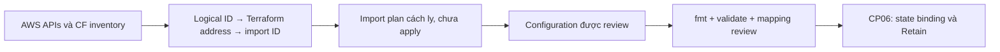

# CP05 — Mô hình hóa AWS mà chưa tạo tài nguyên trùng

## Bài toán thực tế của Lynk

CP04 chuẩn bị backend an toàn. Hạ tầng Lynk đã tồn tại: hai stack CloudFormation quản lý network, EC2, EIP, S3, IAM/OIDC và SSM document. Nếu chỉ viết resource rồi apply vào state trống, Terraform có thể tạo thêm VPC/EC2 hoặc gặp tên IAM trùng. CP05 cần mô hình khớp inventory thực tế, giữ `t3.small`, để CP06 bind đúng tài nguyên cũ bằng import.

## Kiến thức nền

Một **resource address**, ví dụ `aws_instance.node`, là tên Terraform dùng trong dependency graph và state. ID `i-03bb7dcb94ec8bd21` là danh tính AWS. Tên address có thể đổi qua `moved` mà không thay máy, còn sửa thuộc tính cần replacement có thể sinh ID mới dù address giữ nguyên.

**Provider** biết schema và API của AWS. **Dependency** xác định thứ tự thao tác: subnet cần VPC; EC2 cần subnet và instance profile. Dùng reference giữa các resource giúp graph biểu diễn quan hệ đó. Hardcode mọi ID vẫn có thể validate nhưng làm mất nhiều quan hệ mà Terraform cần khi thay đổi sau này.

**Output** là giao diện root công bố cho operator/Ansible. Output ID không phải grant quyền. **Drift** là sai khác giữa cấu hình mong muốn, thông tin state và resource thực. Plan phải refresh/read live mới cho phép đánh giá drift; một plan với state trống không phải kết luận “tài nguyên hiện tại cần tạo lại”.

## Câu hỏi dẫn dắt

| Câu hỏi                        | Trả lời với Lynk                                                                                                                |
| ------------------------------ | ------------------------------------------------------------------------------------------------------------------------------- |
| What cần mô hình?              | Các logical resources của hai stacks và thuộc tính đi kèm như S3 controls, IAM policies, root EBS.                              |
| Why giữ t3.small?              | CP05 chỉ mô hình hóa; resize có snapshot và bảo trì riêng ở CP08.                                                               |
| How lấy thuộc tính?            | AWS inventory mới, provider read qua import-plan/generation cách ly và đối chiếu template; không giả định template Git là live. |
| When được apply?               | CP05 không apply. Import và quyền sở hữu có gate ở CP06–07.                                                                     |
| Who quản lý lúc này?           | CloudFormation vẫn là owner. Terraform mới có configuration, chưa có environment state bindings.                                |
| What if bỏ sót EIP attachment? | Plan sau import có thể muốn đổi binding mạng; mapping phải bao gồm association và allocation ID riêng.                          |

## Cơ chế hoạt động



Một CloudFormation logical resource không luôn tương ứng đúng một Terraform resource. `GatewayAttachment` là quan hệ được thể hiện qua `aws_internet_gateway.vpc_id`; `ArtifactBucket` cần thêm versioning/encryption/lifecycle/public-access controls theo thuộc tính live. Root EBS thuộc `aws_instance.root_block_device`; không thêm `aws_ebs_volume` quản lý cùng volume. IAM inline/managed policies cần ranh giới rõ để role và policy resource không tranh nhau reconcile.

## Các phương án và đánh đổi

Viết từ template Git nhanh nhưng có thể bỏ lỡ drift hoặc thay đổi operator. Sinh cấu hình từ provider đọc AWS giảm lỗi nhớ thuộc tính, nhưng thường dài, thiếu reference có ý nghĩa và có thể chứa trường dư/thông tin nhạy cảm. CP05 dùng generation trong root local cách ly rồi review, rút gọn có kiểm soát và bổ sung dependencies; không coi generated code là bản thiết kế cuối.

Một module tổng quát cho nhiều môi trường chưa có nhu cầu thực nghiệm. Root `aws-demo` tường minh giúp đọc mapping và plan; tách module sau khi có trường hợp tái sử dụng. Không dùng `ignore_changes=all` để che mismatch. Guard `prevent_destroy` cho tài nguyên quan trọng giúp chặn replacement ngoài ý muốn nhưng không thay backup hoặc review.

## Kế hoạch trước implementation

Kế hoạch này được ghi trong khi chờ CI CP04; tại thời điểm ghi chưa thực hiện model/import môi trường. Gate để bắt đầu: CP04 pass CI và tích hợp main với delivery paused. Gate đã đạt: CI [38878762561](https://github.com/ngqkhai/lynk-url-shortener/actions/runs/38878762561) success cho `7485039`, main đã fast-forward sau khi kiểm tra `paused` và required reviewer.

1. **Preflight:** đọc lại gate, CI CP04, bootstrap no-op, stacks `UPDATE_COMPLETE`, EC2 running và Standard credits. Lưu inventory metadata/snapshot protected; không ghi UserData hoặc secrets ra chat.
2. **Mapping:** bao phủ 14 logical resources stack core và 5 logical resources stack automation. EIP allocation `eipalloc-0f88a7eca6c3660d1`, association `eipassoc-0d9ab4bf56ed84463`; route table `rtb-0a44522bc2a4690b5`; role/profile names giữ nguyên.
3. **Dependencies/files:** root `infra/terraform/environments/aws-demo/`, mapping evidence, configuration network/node/storage/IAM/SSM và outputs cho Ansible. CLI/provider giữ pin CP04; generation dùng local backend trong `.recovery/`, không trộn vào backend environment.
4. **Generate/review:** khai báo import blocks ở root generation tạm, chạy plan `-generate-config-out` để provider đọc AWS. Không apply plan generation. Review raw generated config ở vùng protected, lọc dữ liệu trước khi chuyển cấu hình vào Git.
5. **Model:** giữ AMI, AZ, network, EIP, volume type/size/encryption/DeleteOnTermination, IMDSv2, `t3.small`, Standard credits, IAM trust/permissions, S3 retention và SSM document hiện có. Dùng references cho dependencies. Không làm mới UserData để nâng Kubernetes/Helm.
6. **Verify:** fmt/validate; đối chiếu mapping, import IDs và dependencies; plan preview trong vùng cách ly phải không đề nghị update/destroy/replacement ngoài import. Backend environment chưa có binding; không chạy apply để “sửa” plan creates từ state trống.
7. **Tác động:** chỉ đọc AWS và sửa Git, không có downtime hoặc tài nguyên AWS mới. API reads và download provider có chi phí vận hành nhỏ theo thực tế; không bịa số đo.
8. **Đạt:** đầy đủ mapping, không overlap management EBS/SG/policies, validate pass, preview bảo toàn thuộc tính, tests/CI đạt. Sau đó commit CP05 riêng, push branch, kiểm tra gate trước tích hợp main.
9. **Recovery:** bỏ/revert configuration CP05 không xóa tài nguyên AWS vì chưa apply/import. Xóa root generation tạm chỉ xóa file local; giữ evidence an toàn. Nếu phát hiện thuộc tính nhạy cảm trong generated config thì giữ protected và không stage.

## Implementation có giải thích

Root `aws-demo` hiện có **25 resource blocks** chia theo network, node, IAM, storage và delivery. [Mapping](evidence/cp05-import-mapping.json) bao phủ 19 logical resources; một bucket/role được tách controls/policies thành resources riêng, còn IGW attachment và root volume là quan hệ lồng trong resource sở hữu. Import blocks ở `imports.tf.example` nên chưa được Terraform load trong environment. Generation và import preview dùng backend local riêng, không copy bindings vào backend môi trường.

Ví dụ dependency thực tế:

```hcl
resource "aws_route_table_association" "public" {
  subnet_id      = aws_subnet.public.id
  route_table_id = aws_route_table.public.id
}
```

Provider đọc association ID `rtbassoc-057406c3a2418d297`, nhưng import yêu cầu chuỗi `subnet-00400b58035a53c92/rtb-0a44522bc2a4690b5`. Mapping giữ cả ID quan sát và ID import để người đọc không nhầm chúng. `aws_route.default` sở hữu default route; `aws_route_table.public` không khai báo lại inline route. Tương tự, EIP resource không gắn EC2 qua thuộc tính `instance`; association resource sở hữu liên kết đó.

`aws_instance.node` tham chiếu subnet, security group và instance profile, giữ `t3.small`, Standard credits, IMDSv2 và root disk encrypted gp3 30 GiB với `delete_on_termination=false`. Profile tham chiếu role; node phụ thuộc route và policies cần cho SSM/artifacts trước bootstrap. `prevent_destroy` chặn replacement ngoài ý muốn cho node, EIP, VPC, buckets và IAM identities quan trọng. Không dùng ignore_changes để làm plan im lặng.

UserData live được giữ byte-for-byte trong `user-data.sh`; đó là bootstrap lịch sử, chưa nâng Kubernetes/Helm. K3s live vẫn `v1.37.1+k3s1`, Helm `v3.21.2`. IAM trust dùng immutable owner/repository IDs như runtime, khác literal subject trong template Git cũ; mô hình theo live để không làm mất OIDC access. Quyền inline và managed attachment do resources riêng quản lý, role không khai báo lại chúng.

SSM document lấy Content của `$DEFAULT`, giữ format JSON và version hiện có. Lần preview dùng jsonencode đề nghị đổi document chỉ vì whitespace, nên đổi sang `file("${path.module}/deploy-document.json")` với bytes live. `.prettierignore` chỉ loại file nhạy với định dạng này; JSON vẫn được parse và plan kiểm tra. Không sửa document trên AWS để thuận tiện cho formatter. Các outputs công bố instance ID, EIP, region, artifact bucket, role name và document name cho checkpoint tiếp theo; chưa có credentials hoặc DB URLs trong output.

## Verification, troubleshooting và recovery

Khi thấy `+ create` trong environment chưa import, kiểm tra state binding trước khi sửa cấu hình hoặc apply. Khi import preview có `-/+`, đọc thuộc tính gây replacement và so với AWS live. Một plan hợp lệ về syntax vẫn có thể phá ranh giới ownership.

Kết quả thật trong [evidence CP05](evidence/cp05-model.json): **25 to import, 0 to add, 0 to change, 0 to destroy**. Kiểm tra plan JSON xác nhận đủ đúng 25 addresses trong mapping, mỗi action là `no-op` kèm importing metadata. `fmt` và `validate` pass, không còn warning. Đây là preview, không phải tuyên bố Terraform đã sở hữu AWS hoặc environment state đã có bindings.

Các lỗi đã gặp và cách phân biệt:

- Generation sinh EIP association có cả instance và network-interface ID, subnet có cả AZ name/ID, IPv6 count/list, VPC netmask không có IPAM pool. Giữ một cách biểu diễn hợp lệ theo schema và trạng thái thực. Không tắt validation.
- Route association import bằng rtbassoc ID bị provider từ chối; dùng composite ID đúng như trên, không đoán association mới.
- Lifecycle expiration có `days` cùng `expired_object_delete_marker=false`; bỏ marker argument dư để giữ retention 7/14 ngày mà hết warning.
- Terraform validate trong sandbox không tạo được plugin socket; chạy cùng lệnh ngoài sandbox thành công. Không cài lại hoặc đổi provider để che lỗi môi trường.
- Preview trước khi giữ Content bytes có **1 update SSM**. Đã loại diff bằng việc giữ nguyên bytes, không apply update. Không coi “chỉ whitespace” là lý do cho phép thay runtime ngoài scope.

Runtime read-only qua SSM xác nhận K3s active, các Pod Running đều ready; Jobs Succeeded có container ready=false là bình thường vì đã kết thúc. Memory available **214 MiB** trên máy tổng **1905 MiB** tại thời điểm lấy số liệu; đây là quan sát, không phải benchmark hoặc capacity gate cho ArgoCD. Không có fault injection production.

Lệnh kiểm tra source root có thể chạy lại bằng CLI đúng pin:

```bash
terraform fmt -check -recursive infra/terraform
terraform -chdir=infra/terraform/environments/aws-demo validate
```

Để review import preview, dùng root local cách ly chứa configuration này và import blocks từ template; không đặt template active vào environment rồi apply ở CP05. Raw plan/metadata snapshots ở `.recovery/` được bảo vệ, không commit. File source và evidence đã được review loại private keys, credentials, token và connection strings; kết quả scan chỉ áp dụng tập file CP05, không phải audit toàn bộ lịch sử Git. App source không đổi; bộ 42 integration/unit tests CP04 là baseline, CI branch CP05 chạy lại required checks.

Nếu provider generation tạo cấu hình không validate được, lưu lỗi và sửa theo schema phiên bản đã pin; không bỏ validation. Nếu AWS API bị AccessDenied, xác định permission read cụ thể, không mở quyền public hoặc dùng state giả.

## Tự học

**Dự đoán:** đổi tên `aws_instance.node` thành `aws_instance.server` mà không có `moved` hoặc điều chỉnh binding sẽ tạo plan gì sau import?

**Bài read-only:** so sánh mapping EIP với EC2, tìm allocation ID và association ID; giải thích vì sao cùng địa chỉ IP không đủ cho cả hai import. Xác định nơi quản lý root volume và tìm reference EC2 → instance profile → IAM role. Kết quả cần quan sát là một owner cho mỗi thuộc tính và đường dependency tường minh.

<details>
<summary>Lời giải</summary>

Address cũ mất khỏi config trong khi address mới chưa có state thường dẫn tới destroy/create nếu không có moved/import phù hợp; prevent_destroy có thể làm plan fail thay vì cho phép. EIP allocation là tài nguyên địa chỉ, association là liên kết tới network interface/instance; chúng có ID và vòng đời khác nhau. Root disk do instance resource quản lý; không thêm volume resource riêng cho cùng disk. Bài của người học vẫn chờ tự thực hiện.

</details>

## Nguồn chính thức

- [Terraform resource address](https://developer.hashicorp.com/terraform/cli/state/resource-addressing).
- [Generate configuration for import](https://developer.hashicorp.com/terraform/language/import/generating-configuration).
- [Resource dependencies](https://developer.hashicorp.com/terraform/language/resources/behavior#resource-dependencies).
- [AWS provider 6.69.1 instance](https://registry.terraform.io/providers/hashicorp/aws/6.69.1/docs/resources/instance).
