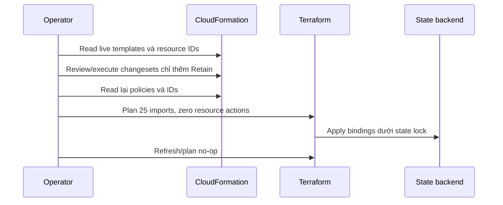

# CP06 — Import, binding và Retain

## Bài toán thực tế của Lynk

CP05 tạo mô hình AWS và preview đúng 25 imports với zero resource changes. Hệ thống vẫn do CloudFormation quản lý; environment Terraform chưa có binding. CP06 phải đưa đúng IDs vào state và thiết lập cơ chế giữ tài nguyên trước khi kết thúc CloudFormation ở CP07. Tạo lại máy hay apply một plan có update IAM/SSM ngoài ý muốn đều không đạt yêu cầu.

## Kiến thức nền

**Import** thiết lập quan hệ address → resource ID trong state. Nó không tự chuyển ownership khỏi công cụ cũ và không tạo backup dữ liệu. Import block cho phép review toàn bộ plan trước khi ghi state; apply plan đó vẫn có thể sửa resource nếu cấu hình khác live, nên phải kiểm tra cả importing metadata lẫn action list.

**Retain** là chỉ dẫn CloudFormation giữ resource khi resource rời stack hoặc stack bị xóa. `DeletionPolicy` áp dụng lúc xóa; `UpdateReplacePolicy` áp dụng cho resource cũ khi replacement. Hai chính sách khác nhau và không ngăn operator chủ động gọi API xóa tài nguyên. Terraform `prevent_destroy` cũng không thay cho Retain bên CloudFormation.

**Ownership** là thỏa thuận ai được reconcile tài nguyên. Một state binding chưa phải bàn giao hoàn tất. CP06 có khoảng chuyển tiếp hai công cụ đều biết resource; delivery paused và không cập nhật resource từ hai phía. CP07 phải đóng khoảng này trước resize/Ansible/adoption.

## Câu hỏi dẫn dắt

| Câu hỏi                         | Trả lời trong Lynk                                                                                                            |
| ------------------------------- | ----------------------------------------------------------------------------------------------------------------------------- |
| What thay đổi?                  | Metadata Retain trong stacks và 25 bindings ở state S3.                                                                       |
| Why Retain trước?               | Nếu xóa stack trước policy, mặc định có thể xóa network, IAM, EC2 hoặc EIP. Root EBS giữ lại không cứu được toàn bộ hệ thống. |
| How biết import không sửa AWS?  | Review plan JSON: mọi resource action `no-op`, đủ 25 importing IDs; apply đúng saved plan; plan sau import no-op.             |
| When được kết thúc CF?          | Sau khi audit Retain live, import hoàn tất và public/runtime checks đạt; ở CP07 riêng.                                        |
| Who được thay đổi?              | Một operator đang thực hiện migration; legacy delivery vẫn paused, không tự chạy bootstrap.                                   |
| What if import dừng giữa chừng? | Đọc state thực, giữ bindings đã thành công, plan lại phần còn lại; không xóa state để làm lại từ đầu.                         |

## Cơ chế hoạt động



CloudFormation snapshot là bằng chứng template/ownership, Terraform state snapshot là bằng chứng binding, còn EBS/DB backups bảo vệ dữ liệu ở các checkpoint sau. Không gọi ba loại này thay thế cho nhau.

## Các phương án và đánh đổi

CLI import từng resource dễ hiểu nhưng dễ bỏ sót hoặc dùng nhầm ID và khó review cả đợt. Import blocks với saved plan cho phép kiểm tra toàn bộ action graph; đổi lại cần bảo vệ file plan vì nó có thể chứa dữ liệu nhạy cảm. Với Lynk dùng blocks từ mapping CP05, vẫn giữ snapshots protected.

Có thể remove resource khỏi template bằng Retain thay vì xóa stack; cách đó cần giữ một stack skeleton hợp lệ và giải quyết refs/outputs. CP06 chỉ thiết lập Retain; CP07 sẽ kết thúc hai stacks sau review riêng. Không đưa quyết định xóa stack vào một changeset đang chỉ chuẩn bị import.

## Kế hoạch trước implementation

Ghi trước thao tác cập nhật stack/import. Chỉ thực hiện khi CP05 CI success và main đã được tích hợp với paused gate.

1. **Preflight:** đọc lại account/gate, stacks `UPDATE_COMPLETE`, inventory IDs CP05, environment state hiện tại, SSM và readiness. Lưu live template và inventory mới trong `.recovery/` 0700. State nếu có phải backup trước; không ghi nội dung ra chat/Git.
2. **Chuẩn bị Retain:** lấy **live original templates**, giữ nguyên intrinsic tags, properties, conditions, parameters và outputs. Chỉ thêm `DeletionPolicy: Retain` cùng `UpdateReplacePolicy: Retain` cho 14 + 5 resources. Chứng minh phần khác byte-identical; không dùng template Git cũ có OIDC subject khác live.
3. **Changesets:** dùng previous parameter values và IAM capability cần thiết; create change sets nhưng chưa execute. Review diff chỉ policy, không Add/Remove/Replacement hay property change. Nếu CloudFormation báo không có property change, vẫn phải kiểm tra khả năng lưu policy bằng kết quả API thực, không giả vờ update đã diễn ra.
4. **Execute/audit:** thực thi changesets đã review, chờ trạng thái kết thúc; đọc lại templates, verify mọi resource có cả hai Retain và physical IDs giữ nguyên. Không xóa stack ở CP06.
5. **Import:** kích hoạt `imports.tf` từ template CP05 trong environment root S3. Plan lưu protected, kiểm tra đúng 25 imports, mọi resource action no-op. Apply chính saved plan; Terraform ghi bindings, không được create/update/delete AWS. Sau đó plan phải no-op và state list khớp mapping.
6. **Files/dependencies:** root `aws-demo`, import mapping CP05, helper kiểm tra plan/template nếu cần, evidence CP06 và bài này. Pin CLI/provider giữ nguyên; không sửa module ứng dụng.
7. **Tác động:** metadata stack và state thay đổi; không đổi service/data/network. Hai công cụ cùng biết IDs trong khoảng CP06→CP07; cấm apply resource changes trong khoảng này. Gate paused không chặn operator AWS trực tiếp, nên thỏa thuận vận hành vẫn cần thiết.
8. **Đạt:** live Retain đủ 19 resources, IDs không đổi, 25 bindings đúng, Terraform no-op, readiness và CI đạt. Commit CP06 riêng, push branch rồi gate main; tự chuyển CP07 khi đủ điều kiện.
9. **Recovery:** stack update thất bại thì đọc events/status, không import khi ownership chưa rõ. Import lỗi giữ state hiện có và inspect; có thể bỏ binding bằng state rm sau backup chỉ khi quyết định quay lại CloudFormation, không destroy. Revert Git không tự hoàn tác state hoặc policies AWS. Không xóa resources để sửa import.

## Implementation có giải thích

Gate CP05 đã đạt: [CI 38879819048](https://github.com/ngqkhai/lynk-url-shortener/actions/runs/38879819048) success và main fast-forward tới `906c6e6` sau kiểm tra paused/reviewer. Preflight CP06 đọc lại account, templates, physical IDs và xác nhận chưa có environment state object. Snapshots raw được giữ trong `.recovery/`, không đưa vào Git.

`migration-guards.py retain` đọc original YAML từ AWS, đối chiếu logical IDs với inventory rồi thêm hai thuộc tính sau cho mỗi resource:

```yaml
DeletionPolicy: Retain
UpdateReplacePolicy: Retain
```

Helper giữ nguyên intrinsic tags như `!Ref`, `!Sub`, giữ nguyên tất cả properties/conditions/outputs; không serialize lại template bằng một YAML loader làm mất intrinsic tags. Guard từ chối inventory khác, resource format bất ngờ hoặc policy hiện có ngoài Retain. Candidate chỉ khác source ở các dòng policy được thêm. Template đang live có immutable OIDC subjects; không lấy bản Git lịch sử để cập nhật ngược trust.

Hai changesets được tạo với previous parameter values. Review JSON xác nhận **14 + 5 Modify**, tất cả `Replacement=False`, Scope chỉ `DeletionPolicy`/`UpdateReplacePolicy`. BeforeContext và AfterContext bằng nhau sau khi loại hai policy mới. Sau đó mới execute lần lượt; cả hai kết thúc UPDATE_COMPLETE, audit template live thấy đủ **19 × 2 Retain** và mọi physical ID giữ nguyên. [Evidence review/execute](evidence/cp06-retain-review.json) chỉ lưu metadata/scopes, không lưu đầy đủ resource contexts.

`imports.tf` được kích hoạt từ template đã review. Import plan thật lưu protected và được guard kiểm tra:

```bash
python3 scripts/terraform/migration-guards.py check-import-plan \
  --plan .recovery/cp06-import-plan.json \
  --mapping docs/runbook/deployment-checkpoints/evidence/cp05-import-mapping.json
```

JSON ở đây do `terraform show -json` của saved binary plan tạo ra. Guard yêu cầu mỗi importing ID khớp mapping và mỗi action đúng `no-op`; thiếu resource, ID sai, update hay replacement đều fail. Đây là guard cho lần import đầy đủ đầu tiên, không dùng cho plan bình thường sau import hoặc tự động chấp nhận partial import. Apply dùng đúng saved binary plan, không lập một plan khác rồi auto-approve.

## Verification, troubleshooting và recovery

CloudFormation changeset thể hiện ý định; template sau execute mới xác nhận policy đã có hiệu lực. State list chỉ chứng minh có address; phải đối chiếu ID và dùng plan live để kiểm tra thuộc tính. Public readiness chỉ chứng minh đường HTTP/DB của endpoint đó, không chứng minh toàn bộ backup dữ liệu hoặc Kafka persistence.

Kết quả apply: **25 imported, 0 added, 0 changed, 0 destroyed**. Post-import plan với refresh live exit **0**, không còn diff. Đối chiếu state từng resource theo identity: route dùng route-table + CIDR, association dùng subnet/route-table cùng observed association ID, IAM policy/attachment dùng role + policy, các resource còn lại dùng ID. Không so chuỗi state ID với import ID một cách máy móc vì provider có những định dạng khác nhau. [Evidence import](evidence/cp06-import.json) lưu 25 bindings và metadata state, không lưu raw attributes.

Root volume vẫn `vol-09662942cb90152da`, SSM document vẫn version **2**, public readiness sau import trả `ready`, database `ok`. State backup sau import được giữ trong `.recovery/` mode 0600; bản remote có S3 versioning từ CP04. Không tuyên bố các checks này là database restore test. Hai stacks vẫn tồn tại; CP07 mới kết thúc CloudFormation ownership.

Guard tests **5/5** pass bằng fixtures giả, bao gồm policy-only/idempotency, intrinsic/property preservation, inventory mismatch, unexpected policy, import create/update/delete/replacement, sai ID và thiếu import. CI bổ sung chạy tests này trong Terraform job, không dùng AWS credentials. Workflow gate tests **4/4** pass. Application source và Dockerfiles không đổi; CI branch vẫn chạy lint và full application integration tests.

Nếu plan có “will be imported” đồng thời “updated in-place”, action update vẫn là thay đổi AWS và phải giải quyết trước apply. Nếu state lock lỗi, xác minh process/lock owner, không thêm `-lock=false`. Nếu CloudFormation đã vào rollback trạng thái lỗi, không chạy thêm thao tác ownership từ Terraform để đoán chữa.

## Tự học

**Dự đoán:** chỉ thêm import blocks vào Git nhưng chưa apply thì Terraform đã quản lý EC2 chưa? Nếu đã import mà chưa Retain rồi delete stack thì `prevent_destroy` có cứu EC2 không?

**Bài read-only:** đọc evidence changeset và template policies; tìm binding EC2/EIP trong mapping, so với state list metadata. Kết quả cần quan sát là policy thuộc CloudFormation, binding thuộc Terraform và physical identity vẫn là resource cũ.

<details>
<summary>Lời giải</summary>

Blocks mới chỉ mô tả ý định; state chưa có binding cho tới import apply thành công. Terraform prevent_destroy chỉ áp dụng khi Terraform lập plan, không chặn CloudFormation xóa resource. Cần Retain bên CF và kết thúc ownership có kiểm soát. Bài người học vẫn chờ tự thực hiện.

</details>

## Nguồn chính thức

- [Import blocks và review plan](https://developer.hashicorp.com/terraform/language/import).
- [CloudFormation DeletionPolicy](https://docs.aws.amazon.com/AWSCloudFormation/latest/TemplateReference/aws-attribute-deletionpolicy.html).
- [CloudFormation UpdateReplacePolicy](https://docs.aws.amazon.com/AWSCloudFormation/latest/TemplateReference/aws-attribute-updatereplacepolicy.html).
- [Review changesets](https://docs.aws.amazon.com/AWSCloudFormation/latest/UserGuide/using-cfn-updating-stacks-changesets-view.html).
