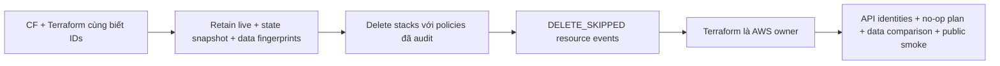

# CP07 — Kết thúc CloudFormation ownership

## Bài toán thực tế của Lynk

CP06 đã import 25 resources vào Terraform S3 state, plan sau import no-op; 19 CloudFormation logical resources có cả hai Retain và IDs giữ nguyên. Hai stacks vẫn tồn tại. Nếu operator cập nhật stack cũ sau khi Terraform thay đổi AWS, hai cấu hình có thể tranh quyền và ghi đè kết quả của nhau. CP07 kết thúc khoảng chuyển tiếp này trước resize CP08.

## Kiến thức nền

**Owner** là công cụ được phép điều khiển thuộc tính tài nguyên. Terraform state binding ghi danh tính nhưng không cấp một khóa sở hữu toàn cục trên AWS. CloudFormation cũng không tự biết một Terraform state khác đã import tài nguyên của nó.

**Reconciliation** là so sánh desired state với live rồi hành động. CloudFormation thực hiện khi có thao tác stack, Terraform khi operator chạy plan/apply; chúng không phải controller liên tục tự chữa như ArgoCD. Tuy vậy, một lần operator chạy nhầm template cũ vẫn đủ gây lỗi. Kết thúc ownership vì thế cần cả thao tác AWS lẫn hướng dẫn source rõ ràng.

**Retain rồi delete stack** loại quan hệ quản lý trong CloudFormation nhưng giữ physical resources. Đây không phải rollback dữ liệu. Tags `aws:cloudformation:*` còn trên resource là dấu vết lịch sử; không chứng minh stack còn quyền quản lý.

## Câu hỏi dẫn dắt

| Câu hỏi                       | Trả lời với Lynk                                                                                                             |
| ----------------------------- | ---------------------------------------------------------------------------------------------------------------------------- |
| What sẽ bị xóa?               | Hai stack records/quan hệ quản lý; tài nguyên được Retain phải tiếp tục tồn tại.                                             |
| Why không để hai công cụ mãi? | Một update bằng template cũ có thể đổi IAM/network ngoài Terraform review.                                                   |
| How kiểm chứng?               | Audit Retain ngay trước delete, xem DELETE_SKIPPED từng logical resource, đối chiếu AWS identities và plan Terraform sau đó. |
| When resize?                  | Sau khi CP07 release và smoke/CI đạt; chưa resize trong bước này.                                                            |
| Who vận hành tiếp?            | Terraform quản lý AWS; Ansible quản lý host, Helm legacy vẫn quản lý workload cho tới Argo adoption.                         |
| What if delete stack lỗi?     | Dừng thao tác ownership, đọc events/retention từng resource, không force-delete hoặc recreate stack.                         |

## Cơ chế hoạt động

Kiểm tra dữ liệu dùng từng deployment với credentials của chính service: auth → lynk_auth, URL → lynk_urls, redirect → lynk_redirects. Chỉ SELECT counts và checksum tổng hợp trên server, không xuất rows, password hashes, tokens hoặc connection strings. Đây là phép so sánh các bảng được chọn tại hai thời điểm, không phải backup hoặc chứng minh mọi storage trong hệ thống.

## Các phương án và đánh đổi

Giữ stack để tham khảo đơn giản nhưng kéo dài rủi ro quản lý kép. Remove từng resource khỏi template cần giải quyết dependencies/outputs và skeleton; với hai stack migration một lần, Retain toàn bộ rồi delete stack dễ kiểm tra hơn. Đổi lại, quay về CloudFormation sau CP07 cần resource import có kiểm soát; không thể “undo delete stack” bằng deploy template cũ.

Counts phát hiện thay đổi số hàng nhưng không phát hiện nội dung hàng bị sửa. Checksum tổng hợp bổ sung phép so sánh nội dung, với chi phí đọc các bảng. Dùng cho dữ liệu demo nhỏ hiện có; query có deadline và không gửi hàng dữ liệu ra ngoài. Nếu có traffic ghi đồng thời làm fingerprint đổi, phải phân tích thay đổi hợp lệ trước khi kết luận mất dữ liệu hoặc đạt kiểm chứng.

## Kế hoạch trước implementation

Ghi trước thao tác release. Chỉ execute sau CP06 CI success và main đã tích hợp trong chế độ paused.

1. **Preflight:** xác minh account/gate, state bindings/backup protected, Terraform no-op, stacks UPDATE_COMPLETE và inventory IDs. Đọc **lại** live templates; Retain đủ 19 resources, không dựa vào evidence CP06 làm trạng thái hiện tại. Kiểm tra termination protection trước khi delete.
2. **Snapshot:** giữ state và template/inventory mới trong `.recovery/`; ghi fingerprints bảng ứng dụng bằng role riêng, snapshot EIP/EBS/EC2/SSM và PVC identities. Không tạo hoặc thay đổi tài khoản ở bước lấy baseline.
3. **Release:** delete `lynk-cicd` trước rồi `lynk-k3s-dev`, dùng policies Retain đã audit. Chờ từng stack kết thúc; review resource events phải DELETE_SKIPPED, không có resource DELETE_COMPLETE. Không force-delete. Nếu protection bật, trình bày và xử lý đúng scope release đã được ủy quyền trước khi tiếp tục.
4. **Verify:** AWS API xác nhận EC2 running, cùng EIP/volume/network/IAM/SSM/S3 IDs. Terraform refresh/plan phải no-op. Đọc fingerprints/PVCs sau release **trước** smoke để phân biệt dữ liệu do smoke tạo. So sánh đủ đúng phạm vi baseline, không suy rộng thành backup test.
5. **Public smoke:** chạy acceptance hiện có với AWS/SSM mode và failure tests false. Smoke được phép tạo dữ liệu synthetic auth/URL, kiểm tra ownership/auth/redirect và event persistence; không dừng broker/DB/Pod. Token chỉ ở memory.
6. **Source/files:** thêm bài/evidence CP07 và helper inspect nếu cần; đánh dấu templates CloudFormation lịch sử đã retired, cập nhật current ownership ở runbooks mà không viết lại CP01–CP03. Không đổi runtime workloads, names, PVCs, domain hoặc credentials.
7. **Tác động:** CloudFormation không còn quản lý retained resources, billing của chúng tiếp tục bình thường. Không có bảo trì ứng dụng dự kiến; kiểm chứng chỉ cho kết luận những điều đã quan sát, không khẳng định zero downtime nếu không đo liên tục.
8. **Đạt:** 19 DELETE_SKIPPED, cả hai stacks DELETE_COMPLETE, resource/data/PVC identities giữ nguyên, Terraform no-op, smoke và CI đạt. Commit CP07 riêng, branch CI rồi gate main; sau đó CP08.
9. **Recovery:** nếu stack delete dở dang, giữ nguyên tài nguyên/state, đọc từng event trước retry. Terraform trở thành công cụ phục hồi cấu hình sau release. Muốn quay lại CF phải chuẩn bị import/mapping; không chạy create stack từ template cũ vì có thể tạo trùng. State restore không khôi phục database rows hoặc disk contents.

## Implementation có giải thích

Gate CP06 đã đạt: [CI 38880787267](https://github.com/ngqkhai/lynk-url-shortener/actions/runs/38880787267) success cho `ad4d5bc`, main được tích hợp sau khi kiểm tra paused/reviewer. Ngay trước release, plan live no-op, state được backup protected; cả hai stacks UPDATE_COMPLETE, termination protection false. Guard đọc lại template và xác nhận việc thêm Retain lần nữa không thay bytes: mọi logical resource đã có đủ hai policy.

Delete dùng **StackId ARN**, không chỉ tên, để không nhầm với một stack cùng tên được tạo lại. Mỗi request có client request token riêng; events được lọc theo đúng token để không lấy lịch sử cũ làm bằng chứng. Thao tác dùng STANDARD, không dùng `--retain-resources` dành cho DELETE_FAILED và không force-delete. Automation stack kết thúc trước core stack. [Evidence release](evidence/cp07-release.json) ghi **5 + 14 DELETE_SKIPPED**, hai stack DELETE_COMPLETE; không có resource DELETE_COMPLETE trong operation.

`scripts/ops/inspect-data.py` dùng Node/postgres có sẵn trong từng service deployment. Mỗi database được đọc bằng một SELECT, chứa các subquery aggregate cho bảng allowlist để có một statement snapshot trong database đó. `row_to_json` được hash tại DB, chỉ counts/checksum đi qua stdout; không có raw rows hoặc tokens. Script xác minh current database/current role đúng ownership. Checksum MD5 ở đây chỉ hỗ trợ consistency comparison, không phải encryption, backup hay bằng chứng chống chỉnh sửa có chủ đích. Ba database không có một global transaction snapshot chung.

Hai PVC được đối chiếu bằng namespace/name/UID/volumeName/Bound phase. Workload Deployment/StatefulSet được đối chiếu bằng UID và image references, không chỉ tên. Source CloudFormation templates được đánh dấu retired và runbooks current ownership trỏ về Terraform; các snapshot CP01–CP03 vẫn giữ nguyên như lịch sử.

## Verification, troubleshooting và recovery

Stack record DELETE_COMPLETE không đủ: phải thấy từng resource được skip, còn live API và Terraform no-op xác nhận resource vẫn đúng. Resource tags có thể giữ tên stack cũ; không cần xóa tags lịch sử để “chứng minh” transfer.

[Evidence verification](evidence/cp07-verification.json) ghi before/after riêng: cả **bảy bảng** giữ nguyên counts/checksums. Users **7**, refresh_sessions **7**, refresh_tokens **9**, access_tokens **0**, URLs **5**, outbox **0**, redirect URLs **5** tại hai thời điểm so sánh; đây là số quan sát thực tế, không phải benchmark. PostgreSQL reported version `18.6 (653b019)`. So sánh hoàn tất trước khi smoke tạo dữ liệu synthetic.

PVC Kafka và Traefik giữ cùng UID/volume; chín Deployment/StatefulSet giữ UID và images. AWS API xác nhận EC2 `i-03bb7dcb94ec8bd21` running `t3.small`, EIP `3.1.88.80`, root EBS `vol-09662942cb90152da`, SSM Online; Terraform plan sau release exit **0**. Điều này hỗ trợ kết luận ownership transfer không đề nghị thay cấu hình AWS hiện tại; không suy ra toàn bộ nội dung EBS/Kafka đã được hash.

Public acceptance thực tế **Success/exit 0** qua SSM, kiểm tra opaque gateway, owner isolation, refresh reuse, logout, public redirect và replication trước first click. Chạy với `LYNK_SMOKE_AWS=true`, `LYNK_SMOKE_SSM=true`, `LYNK_FAILURE_TESTS=false`; không dừng broker, DB hoặc Pod. Tokens chỉ trong memory; output chỉ có PASS. Smoke tạo users/URLs synthetic sau phép so sánh dữ liệu nên counts sau smoke có thể tăng hợp lệ. Không xóa dữ liệu test bằng các thao tác DB thủ công trong checkpoint này.

Không có lỗi release cần retry/rollback. Việc phục hồi bằng CloudFormation chưa được thử và không được coi là một nút undo; muốn tái nhận ownership phải import vào stack mới với mapping và plan riêng. Bộ guard tests CP06 tiếp tục pass; source ứng dụng, imports `.js`, service-layer boundaries và Docker `USER node` không đổi. CI branch vẫn là gate trước tích hợp main.

Readiness xanh không bao phủ auth ownership hoặc event persistence; public smoke bổ sung các đường đó. Fingerprints không thay DB backup/restore CP11 và không bao phủ Kafka log/EBS bytes; PVC ID và Pod identity giúp kiểm tra storage/workload không bị thay ngoài ý muốn.

## Tự học

**Dự đoán:** CF tags còn trên EC2 sau delete stack có nghĩa CF vẫn quản lý máy không? Terraform plan no-op có chứng minh DB không mất một hàng không?

**Bài read-only:** lần theo mapping một logical resource đến Terraform address, physical ID và event DELETE_SKIPPED. So sánh before/after fingerprint và nhận diện dữ liệu synthetic do smoke tạo sau thời điểm so sánh. Kết quả cần quan sát là bằng chứng ownership, hạ tầng và dữ liệu trả lời ba câu hỏi khác nhau.

Lời giải

Tags là metadata lịch sử; quyền quản lý được xác định qua stack membership và quy trình vận hành. Terraform quản lý AWS resources nhưng không đọc mọi bảng DB, nên no-op không chứng minh dữ liệu. Phải dùng phép kiểm tra dữ liệu riêng và nêu phạm vi của nó. Bài người học vẫn chờ tự thực hiện.

## Nguồn chính thức

- [DeleteStack API](https://docs.aws.amazon.com/AWSCloudFormation/latest/APIReference/API_DeleteStack.html).
- [CloudFormation stack events](https://docs.aws.amazon.com/AWSCloudFormation/latest/UserGuide/view-stack-events.html).
- [Retain resource behavior](https://docs.aws.amazon.com/AWSCloudFormation/latest/TemplateReference/aws-attribute-deletionpolicy.html#aws-attribute-deletionpolicy-options).
- [Terraform state purpose](https://developer.hashicorp.com/terraform/language/state/purpose).
