# CP08 — RAM, CPU credits và bảo trì stop/start

## Bài toán thực tế của Lynk

CP07 chuyển AWS sang một owner Terraform và giữ nguyên tài nguyên/dữ liệu. Node vẫn `t3.small`; quan sát trước migration cho thấy tổng RAM 1905 MiB, available 214 MiB. Chưa đủ bằng chứng để cài thêm controller ArgoCD. CP08 thực hiện thay đổi đã thống nhất sang `t3.medium`, tối đa một node, giữ CPU credits Standard, disk và EIP.

## Kiến thức nền

**RAM** chứa working set của hệ điều hành, K3s và containers; requests giúp scheduler đặt chỗ, limits có thể khiến container bị OOM kill. **CPU** là khả năng chạy công việc; T3 còn có **credits** cho phép burst cao hơn baseline trong một khoảng thời gian. Tăng RAM không có nghĩa tăng sustained CPU capacity.

Standard dùng số credits tích lũy; khi cạn, khả năng burst bị giới hạn. Unlimited có thể dùng surplus và phát sinh phí bổ sung. CP08 giữ Standard, không chuyển sang Unlimited để làm deployment trông khỏe hơn. CloudWatch credit balance là một phép đo có thời gian/độ phân giải riêng; không coi một điểm còn nhiều credits là bằng chứng tải dài hạn an toàn.

**Stop/start** giữ instance ID và EBS, nhưng có thời gian ứng dụng ngừng phục vụ trên một node. **Replacement** tạo instance mới; có thể đổi ENI, disk, bootstrap và identities. Terraform marker `~` không tự hứa zero downtime: instance_type update in-place vẫn cần stop/start. EIP là tài nguyên địa chỉ riêng, khác public IPv4 tự động có thể đổi sau stop/start.

## Câu hỏi dẫn dắt

| Câu hỏi                      | Trả lời với Lynk                                                                                                  |
| ---------------------------- | ----------------------------------------------------------------------------------------------------------------- |
| What thay đổi?               | Chỉ instance_type từ t3.small sang t3.medium; không đổi AMI, disk, network hoặc credentials.                      |
| Why snapshot?                | Giữ điểm phục hồi root disk trước bảo trì; snapshot không backup ba Neon databases.                               |
| How tránh replacement?       | Review plan JSON chỉ một update instance_type, prevent_destroy vẫn active; từ chối create/delete.                 |
| When snapshot nhất quán hơn? | Sau khi stop node sạch để root disk không còn writes; khác snapshot crash-consistent của volume đang chạy.        |
| Who phục hồi ứng dụng?       | Systemd khởi động K3s, Kubernetes khôi phục workloads trên cùng disk/PVCs, operator xác minh health/smoke.        |
| What if medium không start?  | Không tăng vượt medium; đọc EC2 status/capacity errors, có thể quay lại small qua cùng quy trình và giữ disk/EIP. |

## Cơ chế hoạt động

```mermaid
flowchart LR
    Plan[Plan: 1 instance_type update] --> Stop[Stop node trong bảo trì]
    Stop --> Snapshot[Snapshot root EBS khi stopped]
    Snapshot --> Gate[Snapshot completed và private/encrypted]
    Gate --> Apply[Replan/review và apply resize]
    Apply --> Start[Running + EC2 status checks + SSM]
    Start --> K3s[K3s / workloads / PVCs]
    K3s --> Smoke[Public smoke và số đo memory mới]
```



Database ở Neon không bị snapshot EBS bao phủ. Kafka data và Traefik certificate storage nằm trên local-path PVCs của root disk; snapshot khi node stopped giảm rủi ro cached writes. Snapshot không tạo HA và vẫn cần quy trình restore local/DB riêng ở CP11. Snapshot được giữ private, encrypted cùng KMS key của encrypted volume; không public-share.

## Các phương án và đánh đổi

Giữ small tránh tăng chi phí compute nhưng headroom hiện tại hạn chế. Medium là phạm vi đã cho phép để tăng RAM; không chứng minh đủ capacity cho ArgoCD cho tới khi đo ở CP12. Thêm HA node hoặc tăng cao hơn medium cần scope mới và không làm trong chuỗi này.

Snapshot khi running rút ngắn downtime nhưng bỏ qua dữ liệu còn trong cache; với root disk, AWS khuyến nghị stop trước snapshot. Chọn stop sạch trong cùng bảo trì rồi đợi snapshot complete trước apply để có gate phục hồi rõ ràng, chấp nhận downtime dài hơn. Snapshot và loại máy lớn hơn tăng chi phí AWS; không ghi dự toán thành hóa đơn đo được.

## Kế hoạch trước implementation

Ghi trước thay đổi type/power state. Gate bắt đầu mutation: CP07 public smoke/CI success, main đã tích hợp với delivery paused.

1. **Preflight:** xác minh account, gate, Terraform no-op, EC2 running small, Standard credits, EIP/ENI/EBS IDs và SSM Online. Đọc CloudWatch credits/utilization mới; lưu datapoints thực và khoảng thời gian, không chế số liệu. Kiểm tra medium có cùng kiến trúc/CPU options và root volume phù hợp.
2. **Snapshot nguồn:** backup state protected, lấy lại data/PVC baseline sau smoke CP07. Sửa duy nhất instance_type trong `node.tf`; tạo/review plan: đúng một update node, chỉ instance_type đổi; không create/delete/replacement hoặc thay IAM/SSM/volume. Thông báo trong chat trước khi stop.
3. **Bảo trì:** bắt đầu ghi các lần public readiness observation có timestamp. Stop EC2 bằng API chuẩn, chờ stopped, không force-stop. Node ngừng phục vụ trong giai đoạn này; database Neon vẫn độc lập.
4. **EBS snapshot:** tạo snapshot `vol-09662942cb90152da` với tags Project=lynk, Checkpoint=CP08, Purpose=pre-resize. Kiểm tra encrypted/private và chờ completed. Nếu quá deadline quan sát 15 phút, không resize; đưa small chạy lại, giữ snapshot đang pending và báo đúng trạng thái. Deadline là kế hoạch vận hành, chưa phải RTO đo được.
5. **Apply:** replan khi stopped, review lại cùng giới hạn action/attributes, apply saved plan. Xác minh running; nếu provider giữ stopped, start cùng instance bằng API, không recreate. Giữ t3.medium và Standard; nếu capacity gate không đạt thì không tăng thêm.
6. **Verify:** EC2 status checks, SSM Online, K3s active/Node Ready, Pods ready, cùng root EBS/EIP/ENI/PVCs; data fingerprints trước/sau bảo trì khớp trong phạm vi bảng chọn trước khi smoke tiếp. Đo RAM available và Pod requests/usage, không coi node Ready là đủ headroom. Chạy public smoke không fault injection; Terraform plan cuối no-op.
7. **Files/dependencies:** `node.tf`, lesson/evidence CP08, runbook current compute note nếu cần. Không sửa images/chart/domain/JWT/mTLS hoặc chạy migration. Dùng provider/CLI pins hiện tại.
8. **Đạt:** snapshot completed/encrypted/private, plan chỉ resize, cùng identities/data, Standard, SSM/K3s/smoke đạt, số đo thật và CI xanh. Commit riêng CP08, branch CI rồi kiểm tra gate main, sau đó CP09.
9. **Recovery:** nếu chưa apply, đổi source về small và start lại instance hiện có; nếu đã resize và lỗi, review plan medium→small và dùng bảo trì tương tự. Snapshot là nguồn tạo volume phục hồi khi disk hỏng, không tự attach/replace root trong CP08 vì vượt thay đổi resize. Không restore EBS snapshot vào hệ thống đang ghi hoặc tuyên bố nó rollback Neon DB. Giữ snapshot ít nhất qua migration; chưa tự prune snapshot này.

## Implementation có giải thích

Gate CP07 đã đạt: [CI 38881785875](https://github.com/ngqkhai/lynk-url-shortener/actions/runs/38881785875) success cho `575cc14`, main đã tích hợp sau kiểm tra paused/reviewer. Baseline data/PVC mới được lấy sau smoke CP07; baseline Terraform plan no-op và state đã backup protected.

Preview trước bảo trì có đúng một node update nhưng assertion ban đầu so sánh mọi top-level field đã fail: ngoài instance_type, provider đánh dấu public_ip/public_dns unknown và chuẩn hóa `user_data_replace_on_change` từ null thành false. Chưa stop hoặc apply khi assertion fail. Đối chiếu [source provider v6.69.1](https://github.com/hashicorp/terraform-provider-aws/blob/v6.69.1/internal/service/ec2/ec2_instance.go) xác nhận false là default, không thay UserData. Điều chỉnh guard trước maintenance: chỉ cho instance_type, hai computed address fields trở thành unknown, cùng đúng normalization null→false; mọi khác biệt disk/UserData/network/IAM khác, replacement hoặc resource action khác đều bị từ chối. EIP allocation/association và IP thực phải được xác minh sau bảo trì, không coi unknown là lời hứa địa chỉ giữ nguyên.

Điều chỉnh trong bảo trì: node đã stop sạch và snapshot `snap-04c1d516e74600500` được yêu cầu lúc **09:46:24 UTC**. AWS vẫn báo pending 0% sau vài phút. Theo cơ chế snapshot point-in-time, volume có thể được dùng lại trong khi transfer; để tránh giữ ứng dụng offline chỉ vì thời gian transfer, operator start lại **cùng máy small** và giữ snapshot tiếp tục. Chỉ dừng local observer process của agent, không hủy snapshot AWS. Resize vẫn yêu cầu snapshot completed/encrypted/private; sau đó replan/review và có một cửa sổ stop/start nữa. Đây là điều chỉnh so với dự kiến giữ node stopped tới khi transfer xong, không phải resize đã thành công. Outage observations được giữ để thể hiện cả hai khoảng thay vì che downtime.

Snapshot đã completed, encrypted/private được xác minh qua API trước apply. Máy small được xác minh phục vụ lại bằng readiness 200, public auth thiếu token 401 và EC2 system/instance checks ok. Sau đó refresh plan với trạng thái running hiện tại, guard lại scope rồi apply saved plan. Kết quả **0 added, 1 changed, 0 destroyed**; cùng instance `i-03bb7dcb94ec8bd21`, ENI `eni-06551b4cd2fbd6599`, EBS `vol-09662942cb90152da`, EIP `3.1.88.80`, type mới `t3.medium`, credits **standard**.

Lệnh guard dùng cho plan đã xuất JSON protected:

```bash
python3 scripts/terraform/migration-guards.py check-resize-plan \
  --plan .recovery/cp08-final-resize-plan.json \
  --from-type t3.small --to-type t3.medium
```

Guard chỉ cho cặp small/medium hoặc chiều recovery tương ứng, không chấp nhận large/Unlimited, import thêm bindings, replacement hay sửa resource khác. Guard tests mở rộng thành **8/8** pass, gồm disk/UserData/address changes ngoài dự kiến. Snapshot được giữ làm artifact phục hồi do operator sở hữu, không được Terraform tự prune; đây là ngoại lệ operational artifact được ghi rõ ngoài root resource model.

## Verification, troubleshooting và recovery

Phân biệt EC2 running, status checks, SSM Online, K3s Ready và public acceptance: mỗi gate kiểm tra một lớp. Nếu EC2 chạy mà SSM chưa Online, đọc system/instance status trước khi kết luận Kubernetes lỗi. Nếu Pods Pending sau resize, kiểm tra requests/node allocatable; nếu restart/OOM thì đọc termination reason/events, không tăng limit mù quáng.

HTTP polling chỉ cho khoảng quan sát outage với độ phân giải polling; không báo chính xác zero downtime hoặc benchmark latency từ các probes đó. Snapshot complete chỉ xác nhận AWS đã hoàn tất snapshot, chưa chứng minh quy trình boot từ volume restore đã được thử.

[Evidence resize](evidence/cp08-resize.json), [verification](evidence/cp08-verification.json) và [raw readiness observations](evidence/cp08-readiness.jsonl) lưu kết quả thật. Monitor ghi request-start timestamps, nghỉ 2 giây giữa requests, timeout mỗi request 3 giây; vì vậy khoảng lấy mẫu thực tế tăng khi timeout. Hai cửa sổ non-200 quan sát được:

| Cửa sổ                                     | 200 cuối trước đó (UTC) | Non-200 đầu (UTC) | 200 đầu sau đó (UTC) |
| ------------------------------------------ | ----------------------- | ----------------- | -------------------- |
| Stop để snapshot, rồi phục hồi small       | 09:45:59                | 09:46:02          | 09:52:11             |
| Stop/start để resize sau snapshot complete | 09:59:37                | 09:59:40          | 10:01:00             |

Không coi bảng này là thời điểm outage chính xác hoặc latency benchmark. Nó chứng minh có gián đoạn quan sát được và khôi phục phục vụ qua từng cửa sổ; không che window đầu vì cuối cùng resize thành công.

Sau resize, SSM command thực thi thành công, K3s active, Node Ready, auth/URL/redirect/Redis/Kafka/Traefik rollout ready. EC2 status checks lúc đầu còn initializing dù ứng dụng đã ready; tiếp tục quan sát tới khi **system=ok và instance=ok**, không đồng nhất hai tầng. Terraform plan cuối exit **0**. Bảy bảng giữ nguyên counts/checksums, cả hai PVC và chín workload UIDs/images giữ nguyên trước smoke. Snapshot không được restore vào production.

RAM available đo từ `/proc/meminfo`: **208.4 MiB trước → 2126.5 MiB sau**; MemTotal raw **1951736 KiB → 3924200 KiB**. Số đo sau lấy gần thời điểm reboot, cache/working set còn thay đổi; không suy ra steady-state headroom hoặc Argo capacity gate đã đạt. `kubectl top` dùng định nghĩa/window khác MemAvailable nên không cộng/trừ hai loại số một cách máy móc. [CloudWatch evidence](evidence/cp08-cloudwatch.json) giữ credit balance/utilization theo period **3600 giây**; credit balance các datapoints trước bảo trì là **576**, không có Unlimited activation. Không suy ra throughput hoặc CPU capacity vô hạn từ balance này.

Public acceptance sau resize **Success/exit 0**: opaque auth, owner isolation, refresh reuse/logout, redirect và replication trước first click. Failure tests false, không fault injection production. Snapshot boot-restore chưa thử; CI branch là gate còn lại trước main. Source app/Dockerfiles không đổi; runtime validation bổ sung cho lint/test bắt buộc trong CI.

## Tự học

**Dự đoán:** plan chỉ có dấu `~` cho instance_type thì vì sao vẫn cần bảo trì? Medium có giải quyết được CPU credits cạn không?

**Bài read-only:** đọc plan evidence, chỉ ra attribute duy nhất được đổi và tìm ID EIP/disk trước/sau. Đọc CloudWatch timestamp/period rồi so với số đo memory từ host; xác định câu hỏi nào mỗi nguồn trả lời được.

<details>
<summary>Lời giải</summary>

In-place nghĩa là giữ resource identity; EC2 vẫn phải stop để đổi type. Medium tăng RAM nhưng không được coi là vô hạn CPU burst; phải xét Standard credits/baseline và tải thực tế. EIP/disk identities và plan actions giúp phân biệt stop/start với replacement. Bài người học vẫn chờ tự thực hiện.

</details>

## Nguồn chính thức

- [Change an EBS-backed instance type](https://docs.aws.amazon.com/AWSEC2/latest/UserGuide/change-instance-type-of-ebs-backed-instance.html).
- [EBS snapshot consistency/encryption](https://docs.aws.amazon.com/ebs/latest/userguide/ebs-creating-snapshot.html).
- [Burstable credits và Standard/Unlimited](https://docs.aws.amazon.com/AWSEC2/latest/UserGuide/burstable-credits-baseline-concepts.html).
- [AWS provider 6.69.1 instance](https://registry.terraform.io/providers/hashicorp/aws/6.69.1/docs/resources/instance).
