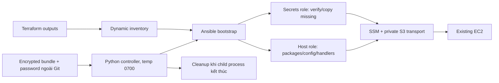

# CP09 — Host convergence, controller và Vault

## Bài toán thực tế của Lynk

CP08 đưa cùng node lên medium, dữ liệu/PVC giữ nguyên, public smoke và Terraform no-op đạt. Ansible source hiện vẫn hardcode instance ID/bucket, trộn host configuration với Helm/kubectl platform reconciliation và mới chỉ verify Vault ở runner. CP09 cần inventory từ Terraform outputs, nối nguồn Vault vào bootstrap thực và chứng minh chạy lại không gây thay đổi host hoặc rotate keys.

## Kiến thức nền

**Cloud-init/UserData** phù hợp cho lần bootstrap đầu của một instance. Sửa file UserData trong Git không có nghĩa host đã tồn tại tự chạy lại mọi bước. **Ansible** đọc trạng thái hiện tại và dùng modules để đưa host tới trạng thái mong muốn; nó phù hợp cho cấu hình vận hành có thể chạy lại.

**Controller** là máy chạy Ansible, giữ AWS session và giải mã Vault tạm thời. **Managed host** là EC2 nhận cấu hình qua SSM. **Inventory** nối tên host logic `lynk` với instance ID và transport options. Terraform outputs là giao diện metadata, không phải nơi chứa DB credentials. **Handler** là hành động như restart K3s, chỉ được notify khi cấu hình liên quan đổi và thường được gom chạy một lần.

**Idempotency** nghĩa là chạy lại với cùng desired state không tiếp tục thay đổi managed state. Changed=0 không có nghĩa không có network calls, không dùng CPU hoặc không tạo file tạm controller. Không dùng changed_when=false để che một host task thực sự thay đổi.

## Câu hỏi dẫn dắt

| Câu hỏi                               | Trả lời trong Lynk                                                                                                             |
| ------------------------------------- | ------------------------------------------------------------------------------------------------------------------------------ |
| What được Ansible quản lý?            | OS dependencies, pinned K3s/Helm/AWS CLI, host config và runtime files; không tự apply workloads.                              |
| Why bỏ hardcoded inventory?           | Sau một lần thay host có kiểm soát, outputs mới phải được dùng mà không sửa ID ở hai nơi.                                      |
| How đưa secrets tới host?             | Controller giải mã bundle trong temp directory 0700, files 0600; role secrets so sánh/copy thiếu, không overwrite key đang có. |
| When restart K3s?                     | Chỉ khi config đổi hoặc cần start service; không restart mỗi lần bootstrap.                                                    |
| Who đọc Terraform state?              | Operator và bootstrap role với quyền read đúng environment state key, không grant write state.                                 |
| What if kết nối host lỗi sau decrypt? | Controller wrapper phải cleanup trong finally khi Ansible trả lỗi/unreachable; không chỉ trông chờ remote task cuối chạy.      |

## Cơ chế hoạt động

Workloads vẫn do delivery/Helm hiện tại sở hữu cho tới CP16. Host bootstrap không reconcile Kafka/Redis/Traefik hoặc ứng dụng; chạy host playbook không trở thành một đường CD thứ hai. Vault chỉ bảo vệ khi lưu; khi sử dụng vẫn có plaintext trên controller và khi cung cấp file tới host. No-log và permissions là ranh giới vận hành, không phải thay thế mã hóa transport/storage.

## Các phương án và đánh đổi

Static inventory đơn giản nhưng trùng nguồn cấu hình. Dynamic inventory từ outputs cần quyền đọc state và Terraform init tại controller; quyền mới phải giới hạn key đọc, không cho CI bootstrap ghi state. Không đổi sang AWS discovery theo tag vì như vậy có thêm cách chọn host ngoài output contract đã thống nhất.

Giải mã trong playbook với delegated tasks tiện, nhưng cleanup cuối play có thể không chạy khi host unreachable/process bị ngắt. Chọn controller wrapper sở hữu tempfile context và child Ansible process, tách host/secrets thành roles. SIGKILL hoặc mất máy vẫn có thể để lại temp files; directory 0700 giới hạn truy cập, operator phải cleanup có kiểm soát khi phục hồi controller. Không tuyên bố mọi crash đều xóa được plaintext.

Giữ key đang chạy tránh rotate ngoài lịch. Nếu Vault và file existing khác nhau thì fail trước khi copy, không tự chọn bên nào là đúng. Missing file có thể được tạo từ Vault; việc thay CA/signing material có quy trình riêng CP10.

## Kế hoạch trước implementation

Ghi trước thay đổi IAM/Ansible/host. Gate thực thi: CP08 CI success và main đã tích hợp, delivery paused.

1. **Preflight:** đọc lại Terraform outputs, EC2 medium/SSM, installed K3s/Helm/AWS CLI, runtime directory/file metadata và readiness. Verify Vault locally với password file có sẵn, không in nội dung. Giữ pins ansible-core 2.19.3, amazon.aws 10.1.2, boto3/botocore 1.40.50 và các phiên bản host hiện có.
2. **Tooling/controller:** cài dependencies vào `/tmp` operator environment; kiểm tra/pin Session Manager plugin theo artifact chính thức. Inventory script đọc outputs bằng CLI đúng pin và kiểm tra IDs/region/types; chỉ xuất required metadata, không dump arbitrary outputs. Syntax CI dùng inventory placeholder không thể kết nối host thật, không cần AWS credentials.
3. **IAM:** policy bootstrap hiện chỉ đọc artifact bucket, chưa có quyền environment state. Thêm policy chỉ GetObject đúng `environments/aws-demo/terraform.tfstate`, ListBucket prefixes cần cho backend/default workspace. Không PutObject/DeleteObject state hoặc lockfile, không mở quyền bootstrap role sang tài nguyên ứng dụng mới. Review Terraform plan chỉ thêm policy, apply rồi kiểm tra simulation/read scope.
4. **Source:** `inventory.py`, controller wrapper, roles `host`/`secrets`, host vars và bootstrap workflow. Wrapper nhận password file hoặc env có sẵn, decrypt vào protected tempfile, chạy Ansible và cleanup bằng context/finally. Password không nằm trong arguments; argument chỉ là tên env hoặc đường dẫn file.
5. **Host:** giữ config và versions, dùng handler cho K3s config change; tránh implicit upgrade. Không đặt platform reconciliation trong default bootstrap. Secret role kiểm tra existing bytes/mode bằng checksum trong no-log tasks, copy chỉ khi thiếu và verify lại; không tạo JWT/CA keys.
6. **Verify:** unit tests cho inventory contract/controller cleanup khi child lỗi; Ansible syntax/check mode; review diff trước apply. Chạy apply trên node, rồi chạy lại cùng desired state để chứng minh **changed=0** cho host. Không gắn changed_when=false cho host mutations chỉ để đạt số này. Verify protected plaintext cleanup và runtime secrets unchanged bằng boolean, không xuất hashes của password/private key.
7. **Tác động:** IAM chỉ thêm read state cho bootstrap; host package/config changes đúng plan có thể notify K3s restart nếu config khác. Thông báo trước apply. Giữ workload names/PVCs/images, domain/EIP và credentials; không chạy Helm/kubectl apply hoặc migration.
8. **Đạt:** inventory đúng outputs, Vault thực sự cấp source, no automatic overwrite, second run idempotent, secrets/versions/workloads bảo toàn, readiness/public smoke và CI đạt. Commit CP09 riêng, branch CI rồi gate main.
9. **Recovery:** lỗi controller thì cleanup temp và giữ host unchanged nếu chưa apply; lỗi giữa host tasks thì đọc recap/task failure, sửa nhỏ rồi converge lại, không regenerate keys. Config file cần backup khi đổi; muốn rollback K3s config thì phục hồi file cũ và restart có chủ đích. Revert Git không tự uninstall packages hoặc hoàn tác IAM. Nếu secrets mismatch, dừng cung cấp và xác minh source, không force copy.

## Implementation có giải thích

### Thay đổi đã thực hiện

- `bootstrap-inventory.tf` cấp cho GitHub bootstrap role `s3:GetObject` đúng environment state key và `s3:ListBucket` theo prefix backend cần thiết. Plan thực tế là **1 add, 0 change, 0 destroy**; policy đã apply. Không cấp quyền ghi state hoặc lockfile.
- `inventory.py` đọc đúng ba Terraform outputs không nhạy cảm, kiểm tra account-specific bucket pattern, EC2 ID và region; không đưa outputs khác vào Ansible hostvars. Workflow khởi tạo backend với Terraform 1.16.6 ở chế độ lockfile readonly.
- `bootstrap.py` giải mã bundle qua Vault CLI vào thư mục controller 0700, giữ password ngoài argv, đưa Ansible local temp vào cùng thư mục riêng và luôn cleanup khi child kết thúc. Trước giải mã, wrapper xác minh inventory phân giải đúng một host. Kiểm thử đã phát hiện Ansible mặc định có thể trả exit 0 khi inventory lỗi và không có host; wrapper hiện biến lỗi đó thành lỗi sớm, trước khi chạm Vault.
- Playbook tách `secrets` và `host` roles. Secret role xác minh bytes so với Vault, mode 0600 và không overwrite file hiện hữu. Host role giữ nguyên K3s `v1.37.1+k3s1`, Helm `v3.21.2`, AWS CLI `2.31.18`, chỉ cài khi thiếu, và K3s restart chỉ qua handler nếu config đổi. Workload reconciliation không còn nằm trong bootstrap mặc định.
- SSM plugin `1.2.896.0` được pin theo URL version cụ thể, SHA256 và signer fingerprint; installer kiểm chứng chữ ký trước khi extract vào prefix riêng, không cài package toàn hệ thống.

### Kết quả quan sát được

| Bằng chứng                         | Kết quả                                                                                                                                                | Phạm vi kết luận                                                                                                                |
| ---------------------------------- | ------------------------------------------------------------------------------------------------------------------------------------------------------ | ------------------------------------------------------------------------------------------------------------------------------- |
| Terraform policy plan/apply        | 1 policy thêm, không đổi/xóa tài nguyên khác                                                                                                           | IAM role có quyền đọc output state theo phạm vi khai báo                                                                        |
| Ansible check mode trên EC2        | `ok=15 changed=0 unreachable=0 failed=0 skipped=13`                                                                                                    | Host đã khớp các task được kiểm tra; check mode không thay thế apply                                                            |
| Ansible apply và chạy lại trên EC2 | Cả hai lần `ok=18 changed=0 unreachable=0 failed=0 skipped=10`                                                                                         | Versions/config/files hiện có khớp desired state; 11 file runtime được so với Vault dưới `no_log`; lần chạy lại đạt idempotency |
| SSM preflight                      | K3s, Helm, AWS CLI đúng pin; secret directory root-owned 0700, 11 file regular 0600; không có CA signing key trên host                                 | Trạng thái được đọc trực tiếp trên node; preflight chưa xác nhận chủ sở hữu từng file secret                                    |
| Local checks                       | 8 migration guard tests, 7 controller/inventory tests, 7 Vault bundle tests; Terraform fmt, Ansible syntax, workflow gate, shell syntax, Helm lint đạt | Kiểm chứng source/contract cục bộ; không chứng minh OIDC workflow đã chạy                                                       |

Evidence đã loại secrets được lưu riêng tại [cp09-host.json](evidence/cp09-host.json); log đầy đủ và state recovery vẫn nằm ngoài Git.

Lượt thử đầu sau khi SSO hết hạn không đọc được backend vì token trả `InvalidClientTokenId`; phiên bản wrapper cũ đã để Ansible bỏ qua inventory rỗng và trả exit 0. Wrapper được sửa để thất bại trước khi giải mã Vault, có test cho lỗi inventory và inventory không host. Sau khi làm mới SSO, inventory phân giải đúng host; lượt chạy lại đạt recap `changed=0`, không unreachable/failure. SSM preflight và public synthetic smoke sau hội tụ đều thành công, với failure injection tắt. Role OIDC `lynk-github-bootstrap` chưa được chạy qua GitHub workflow gate, nên effective AssumeRole session chưa được xác minh đầu-cuối. IAM simulator trong management account cũng không được dùng làm bằng chứng quyền hiệu lực.

## Verification, troubleshooting và recovery

Syntax-check không kết nối EC2 và không chứng minh idempotency. Check mode cho biết thay đổi dự kiến theo module, nhưng không thay thế apply thực và lượt chạy lại. Cả hai lượt apply trên host hiện tại không đổi host và lần chạy lại có recap `changed=0`, `unreachable=0`, `failed=0`. Điều đó chỉ áp dụng host/trạng thái đã quan sát, không chứng minh bootstrap một host mới từ đầu hoặc disaster recovery thành công. Một lần dừng controller trong khi SSM chậm để lại thư mục tạm 0700; thư mục đã được nhận diện, kiểm tra metadata và xóa tường minh trước lần xác minh tiếp theo. Lỗi mất tiến trình đột ngột có thể cần bước dọn tương tự.

Nếu Session Manager plugin không tìm thấy, sửa controller PATH/executable theo bản đã pin, không mở SSH port. Nếu transport S3 lỗi, đối chiếu bucket/prefix policy với instance ID từ outputs, không grant s3:* toàn account. Nếu permissions/chains mismatch, giữ lỗi có bằng chứng đã loại secrets trước khi sửa; không skip verify.

## Tự học

**Dự đoán:** vì sao Vault verify trong workflow cũ không có nghĩa host đã nhận secrets từ Vault? Vì sao một handler tốt hơn restart command chạy vô điều kiện?

**Bài read-only:** lần theo output instance_id tới inventory rồi SSM transport; tìm controller cleanup boundary và secret copy condition. Đọc second-run recap cùng task list, chỉ ra đâu là host desired state, đâu là artifact controller tạm.

Lời giải

Verify chỉ giải mã/kiểm tra bundle ở controller; phải nối output directory tới secret role mới cung cấp được file. Handler chỉ restart khi config thực sự đổi, giảm thao tác không cần thiết. Temp directory có thể tạo mỗi lần nhưng phải cleanup; không được vì thế mà che Changed của package/config tasks. Bài người học vẫn chờ tự thực hiện.

## Nguồn chính thức

- [Ansible core 2.19 handlers](https://docs.ansible.com/projects/ansible-core/2.19/playbook_guide/playbooks_handlers.html).
- [Ansible core 2.19 error handling](https://docs.ansible.com/projects/ansible-core/2.19/playbook_guide/playbooks_error_handling.html).
- [SSM plugin installation](https://docs.aws.amazon.com/systems-manager/latest/userguide/install-plugin-linux-overview.html).
- [SSM plugin signature verification](https://docs.aws.amazon.com/systems-manager/latest/userguide/install-plugin-linux-verify-signature.html).
- [S3 backend read permissions](https://developer.hashicorp.com/terraform/language/backend/s3#permissions-required).
