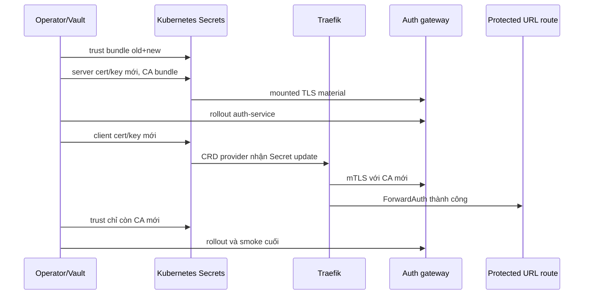

# CP10 — PKI, trust và rotation mTLS

## Bài toán thực tế của Lynk

Auth service nhận kết nối HTTPS nội bộ từ Traefik qua ForwardAuth. Auth chỉ chấp nhận client certificate có CN `lynk-traefik`; Traefik cần tin CA của server và giữ private client key riêng. Source hiện có CA certificate cùng server/client certificate và keys trong runtime bundle được mã hóa, nhưng không có CA signing key cũ. Vì vậy bundle có thể kiểm tra và khôi phục những identity đang chạy, nhưng không thể ký certificate mới từ CA hiện hành.

Preflight ngày 2026-10-16 cho thấy cả ba certificate cũ còn hạn tới 2027-10-08. Server SAN gồm `auth-service-gateway`, `auth-service-gateway.lynk-aws.svc` và `localhost`; client identity là `CN=lynk-traefik`. Key pairs và hai chain cũ qua kiểm tra offline. SSM xác nhận Kubernetes Secrets hiện khớp byte với runtime source trên node. Rotation CP10 là lập nguồn cấp CA mới có thể phục hồi và thay mTLS identity trong maintenance; không có lý do khẩn cấp do certificate expiry.

## Kiến thức nền

**Certificate** công bố danh tính và public key, được một CA ký. **Private key** chứng minh quyền sở hữu identity; certificate không thay thế key. **CA certificate** là trust anchor mà TLS peer dùng để quyết định tin certificate nào. **CA signing key** có quyền cấp certificate mới, nên cần bảo vệ mạnh hơn server/client keys.

**mTLS** xác thực hai phía trong TLS: client kiểm tra server chain và tên host; server kiểm tra client chain và chính sách identity. Chain hợp lệ chưa chắc identity được phép: auth service còn kiểm tra CN `lynk-traefik`. EKU `serverAuth` và `clientAuth` giới hạn certificate theo vai trò. SAN cần khớp Kubernetes DNS mà Traefik gọi; không dựa vào CN thay SAN.

**JWT signing keys** phục vụ token application, độc lập với mTLS. CP10 giữ nguyên cả public/private JWT bytes. **Secret** trong Kubernetes là vật chứa dữ liệu; update Secret không đảm bảo tiến trình đã nạp bytes mới. Auth tạo TLS context lúc khởi động từ mounted files, nên cần rollout auth sau server-secret update. Traefik Kubernetes CRD provider quan sát thay đổi resource; rotation phải xác nhận hành vi reload thực tế rồi mới kết luận client key đã được dùng.

## Câu hỏi dẫn dắt

| Câu hỏi                                     | Trả lời bằng ví dụ Lynk                                                                                                                        |
| ------------------------------------------- | ---------------------------------------------------------------------------------------------------------------------------------------------- |
| What đang được xác thực?                    | Auth service xác thực Traefik bằng client cert `CN=lynk-traefik`; Traefik kiểm tra server cert cho `auth-service-gateway.lynk-aws.svc`.        |
| Why cần CA signing key mới?                 | `ca.crt` chỉ chứa public trust anchor; CA key cũ đã bị xóa, nên không thể ký leaf certificate mới.                                             |
| How tránh split trust khi thay cả hai phía? | Tạm mở trust bundle gồm CA cũ và mới, đổi server cert, rồi client cert; cuối cùng thu trust về CA mới và kiểm tra lại.                         |
| When cần restart?                           | Auth phải restart sau khi mounted server key/cert/CA đổi. Traefik chỉ restart nếu quan sát xác nhận Secret update không được provider nạp.     |
| Who được giữ signing authority?             | Operator giữ CA key đã mã hóa riêng trong Vault; runtime host và GitHub bootstrap không nhận CA signing key.                                   |
| What if auth không Ready sau rotation?      | Dừng chuỗi thay đổi, khôi phục old CA/client/server material từ encrypted snapshot, rollout auth và chạy lại public smoke. Không đổi JWT keys. |

## Cơ chế hoạt động

`lynk-gateway-ca`, `lynk-gateway-server` và `lynk-gateway-client` giữ nguyên names, namespace và key names. `lynk-gateway-server` chứa trust bundle dùng để xác minh client; Traefik dùng CA Secret và client Secret từ Middleware. Public HTTPS certificate của `lynk.codes` do Let's Encrypt quản lý trong Traefik PVC, không nằm trong CA này và không được đổi.

## Các phương án và đánh đổi

Giữ old CA vô thời hạn giúp rollback dễ nhưng tiếp tục tin certificate do CA cũ ký. Cắt thẳng sang CA mới làm mất overlap và tạo cửa sổ dễ lỗi nếu hai phía chưa cập nhật. Chọn trust overlap trong cùng maintenance, sau đó chuyển sang new-only khi public mTLS smoke thành công. Nếu bước cuối thất bại, dùng rollback có chủ đích về bộ cũ; không để workflow tự tiếp tục hoặc tự prune tài liệu cũ.

Dùng CA riêng cho từng certificate làm trust/config phức tạp hơn mà hệ thống một node không cần. Chọn một root RSA-2048 theo key type đang chạy, SHA-256, 365 ngày cho root và leaf, SAN/EKU phù hợp các service hiện hữu. CA signing key được mã hóa bằng một Vault password/ID tách khỏi password mà GitHub bootstrap dùng; routine host bootstrap không được giải mã signing authority. Mỗi server/client private key chỉ tới đúng pod/consumer qua Kubernetes Secret.

Một replica auth và một replica Traefik làm cho rollout có thể gây gián đoạn auth/ingress ngắn. Node hiện tại là `t3.medium`; snapshot `kubectl top node` trước maintenance là `190m CPU`, `2448Mi memory (63%)`. Đây là quan sát thời điểm preflight, không phải capacity guarantee. Không scale replicas, restart Traefik hoặc thay image/chart trừ khi kiểm chứng chứng minh cần thiết.

## Kế hoạch trước implementation

**Trạng thái trước CP10:** CP09 main `fc34f36`; delivery paused; deploy job skipped. Runtime CA/server/client keys khớp Kubernetes Secrets; auth, Traefik, URL, redirect, Redis và Kafka mỗi workload `1/1 Ready`; hai PVC đang Bound. Old Vault artifact đã được sao chép mãn hóa vào `.recovery/cp10-vault-before.vault` để rollback ngoài Git. Preflight SSM lần đầu dừng ngay do shell script dùng `pipefail` dưới `/bin/sh`; cú pháp được sửa và lần thứ hai thành công, không có tài nguyên nào thay đổi bởi lần đầu.

**Thay đổi dự kiến:** tạo CA key riêng, CA cert và hai leaf key/certificate; giữ SAN/CN contracts. Bundle runtime Vault cập nhật chỉ các file mTLS; JWT/env/Redis file giữ nguyên. CA signing key nằm trong file Vault riêng với password riêng. Thêm generator/validator, package/rotation tooling, Ansible playbook chuyên biệt, lesson/evidence CP10. Không thay mã dịch vụ, chart/image, DB, EIP/domain, PVC hoặc CA authority ngoài phạm vi này.

**Dependencies:** branch CP09 đã tích hợp và CI xanh; `aws-demo` vẫn cần reviewer, `aws-bootstrap` vẫn cần reviewer; `LYNK_DEPLOY_MODE=paused`; AWS SSO `ngqkhai-dev`; Terraform 1.16.6/provider 6.69.1; Ansible 2.19.3/amazon.aws 10.1.2; SSM plugin 1.2.896.0; OpenSSL 3.0.13; Vault password hiện có và encrypted baseline. SSM artifact bucket preflight: SSE-S3 AES256, public-access block đủ bốn flags, versioning tắt.

**Preflight và guard:** trước khi sửa Secrets, kiểm tra instance status/SSM Online, K3s/Node/auth/Traefik readiness, S3 transport access, certificates expiry/subject/SAN/EKU, key pairs, strict server/client chain purpose/hostname, old/new trust overlap và JWT equality boolean. Ghi workload UIDs, imageIDs, PVC names/UIDs, node metrics, Secret-key names và public health baseline; không ghi private-key content/hash, Vault password hoặc connection string. Nếu service không Ready hoặc capacity/transport không ổn định, dừng trước mutation.

**Thực hiện có thứ tự:**

1. Sinh key/certificate cục bộ trong directory 0700; không dùng local-key script để tự rotate JWT. Validate leaf key pairs, SAN/CN, EKU, purpose, expiry và chain bằng OpenSSL trước khi cập nhật source.
2. Mã hóa CA signing key riêng; tạo package runtime gồm đúng 11 tên CP03, thay 5 file mTLS liên quan và giữ nguyên 6 file còn lại. Verify bundle roundtrip và so sánh JWT bytes cũ/mới trong tiến trình cục bộ, chỉ xuất `equal=true/false`.
3. Review diff chỉ gồm encrypted Vault bytes, public tooling/config, lesson/evidence. Chuyển cert files qua SSM private S3 transport bằng Ansible `no_log`; không gửi key trong command parameters/stdout.
4. Trong maintenance, áp CA trust overlap; cập nhật server Secret với bundle + server identity mới; rollout duy nhất auth-service và đợi Ready. Cập client Secret; đợi Traefik provider nạp, chạy public auth/protected route smoke với failure injection tắt.
5. Khi smoke qua, chuyển CA Secret và server Secret sang new-only CA; rollout auth-service, đợi Ready, chạy smoke lại. Cập runtime files trên host từ Vault source; kiểm tra các Secret match đúng runtime files, JWT Secret vẫn giữ nguyên, workload/PVC identities không đổi ngoài auth Pod UID.
6. Không chạy Argo/Helm adoption hoặc application rollout. Capture sanitized metadata, versions/status, command IDs, recap và smoke status; không capture SSM output có key material.

**Tác động:** auth requests và protected route có thể lỗi trong lúc duy nhất auth pod restart; nếu phải restart Traefik, public HTTPS có thể gián đoạn vì chỉ có một ingress pod. Vì vậy gộp vào maintenance. External domain/EIP, Let's Encrypt ACME PVC, DB schema/ownership, Redis, Kafka PVC, JWT signing, replicas, image revisions và deploy gate phải được bảo toàn. Acceptance smoke tạo synthetic accounts/URLs để xác minh auth và ownership; script không xóa các records đó nên cần tính chúng là dữ liệu kiểm thử đã ghi vào database.

**Tiêu chí đạt:** new CA key chỉ tồn tại dạng Vault encrypted; server/client cert chain/purpose/SAN/CN đúng; public auth và protected route thành công sau trust new-only; JWT bytes unchanged; runtime files và Kubernetes Secrets trùng byte; workloads/volumes/application images không đổi ngoài auth pod replacement; data/readiness/smoke đạt; encrypted rollback bundle còn nguyên; branch CI và main CI pass, deploy gate paused.

**Phục hồi:** nếu readiness hoặc handshake smoke thất bại, dừng rotation. Controller giải mã runtime bundle cũ vào thư mục tạm; playbook phục hồi CA/server/client material trong ba Kubernetes Secrets, cập nhật runtime files trên host, rollout auth rồi kiểm tra chain và public smoke cũ. CP10 đã thử phục hồi bundle cũ cục bộ: decrypt, kiểm tra server/client chain, mode 0700/0600 và xóa plaintext sau đó. Không chạy rollback thật trên production vì cutover đạt; rollback production procedure chưa được fault-inject. CA signing key cũ không còn, nhưng leaf keys/certificates cũ vẫn nằm trong encrypted snapshot và đủ để khôi phục các identity đang chạy. Rollback không phục hồi credential bên ngoài nếu có nghi ngờ bị lộ, không viết lại Git history và không đổi JWT. Giữ log đã lọc secrets, tìm nguyên nhân trước lần thử tiếp theo.

## Implementation có giải thích

`prepare-mtls-pki.py` tạo một CA root cùng server/client leaf key và certificate trong thư mục mode 0700; private keys mode 0600. Validator yêu cầu hostname SAN, CN contract, key pair khớp và `sslserver`/`sslclient` purpose đúng. Generator không đụng JWT keys. CA key được mã hóa thành `aws-demo-ca-signing.key.vault` dưới Vault ID riêng; password không nằm trong Git. Người vận hành phải giữ password đó trong nơi lưu recovery được bảo vệ vì mất password đồng nghĩa không thể phát hành leaf certificate mới từ CA này.

`vault-bundle.py pack` chỉ nhận đúng 11 tên file cố định, từ chối symlink, file bổ sung và ghi đè output, rồi mã hóa package trong thư mục tạm riêng. Sáu file env/Redis/JWT được so sánh byte với baseline trước khi package; evidence lưu kết quả boolean. Plaintext test fixtures và private keys được xóa sau khi encrypted artifacts được kiểm chứng. Routine bootstrap tiếp tục từ chối thay runtime file khác Vault; rotation là playbook/controller riêng.

`rotate-mtls.py` yêu cầu Terraform inventory chính xác một host trước decrypt, giải mã bundle vào thư mục tạm 0700, kiểm tra chain/purpose/hostname/key pair và overlap trust ở local, sau đó truyền chỉ path của file qua Ansible variables mode 0600. CA signing key không được truyền lên instance. `rotate-mtls.yml` giới hạn cập nhật vào ba Secrets đã có và auth Deployment; `mtls-secret.py` đọc Secret hiện tại, đổi riêng data keys đã định danh rồi gửi JSON qua stdin `kubectl apply`. Task dữ liệu dùng `no_log`, `diff: false`, và runtime replacement chỉ chạm năm mTLS files.

Thực tế khớp thiết kế: overlap phase cài CA cũ+mới, server leaf mới, rollout auth rồi client leaf mới; public smoke thành công. Finalize cài new-only server/CA trust, rollout auth lần hai, cập năm runtime files và dọn staging directory. Traefik không restart vì provider nạp cấu hình mới và public smoke sau đổi client cert thành công. Deployment/PVC UIDs và desired/ready replicas không đổi; playbook không thay image fields; auth Deployment UID giữ nguyên dù Pod được rollout. Delivery vẫn paused.

Implementation có một số lần dừng guard được ghi đầy đủ trong [evidence CP10](evidence/cp10-rotation.json): thiếu Terraform binary; overlap bundle chưa được tạo sau khi pack step bị dừng; source path overlap tương đối; thiếu SSM collection; và finalize ban đầu thiếu `ca.crt` trong staging. Mỗi lần đều dừng trước bước nguy hiểm tương ứng; lỗi cuối không gọi `kubectl apply` và không restart pod. Sau khi sửa, rollout hai pha hoàn thành. Ansible SSM plugin đôi lúc ghi cảnh báo destructor ra stderr khi đóng session, nhưng task recap vẫn thành công và kiểm tra sau đó xác nhận bytes/readiness.

## Verification, troubleshooting và recovery

OpenSSL kiểm tra chain cần kết hợp trust anchor với purpose; `openssl verify -purpose sslserver -verify_hostname ...` và `-purpose sslclient` kiểm tra từng vai trò. SAN phải giữ `auth-service-gateway.lynk-aws.svc`; CA `CA:TRUE` và keyCertSign cần có. Public smoke đi qua Traefik→Auth mTLS, nhưng không thay thế chain checks hoặc kiểm tra new-only trust.

Nếu Auth Pod không Ready, đọc readiness/probe/logs và CA/server mount metadata trước; đừng xoay JWT. Nếu Traefik Secret update chưa được nạp, kiểm tra CRD provider events/configuration và chỉ khi đó quyết định rollout Traefik trong maintenance. Nếu HTTPS domain có lỗi trong khi ForwardAuth khỏe, xác minh Let's Encrypt cert và Traefik PVC vẫn còn; hai PKI này khác nhau. Rollback luôn dùng encrypted old baseline, không tái tạo key ngẫu nhiên để “sửa nhanh”.

## Tự học

**Dự đoán:** nếu thay server cert nhưng giữ client cert cũ, bước nào cần trust overlap? Vì sao restart auth cần thiết dù Kubernetes Secret đã đổi? Điều gì chứng minh public HTTPS cert không thuộc CA mTLS này?

**Bài read-only:** render auth Deployment và ForwardAuth Middleware. Lần theo từng Secret key từ `/opt/lynk/secrets` tới container mount và Traefik reference. Dùng `openssl x509 -noout -subject -issuer -dates -ext subjectAltName,extendedKeyUsage` trên certificate fixture, rồi dự đoán lệnh verify tương ứng với `sslserver` và `sslclient`. Quan sát CP10 evidence để so baseline trước/sau và giải thích vì sao giữ nguyên Deployment UID không có nghĩa Pod không restart.

Lời giải

Client cert cũ phải còn được server trust tới khi Traefik đổi sang client mới; server trust bundle và Traefik CA Secret cần nhận CA mới trước khi leaf mới active. App code đọc cert/key lúc khởi động nên rollout Auth xác nhận key đã nạp lại. HTTPS `lynk.codes` certificate do Traefik ACME resolver/PVC quản lý, còn CA mTLS ký `auth-service-gateway` và `lynk-traefik`. Rotation CP10 đã được tự động hóa và vận hành trong checkpoint; bài tập người học ở đây vẫn là dự đoán/đọc trạng thái, không khẳng định người học đã tự chạy quy trình.

## Nguồn chính thức

- [OpenSSL verification options: CA constraints, EKU và TLS purpose](https://docs.openssl.org/3.5/man1/openssl-verification-options/).
- [OpenSSL x509: kiểm tra SAN/serial/subject và ký certificate](https://docs.openssl.org/3.5/man1/openssl-x509/).
- [Traefik Kubernetes CRD provider](https://doc.traefik.io/traefik/reference/install-configuration/providers/kubernetes/kubernetes-crd/).
- [Traefik ForwardAuth middleware](https://doc.traefik.io/traefik/reference/routing-configuration/http/middlewares/forwardauth/).
- [Kubernetes Secrets](https://kubernetes.io/docs/concepts/configuration/secret/).
