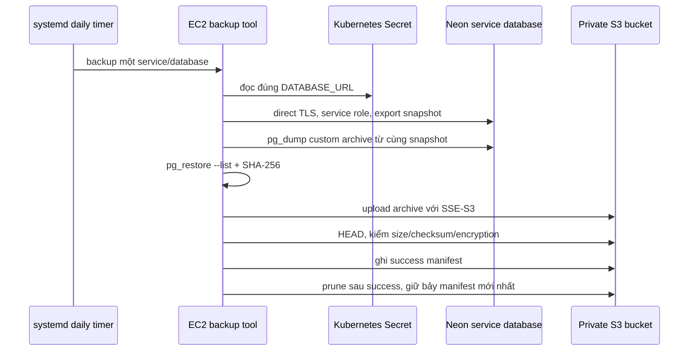

# CP11 — Backup, retention và restore cho ba database Lynk

## Bài toán thực tế của Lynk

URL Service sở hữu `lynk_urls`, Redirect Service sở hữu `lynk_redirects`, và Auth Service sở hữu `lynk_auth`. Mỗi service kết nối bằng database role riêng. Đây là ba database trên cùng Neon production branch/compute ở Singapore, không phải ba PostgreSQL Pod trên EC2. Read-only truy vấn từ mỗi workload xác nhận PostgreSQL `18.6`, database/role đúng ownership, URL dùng direct endpoint (không có `-pooler`) và dung lượng hiện tại lần lượt khoảng 7.9 MB, 7.8 MB, 8.1 MB. Neon project logical size tại lần inventory là khoảng 55 MB.

Hiện chưa có scheduled logical backup riêng trong repository, Neon snapshot list rỗng và snapshot schedule chưa cấu hình. Neon history retention được cấu hình 21,600 giây (6 giờ). Mục tiêu CP11 là tạo thêm bản dump độc lập trong S3, mỗi database dump bằng credential đúng owner, upload có kiểm tra checksum, giữ bảy backup thành công gần nhất và chứng minh có thể restore vào PostgreSQL local. Không đổi quyền sở hữu, schema hay dữ liệu trên production.

## Kiến thức nền

**Backup vật lý** sao chép data files/WAL theo cơ chế của nền tảng; **logical dump** xuất schema và dữ liệu theo object PostgreSQL. Neon history/PITR hữu ích cho phục hồi nhanh trong retention của cùng project. `pg_dump` custom archive độc lập hơn: có thể tải xuống, kiểm tra bằng `pg_restore --list` và restore vào một PostgreSQL khác. Hai cơ chế bảo vệ trước các failure khác nhau.

`pg_dump` xuất nhất quán một database trong khi ứng dụng vẫn đọc/ghi. Một lần dump không chứa các global role của cả cluster; CP11 chỉ cần từng database với object/rows thuộc service đó. Dùng client cùng major PostgreSQL 18 vì server hiện chạy 18.6; không dùng client 16 từ Ubuntu 24.04 nếu không tương thích. Kết nối dump/restore phải là direct URL, không pooled URL.

**RPO** là mức dữ liệu mới nhất chấp nhận mất tính theo thời gian; lịch mỗi ngày đặt mục tiêu tối đa 24 giờ khi lần backup gần nhất thành công. **RTO** là thời gian phục hồi dịch vụ; CP11 đặt mục tiêu kiểm thử dưới 60 phút cho ba DB ở dung lượng hiện tại. Restore harness chạy trên máy local cho ba database lần lượt mất 0.752s, 0.692s và 0.780s, bao gồm khởi tạo PostgreSQL cluster tạm. Đây là thời gian kiểm thử tại máy agent, không phải production RTO hay thời gian phục hồi ứng dụng thật. Hai mục tiêu này khác retention: giữ bảy bản giúp có nhiều điểm quay lại, không tự làm RPO/RTO tốt hơn.

Retention sẽ dựa trên manifest thành công, không xóa theo ngày cố định. Mỗi manifest được ghi sau khi archive upload, checksum, kích thước và mã hóa S3 đã được HEAD kiểm tra. Chỉ khi có manifest mới hợp lệ mới prune các cặp archive/manifest cũ nhất để còn tối đa bảy thành công của database đó. Backup thất bại không tạo manifest và không kích hoạt prune.

## Câu hỏi dẫn dắt

| Câu hỏi                             | Trả lời cho hệ thống Lynk                                                                                                                     |
| ----------------------------------- | --------------------------------------------------------------------------------------------------------------------------------------------- |
| What cần bảo vệ?                    | Schema, constraints và rows trong từng database owner, không dump nhầm cả ba database bằng một superuser.                                     |
| Why không chỉ dựa vào Neon history? | History hiện 6 giờ và không có snapshot schedule; dump S3 riêng cung cấp bản độc lập dài hơn và có thể restore ngoài Neon.                    |
| How biết dump không hỏng?           | `pg_dump` phải trả mã 0, `pg_restore --list` đọc được archive, S3 HEAD phải khớp size/SHA-256 và SSE-S3; manifest chỉ upload sau các bước đó. |
| When được prune?                    | Chỉ sau khi object và manifest backup mới đều xác minh thành công.                                                                            |
| Who được đọc database?              | Job chọn đúng một Kubernetes Secret và service role: `lynk_url`, `lynk_redirect`, hoặc `lynk_auth`.                                           |
| What if một job thất bại?           | Không tạo manifest thành công, không xóa backup cũ của database đó; ghi lỗi đã lọc và để timer lần sau thử lại.                               |

## Cơ chế hoạt động

Terraform sở hữu bucket riêng, public-access block, encryption, TLS-only bucket policy và quyền instance role. Ansible cài signed PostgreSQL Apt Repository client, backup script cùng systemd timer. Script không nhận URL/password qua argv hay log; nó chỉ đặt libpq `PG*` variables trong child environment. Role instance chỉ có quyền S3 cần thiết cho prefix backup. Local restore dùng archive tải về, không kết nối destination tới Neon.

## Các phương án và đánh đổi

Neon PITR không phát sinh bản dump portable và phụ thuộc history window trong cùng project. Snapshot schedule của Neon là project/branch level, không tạo ba archive dùng service roles như yêu cầu. Chỉ dùng S3 dump làm recovery duy nhất cũng bỏ mất lợi ích PITR nhanh. CP11 giữ Neon history không đổi và thêm export theo database vào bucket riêng.

SSE-S3 dùng AWS-managed keys, giảm vận hành key so với CMK; bucket policy và IAM giới hạn truy cập, còn encryption không thay thế authorization. Bản lưu cùng AWS account/region vẫn chịu rủi ro account/region chung; cross-account replication nằm ngoài scope đã thống nhất. Exact-seven-success retention cần job prune vì lifecycle theo số ngày không đảm bảo bảy bản thành công khi lịch bị gián đoạn. Script hiện dùng một `PutObject` cho archive; database hiện chỉ 5–18 KB, nhưng nếu archive tiến gần giới hạn 5 GB của single PUT cần chuyển uploader sang multipart trước khi tăng quy mô.

Job chạy tuần tự theo từng DB để tránh tăng tải đồng thời trên compute Neon 0.25 CU. CP11 preflight hiện tại ghi node `t3.medium`, memory khả dụng 2,085,216 KiB, root disk trống 23,578,587,136 bytes, load average 0.47/0.58/0.58; K3s active, node Ready, 9 Pod Running và 2 Succeeded. Đây là quan sát trong lần chạy này, không phải capacity guarantee. Backup có thể đánh thức compute Neon đang idle và phát sinh compute time; cần quan sát metrics/chi phí thực tế, không suy ra từ kích thước archive.

## Kế hoạch trước implementation

**Trạng thái trước CP11:** main ở CP10 `21946e5`, delivery `paused`. Neon project `restless-water-85518233`, production branch `br-autumn-dream-b390pnq2`, primary database owner roles là `lynk_url`, `lynk_redirect`, `lynk_auth`; endpoint direct, Postgres 18.6, compute idle, 0.25 CU. Snapshot schedule rỗng, snapshots rỗng, history retention sáu giờ. Ba service query read-only trả đúng db/role; database size lần lượt 7,897,088 / 7,815,168 / 8,052,736 bytes. EC2 Ubuntu 24.04.5 chưa có `postgresql-client`; PostgreSQL Apt Repository cần signed setup và version metadata phải được xác minh. Bucket dự kiến `lynk-db-backups-231136241975-ap-southeast-1` chưa tồn tại trong account theo HeadBucket; SSM artifact bucket hiện có không dùng lưu backup.

**Thay đổi dự kiến:** thêm Terraform resource bucket riêng với Block Public Access đủ bốn cờ, BucketOwnerEnforced, SSE-S3, TLS-only policy, prevent-destroy, prefix-scoped role permissions và output bucket. PGDG index hiện cung cấp `postgresql-client-18=18.6-1.pgdg24.04+2` amd64 với SHA-256 `b9d10d99a73bf7aa375be2fe36626c40499cfdf553d0ad174674a88a1b256b43`; signing key fingerprint được kiểm tra là `B97B0AFCAA1A47F044F244A07FCC7D46ACCC4CF8`. Thêm signed client package này, script dump/manifest/checksum/retention, systemd daily timer, runbook/evidence/restore helper. Mỗi database có prefix riêng. Không thay DATABASE_URL, schema, application deployment, Neon role, Neon PITR/schedule, domain, DB ownership hay GitHub delivery gate.

**Preflight:** xác nhận branch/DB/role/direct URL; runtime readiness, workload/PVC identities, node CPU/memory/disk; SSO/AWS account/region; bucket tên availability; S3/Neon reachability; server/client tool versions. Chỉ đọc service Secret trong process nội bộ, chỉ xuất db/role/host/pooler flag. Nếu Neon user không đủ quyền dump object cần thiết, không tăng role privilege; dừng và nêu object/quyền thiếu.

**Các bước:**

1. Kiểm tra PGDG key fingerprint/source và package version tương thích server 18.6. Chọn đúng signed package; nếu repository không còn 18.6 client, chưa đổi major/version nếu chưa có bằng chứng tương thích.
2. Tạo Terraform plan, review chỉ thêm bucket/access/IAM/output; không thay resource hiện hữu. Apply, kiểm tra public block, ownership, encryption, TLS deny và IAM scope.
3. Cài client/tooling qua Ansible với dependency rõ ràng. Backup wrapper chỉ map service→Secret/database/user cố định; xác định exact row counts và constraint summary cùng snapshot mà `pg_dump` dùng; manifest không chứa customer values hay credentials.
4. Thực hiện một backup thật cho từng service. Mỗi bước phải có archive hợp lệ, S3 checksum/encryption verified, manifest success; retention không xóa dữ liệu trước backup thành công. Bật daily schedule theo UTC và chạy một lần qua systemd unit hardened.
5. Download một successful archive cho từng DB vào thư mục local mode 0700; restore tuần tự vào PostgreSQL 18.6 cluster tạm trong `/tmp`; so schema/table/constraint summary và exact row counts trong snapshot manifest, xác nhận dữ liệu restored và ghi thời gian harness. Không connect tới Neon để restore.
6. Ghi sanitized evidence: status/size/checksum, số rows theo bảng (không ghi rows), constraint counts/types, successful backup count, timestamps, encryption, RPO/RTO đo được, timer, resource baseline. Không ghi URL/password/dump content.

**Tiêu chí đạt:** 3 service backups thành công riêng biệt; server-side AES256 confirmed; bucket private/TLS-only; instance role không đọc DB credentials khác qua application interface và chỉ ghi/xóa S3 backup prefix; manifest được verify; retention pruning xảy ra sau success; daily timers active; local restore của cả 3 DB qua schema/constraints/data checks; deploy gate paused; branch/main CI xanh.

**Phục hồi:** nếu install/timer lỗi, disable timer và giữ encrypted objects; nếu backup hỏng, không tạo success manifest, không prune, giữ archive cũ; nếu upload dump thành công nhưng manifest lỗi, object mồ côi không tính vào retention, có thể dọn sau khi kiểm tra. Local restore lỗi thì dừng và giữ archive; không restore vào Neon production. Terraform bucket có `prevent_destroy`; rollback code không xóa bucket hoặc backup history. RPO chỉ đạt sau backup thành công; RTO chỉ ghi theo local restore test.

## Implementation có giải thích

Terraform thêm bucket `lynk-db-backups-231136241975-ap-southeast-1` với `force_destroy=false` và `prevent_destroy`; public block đủ bốn cờ, ownership `BucketOwnerEnforced`, mã hóa mặc định SSE-S3 và policy từ chối `aws:SecureTransport=false`. Instance role nhận `GetBucketLocation`, `ListBucket` chỉ dưới `db-backups/*` và `GetObject`/`PutObject`/`DeleteObject` chỉ trong ba prefix database. Plan thực tế là 6 add, 0 change, 0 destroy; EC2, EIP, network, service-role policy và workload bindings đều no-op. Apply tạo đúng sáu tài nguyên, không thay thế resource hiện hữu. AWS API sau apply xác nhận bốn cờ public access, ownership và AES256. Output bucket được thêm vào Terraform inventory.

Ansible cài `postgresql-client-18=18.6-1.pgdg24.04+2` sau khi xác thực signing key fingerprint `B97B0AFCAA1A47F044F244A07FCC7D46ACCC4CF8`; `pg_dump` và `pg_restore` đều trả PostgreSQL 18.6. Key public đã review được lưu trong role để host không cần tải key lặp lại. `database-backup.yml` chỉ gọi role backup, không chạy secrets hay host role. Ba timer bật UTC 02:00/02:15/02:30, `Persistent=true`; unit chạy root, `UMask=0077`, private tmp/devices, filesystem protection, no-new-privileges và chỉ cho ghi vào backup workspace. Lần gọi qua unit `lynk-db-backup@url.service` hoàn tất `Result=success`, `ExecMainStatus=0`.

Timer đầu tiên chưa tới thời điểm chạy tự động khi ghi bài; `systemctl list-timers` hiển thị lần kế tiếp vào 2026-10-17 UTC 02:00/02:15/02:30. Có một lần chạy URL qua cùng systemd unit thành công, nhưng điều đó không được gọi là bằng chứng timer tự kích hoạt.

`lynk-db-backup.py` ánh xạ service cố định tới Secret/database/role, đọc credential trong process, không in URL hay password. `PGSSLMODE=verify-full`, direct Neon endpoint và identity phải đúng ownership. Row counts và constraint histogram được lấy trong một read-only repeatable-read exporter snapshot; điểm quan trọng là giữ transaction đó mở suốt khi `pg_dump --snapshot` chạy. Lượt kiểm thử đầu tiên phát hiện code đã đóng snapshot sớm; server từ chối snapshot, không có success marker và retention không chạy. Sửa bằng context manager giữ exporter sống tới khi dump xong. Unit test bây giờ xác nhận `pg_dump` chạy khi snapshot đang mở.

Archive custom được `pg_restore --list` kiểm tra trước upload. `PutObject` gửi SHA-256, yêu cầu AES256; `HeadObject` phải khớp checksum, kích thước và encryption trước khi tạo success manifest. Retention chỉ liệt kê manifest thành công và chỉ prune sau khi manifest mới đã verify; khi xóa cặp cũ, marker bị xóa trước archive để orphan không bị hiểu nhầm là backup thành công. Fixture kiểm tra trường hợp quá bảy bản và lỗi archive không được ghi manifest/prune. Kiểm thử hiện tại không tạo đủ bảy backup production để chạy retention thật.

Ba backup production đều thành công bằng đúng service credential: `lynk_urls` 7,857 bytes; `lynk_redirects` 5,012 bytes; `lynk_auth` 17,354 bytes. Tất cả có SHA-256 và manifest success. S3 `HeadObject` xác nhận AES256, checksum và size; restore fixture đọc các archive xuống thư mục mode 0700, sau đó khởi động từng local PostgreSQL 18.6 cluster chỉ qua Unix socket. `pg_restore --exit-on-error` thành công; row counts và constraint histogram khớp manifest:

| Database         | Tables với row counts | Rows theo bảng                                                                 | Constraints (`type:count`)  | Local harness seconds |
| ---------------- | --------------------: | ------------------------------------------------------------------------------ | --------------------------- | --------------------: |
| `lynk_urls`      |                     2 | `url_outbox: 5`, `urls: 10`                                                    | `n:11`, `p:2`, `u:1`        |                 0.752 |
| `lynk_redirects` |                     1 | `redirect_urls: 10`                                                            | `n:3`, `p:1`                |                 0.692 |
| `lynk_auth`      |                     4 | `access_tokens: 15`, `refresh_sessions: 17`, `refresh_tokens: 24`, `users: 17` | `f:3`, `n:17`, `p:4`, `u:3` |                 0.780 |

Trong PostgreSQL 18, histogram `n` là NOT NULL, `p` là primary key, `u` là unique và `f` là foreign key; các số đếm này so sánh cấu trúc ràng buộc mà không lộ dữ liệu hàng.

Đây là số đo thực tế của DB nhỏ hiện tại. Thời gian restore ở máy local không bao gồm tải dữ liệu qua mạng và không chứng minh RTO production 60 phút. Bản dump địa phương đã được xóa sau kiểm chứng; manifests/evidence chỉ giữ tên bảng, counts, hash, byte size và timestamps, không giữ row values. Detailed evidence nằm ở `evidence/cp11-backup-restore.json`; trạng thái trước apply và post-apply/capacity ở `evidence/cp11-preflight.json`.

## Verification, troubleshooting và recovery

`pg_dump` custom format được đọc bằng `pg_restore --list` trước upload. S3 checksum và SSE metadata là bằng chứng transport/storage, không chứng minh logical restore; chỉ restore local và kiểm schema, constraints, rows mới cho bằng chứng đó. Nếu `pg_dump` báo snapshot invalid, kiểm tra exporter transaction có còn mở tới khi dump kết thúc. Nếu báo quyền DB, giữ nguyên quyền owner-role và nêu object/quyền thiếu; không dùng `neondb_owner` để che lỗi ownership. Failure stage trong log được giới hạn vào tập mã không chứa URL, password, stderr nguyên văn hoặc SQL values.

Nếu backup job không chạy, kiểm timer `Persistent`, `systemctl status`, nhật ký đã lọc, SSM reachability và database endpoint. Nếu S3 access denied, kiểm policy exact prefix, không mở quyền toàn bucket. Nếu SHA/size/server encryption không khớp, manifest không được ghi. Nếu local restore thiếu extension/privilege cần thiết, ghi rõ limitation; không thử restore lên production.

## Tự học

**Dự đoán:** tại sao `pg_dump` dùng exporter snapshot và row counts cần cùng snapshot? Vì sao S3 lifecycle `expire after 7 days` không đồng nghĩa giữ bảy backup thành công? Tại sao một user `neondb_owner` dump cả ba DB làm ownership boundary khó kiểm chứng?

**Bài read-only:** chạy `pg_restore --list` trên một archive trong thư mục local trước khi xóa, xác định table/sequence/constraint entries; đọc manifest và giải thích checksum, timestamp, owner role, row count mà không cần thấy row data. So sánh RPO mục tiêu 24h với Neon history sáu giờ, rồi nêu tình huống mà S3 backup kém PITR về recovery time. (Agent đã xóa dump sau kiểm chứng; bài tập có thể dùng archive mới ở lần backup tiếp theo.)

Phần thực hành của người học vẫn chờ bạn hoàn thành; kiểm chứng do agent chạy không có nghĩa bạn đã tự thực hành hoặc vận hành độc lập.

Lời giải

Snapshot exporter tạo transaction-consistent view, vì vậy counts và dump chỉ so khớp khi dùng cùng snapshot. Time-based lifecycle xóa theo tuổi object, không xét backup nào thành công hay lịch có bị gián đoạn; pruning theo manifest mới nhất giữ bảy successful sets. Superuser dump làm mờ quyền/ownership từng bounded context và mở rộng tác động nếu credential bị lộ. Neon PITR giữ thao tác restore nhanh trong lịch sử ngắn, còn S3 dump portable nhưng phải tải và restore toàn database.

## Nguồn chính thức

- [PostgreSQL 18 `pg_dump`](https://www.postgresql.org/docs/18/app-pgdump.html).
- [PostgreSQL 18 `pg_restore`](https://www.postgresql.org/docs/18/app-pgrestore.html).
- [PostgreSQL Apt Repository trên Ubuntu](https://www.postgresql.org/download/linux/ubuntu/).
- [Neon point-in-time branch restore](https://neon.com/docs/introduction/branch-restore).
- [AWS S3 Block Public Access](https://docs.aws.amazon.com/AmazonS3/latest/userguide/access-control-block-public-access.html).
- [AWS S3 default encryption](https://docs.aws.amazon.com/AmazonS3/latest/userguide/default-bucket-encryption.html).
- [AWS S3 object checksum integrity](https://docs.aws.amazon.com/AmazonS3/latest/userguide/checking-object-integrity.html).
