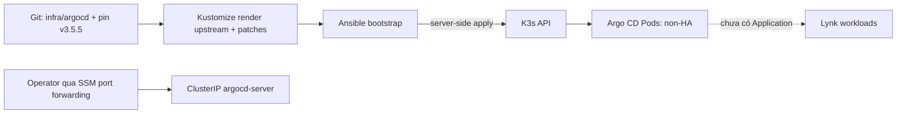

# CP12 — Argo CD bootstrap, ownership tracking và capacity gate

## Bài toán thực tế của Lynk

Lynk hiện chạy K3s một node trên EC2 `t3.medium`; namespace `argocd` chưa tồn tại và chưa có controller GitOps. CP12 thêm Argo CD để làm nền cho việc khai báo desired state ở CP13, nhưng chưa đăng ký Application và chưa giao workload hiện hữu cho controller. Kết quả cần đạt là một Argo CD non-HA có phiên bản cố định, không mở endpoint công khai, có resource requests/limits ban đầu và có số đo sau cài đặt để quyết định có đủ headroom cho adoption hay không.

Trạng thái inventory trực tiếp qua SSM trước CP12: K3s `v1.37.1+k3s1`; một node với 2 CPU, 3,924,200Ki memory allocatable và 28,579,587,664 bytes ephemeral storage allocatable. `kubectl describe node` ghi 750m CPU/876Mi memory requests; `kubectl top` ghi 150m CPU (7%), 2,274Mi memory (59%). Host còn 2,101,362,688 bytes `MemAvailable` và 23,550,935,040 bytes disk. Đây là số đo tại preflight CP12, không phải capacity cam kết sau khi cài. Argo CD upstream non-HA manifest không đặt resource requests/limits, vì vậy overlay đặt ngân sách khởi đầu rõ ràng và đo lại sau install.

## Kiến thức nền

Kubernetes `requests` dùng để xếp Pod lên node và tính tổng tài nguyên đã được hứa; `limits` giới hạn mức tiêu thụ runtime. Requests không phải phép đo sử dụng, còn node allocatable không đồng nghĩa toàn bộ phần chưa được request có thể dành an toàn cho workload mới. CPU thường được throttle khi chạm limit; memory có thể làm container OOM-killed. Vì vậy cần đối chiếu cả số đo runtime lẫn requests sau khi cài.

Argo CD là một controller: nó so sánh trạng thái khai báo trong Git với trạng thái cluster rồi có thể reconcile chúng. Cài controller không tự tiếp quản workload. Adoption cần Application/resource tracking và phải được bật có chủ đích sau khi diff, identity và health đã được kiểm tra. Annotation tracking được chọn để Argo đánh dấu resource ownership riêng, thay vì phụ thuộc vào label có thể bị workload khác ghi đè.

Argo CD `v3.5.5` là stable release được pin cho CP12. Tài liệu release chính thức ở thời điểm chuẩn bị CP12 ghi bản này phát hành ngày 12 Oct 2026; `v3.6.0-rc2` là prerelease. Ma trận tương thích upstream của nhánh 3.5 liệt kê Kubernetes 1.36–1.33; K3s 1.37.1 nằm ngoài dải đã kiểm thử chính thức. Vì kế hoạch yêu cầu giữ phiên bản hạ tầng, không đổi K3s; server-side dry-run trên cluster thật chỉ chứng minh API chấp nhận manifest, không chứng minh runtime compatibility đầy đủ.

## Câu hỏi dẫn dắt

| Câu hỏi                      | Trả lời theo Lynk                                                                                                                      |
| ---------------------------- | -------------------------------------------------------------------------------------------------------------------------------------- |
| What được cài?               | Argo CD standard non-HA, một replica cho mỗi controller, chưa có Application.                                                          |
| Why lúc này?                 | CP13 cần Git desired state và release tracking; trước đó phải cài controller, định rõ tracking và đo chi phí nền.                      |
| How truy cập UI/API?         | Service `ClusterIP`; truy cập riêng qua SSM port forwarding, không tạo LoadBalancer/Ingress.                                           |
| When bật adoption?           | CP16, sau khi seed trạng thái đang chạy, review diff, health/smoke và capacity gate.                                                   |
| Who sở hữu cấu hình?         | `infra/argocd` trong Git là nguồn desired state; Ansible chỉ bootstrap overlay vào K3s.                                                |
| What if node thiếu headroom? | Dừng trước adoption; không tăng quá `t3.medium`, không bật Unlimited/HA; giảm phạm vi hoặc cải thiện cấu hình trong giới hạn đã duyệt. |

## Cơ chế hoạt động

Overlay vendored manifest chính thức của tag `v3.5.5` vào `infra/argocd/upstream/install.yaml`; SHA-256 phải bằng `90dc9094bf4c5964afd9c0e35d735e1c2fcbbda4f8e36799c092d9864ed65f50`. Vendoring tránh việc Kustomize tải branch/tag từ mạng tại mỗi apply. Kustomization đặt namespace `argocd`, annotation tracking, ClusterIP cho server và resource requests/limits cho mọi container cùng init container. Ansible kiểm tra checksum trên host, chạy server-side dry-run rồi apply. Argo CD không nhận quyền quản lý ứng dụng nào trong CP12.

## Các phương án và đánh đổi

Standard install gồm đầy đủ controller nhưng không HA; đây là lựa chọn phù hợp demo/single-node, không có khả năng chịu lỗi node. Upstream ghi non-HA không được khuyến nghị cho production. HA hoặc tách node sẽ tăng tài nguyên và vượt phạm vi capacity hiện tại. Tự viết manifest tối giản có ít Pod hơn nhưng tăng gánh bảo trì và nguy cơ bỏ sót quyền/RBAC.

Không tạo public LoadBalancer hay Ingress giúp giữ bề mặt truy cập hẹp, đổi lại operator phải mở SSM tunnel. Resource budgets ban đầu có thể thấp hơn tải reconcile thực tế và gây throttling/OOM; CP13 chỉ cấu hình GitOps, còn CP16 phải dùng số đo khi chạy workload thật để đánh giá lại. Việc pin tag ổn định cải thiện khả năng tái lập nhưng không loại bỏ rủi ro K3s 1.37 nằm ngoài bảng kiểm thử upstream.

## Kế hoạch trước implementation

1. Kiểm tra branch/worktree, target EC2 qua SSM, phiên bản K3s, node allocatable, workload/pod requests, usage, disk và xác nhận namespace `argocd` chưa tồn tại. Không dùng kubeconfig mặc định của laptop nếu nó trỏ sang cluster khác.
2. Render overlay đã pin bằng Kustomize; kiểm tra ảnh/version, một replica, requests/limits, annotation tracking, ClusterIP và không có Application/Ingress/LoadBalancer.
3. Tạo namespace rỗng sau khi xác nhận chưa tồn tại, vì API server dry-run không lưu Namespace để các object namespaced tiếp theo tham chiếu. Chạy server-side dry-run toàn overlay; dừng nếu API từ chối.
4. Dùng Ansible apply overlay; chờ rollout, cài systemd port-forward chỉ bind `127.0.0.1:8443`, xác nhận credentials Secret tồn tại mà không đọc giá trị, kiểm tra Service không public.
5. Đo requests và runtime usage sau khi tất cả Pod Ready; nếu thiếu headroom, giữ nguyên trạng thái chưa-adopt và ghi rõ gate thất bại.
6. Người vận hành mở `AWS-StartPortForwardingSessionToRemoteHost` tới `127.0.0.1:8443`, xác nhận SSM và TLS; kiểm tra Terraform/deployment gate vẫn paused, chạy kiểm tra local/CI, lưu evidence đã loại secrets.

Tài nguyên/file: `infra/argocd/` (desired state), `infra/ansible/argocd.yml` (bootstrap), `infra/ansible/roles/argocd/` (copy/apply/verify), bài học này và `evidence/cp12-argocd.json`. Dependencies gồm kubectl/Kustomize, Ansible inventory/controller access, K3s đang hoạt động, và SSM session. Kế hoạch không sửa node size, K3s, workload Lynk hay deployment gate.

Tác động dự kiến: thêm namespace `argocd`, 7 workload controller/service và CRDs. Nguy cơ chính là tăng memory pressure hoặc incompatibility runtime do Kubernetes version ngoài ma trận upstream. Dừng/khôi phục: trước apply không đổi cluster; sau apply có thể xóa đúng overlay bằng `kubectl delete -k infra/argocd` sau khi dừng reconcile (hiện chưa có Application), nhưng thao tác này xóa Argo CD CRDs/configuration và mọi Argo custom resources tạo sau đó. Nó không xóa workload ở namespace Lynk. Không xóa namespace thủ công nếu còn tài nguyên không thuộc Argo CD.

Tiêu chí đạt CP12: tất cả controller Ready/Healthy một replica; tracking method `annotation`; server ClusterIP; không có Application; initial credential Secret do Argo tạo tồn tại và không bị đọc/đổi; truy cập kiểm chứng qua SSM; có số đo usage/capacity; không adoption; CI xanh và deployment gate vẫn paused.

## Implementation có giải thích

`infra/argocd/kustomization.yaml` tham chiếu manifest đã vendored và kiểm tra checksum thay vì tải nhánh `stable` tại mỗi apply. Patch tách riêng theo workload để resource budgets có thể review từng thành phần. Bảng ngân sách effective theo từng Pod sau quy tắc init-container (CPU, memory):

| Thành phần                           |         Requests |               Limits |
| ------------------------------------ | ---------------: | -------------------: |
| application-controller               |     100m / 256Mi |         500m / 384Mi |
| repo-server (copyutil init thấp hơn) |     100m / 128Mi |         500m / 256Mi |
| server                               |       50m / 64Mi |         200m / 128Mi |
| applicationset-controller            |       25m / 32Mi |          100m / 64Mi |
| notifications-controller             |       25m / 32Mi |          100m / 64Mi |
| dex (copyutil init bằng nhau)        |       25m / 32Mi |          100m / 64Mi |
| redis (secret-init bằng nhau)        |       25m / 32Mi |          100m / 64Mi |
| **Tổng effective**                   | **350m / 576Mi** | **1,600m / 1,024Mi** |

Init containers không chạy đồng thời với app container; scheduler tính effective Pod request/limit theo max giữa tổng app containers và từng init container. Trước khi cài, node khai báo 750m CPU/876Mi memory requests; sau cài là 1,100m/1,452Mi, delta đúng 350m/576Mi effective mà overlay yêu cầu. Đây là cross-check độc lập giữa overlay và Kubernetes scheduler.

**Kết quả đo thực tế:** 60 object sau Kustomize (59 upstream + Namespace), bảy controller workload đều `1/1`, tất cả Pod Ready. Argo image chạy tag `v3.5.5`, digest runtime `sha256:13db7b10db23283b1b36f855046602e18539a8a8204c9f6f039e8896c8897518`; Dex `v2.45.1`, Redis `8.2.3-alpine`. Lúc chụp số đo, bảy Argo Pod cộng lại khoảng 21m CPU và 164Mi memory; node dùng 225m CPU (11%) và 2,269Mi memory (59%). Số đo này là một thời điểm ngắn sau install, không phải peak hay capacity forecast cho adoption. `argocd-server` là ClusterIP ports 80/443, không NodePort; tracking ConfigMap là `annotation`; Application count bằng 0. Initial admin Secret tồn tại, nhưng password/Secret data không được đọc hoặc ghi vào evidence. SSM local port-forward qua HTTPS trả HTTP 200 từ `/healthz`; phép thử dùng `curl --insecure` vì chứng thư tự ký, nên không kiểm tra identity/chain trust. Ma trận chính thức của Argo CD 3.5 không liệt kê Kubernetes 1.37; Pod Ready chỉ chứng minh smoke ban đầu, không xóa giới hạn hỗ trợ đó.

**Điều chỉnh so với kế hoạch:** kubeconfig mặc định laptop trỏ `kind-lynk-cluster` v1.30, không phải EC2. Không apply vào cluster đó; dùng inventory SSM khóa cứng đúng EC2 `lynk-k3s-dev` và xác nhận server `v1.37.1+k3s1`. Lượt đo requests đầu tiên dùng parser không nhận suffix Kubernetes `10M`, nên thất bại; dùng `kubectl describe node` làm nguồn tổng hợp authoritative, kết quả hiện tại 750m/876Mi. Server-side dry-run toàn bộ lúc namespace chưa tồn tại nhận NotFound cho các object namespaced (CRDs/cluster roles vẫn được API chấp nhận); vì dry-run không lưu Namespace, playbook tạo namespace rỗng sau preflight rồi dry-run lại toàn overlay. Lượt dry-run thứ hai và apply đều thành công. Một lần đầu Ansible gọi SSM không truy cập được AWS SSO do sandbox network; chạy lại qua network-enabled approved environment. Các lỗi cú pháp `--diff=false` và collection path xảy ra trước khi có lệnh tới host; syntax-check đã pass sau khi cài collection đúng `/tmp` path.

## Verification, troubleshooting và recovery

Kustomize render và `scripts/cd/test-argocd-overlay.py` kiểm tra checksum, versions, replicas, patch coverage, resources, ClusterIP/tracking và không có Applications; chúng không xác nhận API/runtime. Server-side dry-run xác nhận cluster API chấp nhận resource schema; nó không xác nhận Pod có thể pull image hoặc chạy ổn định. Rollout Ready, Events/logs đã lọc, `kubectl top`, `kubectl describe node`, SSM HTTP smoke và credential Secret metadata cung cấp bằng chứng runtime/capacity. Không in secret data.

**Đường truy cập dành cho operator:** từ terminal đã đăng nhập AWS SSO mở `aws ssm start-session --target <instance-id> --document-name AWS-StartPortForwardingSessionToRemoteHost --parameters '{"host":["127.0.0.1"],"portNumber":["8443"],"localPortNumber":["18443"]}'`, sau đó truy cập `https://127.0.0.1:18443`. Trình duyệt cảnh báo self-signed certificate; đường truyền vẫn nằm trong SSM nhưng CP12 chưa thiết lập CA browser trust. Trong một terminal SSM shell riêng, operator có thể lấy password lần đầu trực tiếp ra terminal bằng `sudo /usr/local/bin/kubectl --kubeconfig=/etc/rancher/k3s/k3s.yaml -n argocd get secret argocd-initial-admin-secret -o jsonpath='{.data.password}' | base64 --decode`; không redirect vào file, command artifact, ticket hoặc log. CP12 không đọc password đó.

Nếu Pod Pending, so sánh requests với node allocatable và Events; nếu OOMKilled, kiểm memory peak/limit và log trước khi thay budget. Nếu ImagePullBackOff, kiểm image tag/connectivity, không đổi sang `latest`. Nếu health check thất bại trên K3s 1.37, đối chiếu API/runtime với tài liệu Argo 3.5 và ghi rõ unsupported matrix; không tự downgrade K3s hay nâng máy. Nếu service truy cập được ngoài tunnel, dừng và kiểm Service/Ingress/NodePort.

Rollback overlay loại bỏ controller/control-plane resources, nhưng không hoàn nguyên các CRD instances mà người vận hành đã tạo và không xóa bất kỳ workload application nào. CP12 không tạo application instances nên phạm vi rollback hiện tại hẹp; giữ evidence và manifest pin để tái cài.

## Tự học

**Dự đoán:** nếu mọi Pod Ready nhưng node memory usage tăng mạnh, liệu requests thấp có chứng minh còn capacity không? Nếu server là ClusterIP, operator từ laptop cần đường kết nối nào? Vì sao `kubectl apply --dry-run=server` chưa đủ để tuyên bố Argo CD tương thích runtime với K3s 1.37?

**Bài read-only:** sau bootstrap, đọc `kubectl get pods -n argocd -o wide`, `kubectl get svc -n argocd`, `kubectl top pods -n argocd` và `kubectl describe node`. So sánh requests, limits, usage và allocatable; dự đoán phần nào bị CPU throttle hoặc memory pressure khi bắt đầu reconcile. Không thay cấu hình trong bài tập này.

Phần tự thực hành của người học đang chờ bạn hoàn thành; agent triển khai không chứng minh bạn đã tự vận hành Argo CD.

Lời giải

Requests là reservation/scheduling input, không phải usage ceiling hay measurement; cần usage/peak và node available cùng eviction signals. ClusterIP chỉ route nội bộ nên operator cần SSM tunnel/port forward hoặc một đường truy cập riêng được bảo vệ. Server-side dry-run kiểm tra admission/schema API, nhưng không pull image, start process, health-check hoặc chứng minh compatibility được upstream hỗ trợ.

## Nguồn chính thức

- [Argo CD v3.5.5 release](https://github.com/argoproj/argo-cd/releases/tag/v3.5.5) — pinned stable release, không dùng prerelease.
- [Argo CD 3.5 installation](https://argo-cd.readthedocs.io/en/release-3.5/operator-manual/installation/) — standard/non-HA install và ma trận Kubernetes đã kiểm thử.
- [Argo CD v3.5.5 installation manifest](https://raw.githubusercontent.com/argoproj/argo-cd/v3.5.5/manifests/install.yaml) — nguồn manifest được pin.
- [Argo CD 3.5 resource tracking](https://argo-cd.readthedocs.io/en/release-3.5/user-guide/resource_tracking/) — label/annotation tracking semantics.
- [Kubernetes resource management](https://kubernetes.io/docs/concepts/configuration/manage-resources-containers/) — requests, limits và eviction behavior.
