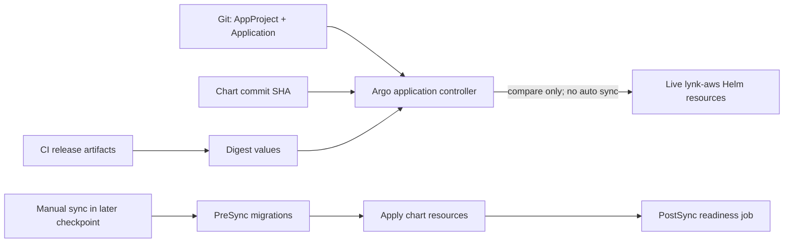

# CP13 — Desired state cho `aws-demo`, sync thủ công và deployment hooks

## Bài toán thực tế của Lynk

CP12 đã cài Argo CD `v3.5.5` non-HA, nhưng chưa có Application. Workload production đang chạy trong `lynk-aws` do một Helm release `lynk-services` revision 6 quản lý. Redirect, URL và Auth mỗi service có một replica, các image đang chạy bằng digest cố định. Redis đang là một Deployment riêng, được apply bằng `kubectl`, không có Helm owner metadata; Kafka có StatefulSet và PVC `data-kafka-0` Bound. Hiện không có Argo Application trong cluster.

Trong Git còn hai Application mẫu cũ: một ứng dụng staging dùng `targetRevision: HEAD`, auto-sync/prune bật và một Redis app staging trỏ Bitnami chart. Chúng không có trong cluster nhưng nếu apply nguyên thư mục có thể tạo reconcile không mong muốn. CP13 thay các mẫu đó bằng một Project giới hạn cho Lynk và Application `aws-demo` trỏ chart/source cố định, dùng image digests hiện đang chạy, giữ sync thủ công và không prune. Argo được phép tính trạng thái/diff; nó chưa được phép tiếp quản hoặc sửa workload.

Preflight qua SSM trên `lynk-k3s-dev`, K3s `v1.37.1+k3s1`, ghi nhận Helm release `lynk-services-0.2.0`, revision 6, deployed; URL/Redirect/Auth đều `1/1` với digest lần lượt `sha256:1d916376…70c978`, `sha256:8bec2f41…e11e82`, `sha256:f4e29642…fd65c`. Redis Deployment `lynk-redis` dùng `redis:8-alpine`, không labels/ownerReferences, có `kubectl.kubernetes.io/last-applied-configuration`; PVC Kafka Bound. Chỉ tên Secret và tham chiếu được xem, không đọc Secret data.

## Kiến thức nền

Helm render chart thành Kubernetes resources. Một Helm release lưu lịch sử revisions và values, còn Argo CD so sánh desired Git state với live cluster. Khai báo Application tự nó không đồng nghĩa apply workload: khi `spec.syncPolicy.automated` vắng mặt, operator phải khởi chạy sync thủ công. Prune là bước xóa resource live không còn trong desired state; để prune off giúp file bị bỏ sót không lập tức xóa database/PVC hoặc Service.

Image tag là tên có thể trỏ tới nội dung mới; image digest là định danh nội dung bất biến. CP13 dùng digest đang chạy làm seed để chart render cùng image bytes trước khi có release promotion. CI CP12 cũng đã publish image digest mới cho source SHA `1e9fbda…`; đó chưa phải image đang chạy và sẽ chỉ được promotion có kiểm soát ở CP15.

Helm hook và Argo hook thuộc hai cơ chế khác nhau. Chart Lynk đã hỗ trợ `global.migrationHookMode: argocd`: migration Jobs thành `PreSync`, chạy trước workload reconcile. CP13 thêm Job `PostSync` dùng image URL service hiện có để probe readiness nội bộ của ba service sau khi resources khỏe. Cả hai chỉ chạy khi operator thực sự sync Application. Hook Job không chứa DB credential; migration lấy đúng Secret ref của service trong template hiện có.

## Câu hỏi dẫn dắt

| Câu hỏi                       | Trả lời theo Lynk                                                                                                          |
| ----------------------------- | -------------------------------------------------------------------------------------------------------------------------- |
| What được khai báo?           | AppProject `aws-demo` và Application cho chart `lynk-services` trong namespace `lynk-aws`.                                 |
| Why sync thủ công?            | Live Helm release đang phục vụ domain và ba database production; đầu tiên cần quan sát diff, chưa giao ownership cho Argo. |
| How tránh tải image khác?     | App values pin đúng ba digest hiện tại; tag source SHA và chart commit cũng được cố định.                                  |
| When chạy migrations/smoke?   | Migration ở PreSync, readiness smoke ở PostSync; chỉ khi có sync thủ công ở CP16 trở đi.                                   |
| Who được phép reconcile?      | Project chỉ cho GitHub repo này, cluster nội bộ và namespace `lynk-aws`; resource kinds bị giới hạn.                       |
| What if chart thiếu resource? | Sync tự động và prune đều tắt; review diff rồi sửa desired state trước khi operator sync.                                  |

## Cơ chế hoạt động

Argo theo dõi resources bằng annotation tracking đã cấu hình ở CP12. AppProject giới hạn source/destination/kinds. Application chỉ render chart path và values đã pin. Vì auto-sync/prune không bật, controller chỉ tính trạng thái/diff. Không tạo Redis Application trong CP13: live Redis đang do `kubectl apply` ownership, image/config khác với Bitnami chart mẫu; chuyển owner cần riêng inventory và review ở CP16.

## Các phương án và đánh đổi

Có thể để Application dùng branch `HEAD`, nhưng mỗi commit chart có thể đổi render dù Application review không thay đổi. Pin chart SHA khiến nguồn lặp lại được, đổi lại cần cập nhật SHA trong promotion. Giữ image digest live tránh thay Pod trong lần seed đầu; vì thế nó tách khỏi CI image mới nhất. Auto-sync tiện hơn nhưng sẽ tự sửa live resources ngay khi controller thấy drift; điều đó chưa phù hợp khi Helm hiện là owner. Bỏ AppProject và dùng `default` dễ cấu hình nhưng không giới hạn namespace/source/kinds.

Chart và Application cùng ở repository, trong khi Application cần trỏ tới commit chính xác chứa chart và PostSync hook. Commit không thể chứa chính SHA của nó trong Application mà không tạo self-reference. Vì vậy implementation cần source commit liên kết trước commit GitOps cuối cùng; Application pin vào SHA source cuối `87eb22600c545ac6952d472739b0091f5bd84281`. Lượt CI đầu phát hiện chart lint với values AWS chung thiếu `global.postSyncSmoke`; template được sửa để hook opt-in và an toàn khi map không có. SHA sau sửa được dùng làm source pin.

## Kế hoạch trước implementation

1. Đọc `helm get values` trên target nhưng chỉ in allowlist image/digest, replica, resources và Secret reference names; kiểm tra tên/image/ownership live, PVC, ingress, Argo apps và deployment gate. Không in Secret values.
2. Thay hai Application mẫu staging bằng Project/Application `aws-demo`; source repo/Project giới hạn rõ, chart commit `87eb22600c545ac6952d472739b0091f5bd84281` pin, values giữ image digests live và sync/prune off.
3. Thêm hook smoke `PostSync` nội bộ vào chart. Giữ migrations `PreSync`; mọi hook chỉ chạy khi sync thủ công.
4. `helm lint`, `helm template`, kiểm tra hook annotations, image refs, names, resource settings, namespace, PVC/Secret refs; chạy CI static tests. Không apply workload chart.
5. Tạo commit source chart/hook `87eb22600c545ac6952d472739b0091f5bd84281`; dùng SHA commit đó trong Application; tạo commit GitOps/doc/evidence. Push branch, chờ CI.
6. Trước khi apply Project/Application CRs vào Argo, lưu snapshot chỉ metadata của deployments/services/ingresses/PVCs/secrets names và image IDs. Server-side dry-run các CRs, apply đúng hai CR manifest, kiểm tra Argo diff/status; so sánh metadata workload trước/sau, xác nhận không Job hook chạy, không resource version/revision/image/PVC đổi.
7. Kiểm tra delivery gate vẫn paused trước main push, fast-forward khi CI đạt; xác nhận main CI và deploy skipped.

Files: `gitops/` (Project/Application), `infra/k8s/helm/lynk-services` (smoke hook, values, chart version), `scripts/cd/check-gitops.py` và test chart, CI workflow, lesson này và `evidence/cp13-gitops.json`. Dependencies: Argo CRDs từ CP12, GitHub repo truy cập công khai từ node, Helm 3.21.2, image digests đang chạy, K3s/SSM. Tác động cluster dự kiến chỉ tạo `AppProject` và `Application` trong `argocd`; chart workloads không apply. Rủi ro là lỗi pin/repo/path làm App `ComparisonError` hoặc diff lớn; auto-sync/prune off giúp giữ workload. Recovery là xóa chính hai CR objects; nó không rollback/đụng workloads, hooks hay dữ liệu. Tiêu chí đạt: render source đầy đủ, sync remains manual, prune off, Argo diff quan sát được, live workload snapshot không đổi, CI xanh, deployment paused.

## Implementation có giải thích

Chart values sẽ kế thừa `values-aws.yaml` hiện tại cho `lynk.codes`, auth, Kafka và resource budgets; `values-aws-demo.yaml` override image repositories/digests đang chạy cùng `migrationHookMode: argocd`. `lynk.image` helper đã hỗ trợ `repository@digest`. App `aws-demo` pin SHA source chart và không khai báo automated sync. AppProject allowlist đúng Git repo, destination nội bộ `lynk-aws`, namespaced Jobs/Deployments/Services/Ingresses và `traefik.io/Middleware`; không cấp cluster resource whitelist.

Smoke Job dùng chính digest URL service và Node `fetch`, không thêm image bên ngoài. Nó gọi ba `/health/ready` endpoint nội bộ, có timeout/retry, và chỉ in tên endpoint/status code. Hook không đọc hay ghi DB trực tiếp; readiness service hiện có kiểm tra dependency theo service contract.

## Verification, troubleshooting và recovery

`helm lint/template` kiểm tra cú pháp và output chart, không chứng minh runtime readiness. YAML contract tests kiểm tra repo/SHA/project/namespace/digests, hook annotations và sync/prune. Server-side dry-run xác nhận App CR schemas. Branch CI run `38934121125` trên source commit `87eb226…` hoàn tất thành công; các job publish/package/deploy bị skip vì delivery paused.

Trên cluster, Argo đã fetch revision `87eb226…`, render 12 resources và báo `OutOfSync`, health `Progressing`, không có status condition lỗi. Danh sách 12 Service/Deployment/Ingress/Middleware đều OutOfSync vì App mới đang compare với resources thuộc Helm release cũ và chưa được adoption. Đây là bằng chứng source được render và trạng thái được so sánh; không phải trạng thái deployment khỏe. CP13 cố ý dừng ở đây: chưa yêu cầu Argo hiển thị/apply workload diff và chưa sync; CP16 phải review diff và ownership trước khi chuyển owner.

Ansible server-side dry-run thành công, xác nhận policy manual/no-prune và không có migration hay PostSync Job. Snapshot secret-free trước/sau được so sánh chính xác bằng chuỗi JSON và assertion passed; playbook không lưu hash của hai snapshot nên evidence ghi `null` cho digest thay vì dựng lại số liệu. Kết luận chỉ giới hạn rằng việc đăng ký Project/Application không thay đổi snapshot workload được chọn; nó không chứng minh ứng dụng khỏe hoặc mọi resource ngoài snapshot bất biến.

Nếu App `ComparisonError`, kiểm source repo/commit/path và values file tương đối với chart. Nếu nhiều diff ngoài hook annotations, image, replica và resource values dự kiến, giữ sync thủ công và giải thích từng diff; không sync để “thử”. Nếu Project từ chối resource, chỉ mở allowlist cho đúng kind/namespace cần thiết. Nếu App vô tình có automated/prune, không apply App cho đến khi manifest sửa và render lại. Rollback xóa AppProject/Application CR đã tạo; không xóa resources app.

## Tự học

**Dự đoán:** Application `OutOfSync` nhưng không có `automated` có làm đổi pod không? Nếu resource biến mất khỏi Git trong khi prune off thì điều gì xảy ra? Vì sao pin image digest hiện tại khác pin image digest mới từ CI?

**Bài read-only:** sau khi App object tồn tại, so sánh `status.sync.status`, `status.health.status` và danh sách resource status; xem `kubectl get deploy -n lynk-aws` cùng imageIDs, PVC Bound và các Job. CP13 hiện ghi nhận `OutOfSync/Progressing` với 12 resources và không có conditions. Chỉ quan sát; không bấm Sync.

Phần tự thực hành của người học còn chờ bạn hoàn thành; agent tạo App object không chứng minh bạn đã tự review hoặc sync.

Lời giải

OutOfSync chỉ là kết quả compare nếu không yêu cầu manual sync. Prune off giữ orphan live resource thay vì xóa khi Git bỏ resource. Digest hiện tại seed đúng binary đang chạy, còn digest mới biểu diễn binary CI mới hơn và cần release/promotion theo CP14–CP15.

## Nguồn chính thức

- [Argo CD 3.5 Applications](https://argo-cd.readthedocs.io/en/release-3.5/user-guide/application-specification/) — source, project, destination và sync policy.
- [Argo CD 3.5 Projects](https://argo-cd.readthedocs.io/en/release-3.5/user-guide/projects/) — source/destination/resource allowlists.
- [Argo CD 3.5 resource hooks](https://argo-cd.readthedocs.io/en/release-3.5/user-guide/resource_hooks/) — PreSync/PostSync ordering.
- [Helm chart templates](https://helm.sh/docs/chart_template_guide/) — values và template render.
- [Kubernetes image names/digests](https://kubernetes.io/docs/concepts/containers/images/) — immutable image references.
