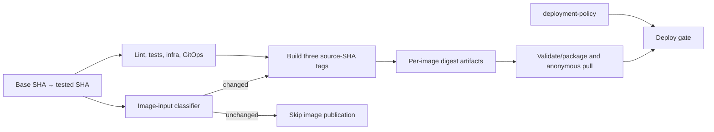

# CP14 — CI dependency graph, immutable artifacts và selective image builds

## Bài toán thực tế của Lynk

CP13 tích hợp GitOps/Application và chart hook tại main commit `32b33984b8542c858d046a9ac8fe0942daf476fc`. Main CI run `38935168448` thành công: ba image được build/push theo source SHA, package-release thành công và deploy bị skip do `LYNK_DEPLOY_MODE=paused`. Release artifact gắn đúng commit SHA và chứa digest URL `sha256:4b96b700b575d1b8f7ba3e1bf12827188dada09bfe10bad7b997bb6edf0b9214`, Redirect `sha256:071bd05aeb85a37eb8145d096985387b32df6e6175ec46f0cd55c16db3ea3166`, Auth `sha256:8ceaef9c1a018f09d55c66cd7a5a1374b032b2e3c03430db6dfad9506f2680ce`. Package job đã kiểm tra anonymous pull của cả ba digest. Thay đổi CP13 chủ yếu là chart/GitOps/CI nên ba lần build đó không cần thiết.

CP14 sẽ giữ các kiểm tra lint/test, resilience, Terraform, Ansible/Helm và GitOps chạy theo trigger hiện tại, nhưng thêm một dependency classifier trước image publication. Nếu thay đổi không chạm đầu vào Docker image, build matrix và các job chỉ tiêu thụ digest sẽ skip. Thay đổi ở source service/shared/root manifests vẫn build image theo source SHA và lưu digest artifact. CD giữ paused xuyên suốt checkpoint.

## Kiến thức nền

Workflow là một đồ thị job. `needs` tạo dependency: job downstream chỉ chạy sau upstream thành công; nếu upstream bị skip thì downstream cũng skip trừ khi có điều kiện override rõ ràng. CI validation và image publication có thể thuộc cùng workflow nhưng phục vụ mục tiêu khác nhau: validation trả lời source có đạt quality gate không, còn publication tạo binary có thể triển khai.

Docker build context là tập file mà build có thể đọc. Mỗi Dockerfile Lynk copy root `package*.json`, `tsconfig*.json`, `packages/shared/` và đúng thư mục service. Vì vậy source trong service đó hoặc shared package có thể làm thay đổi image. `gitops/`, Terraform, Ansible và tài liệu không được Dockerfile copy vào image. Thay đổi root lockfile hoặc shared code ảnh hưởng cả ba image.

Source SHA tag như `ghcr.io/ngqkhai/lynk-url-service:<commit>` cho biết image được build từ commit nào; tag có thể được ghi đè nên không phải định danh nội dung bất biến. OCI digest `sha256:…` nhận diện chính xác image bytes và là reference dùng trong release manifest. Workflow upload digest metadata làm artifact giữa build job và package-release; package job kiểm tra cấu trúc digest, tạo release bundle rồi thử anonymous pull.

Path classification là một dependency graph có thể sai nếu thiếu một input. Nếu filter bỏ sót file được Dockerfile copy, Lynk có thể chạy image cũ dù validation source mới xanh. Vì vậy quy tắc phải xuất phát từ Dockerfile/build context, test các ranh giới quan trọng, và fail-safe: không có base SHA hoặc không đọc được diff thì coi như image cần build. Việc phân loại chỉ gate publication; nó không được bỏ qua kiểm tra chất lượng.

## Câu hỏi dẫn dắt

| Câu hỏi                                      | Trả lời theo Lynk                                                                                        |
| -------------------------------------------- | -------------------------------------------------------------------------------------------------------- |
| What là input của mỗi image?                 | Root manifests/TypeScript config, shared package và source/Dockerfile/drizzle của service.               |
| Why không dùng `paths:` để skip cả workflow? | GitOps, Terraform và application source vẫn cần kiểm tra; chỉ image publication phụ thuộc build inputs.  |
| How xác định files thay đổi?                 | So sánh push `before..HEAD` hoặc PR base với commit đang kiểm tra sau khi fetch đủ history.              |
| When publish digest?                         | Sau khi mọi quality jobs cần thiết xanh và classifier báo image input thay đổi trên push `main`.         |
| Who truyền digest sang release?              | Build matrix upload metadata artifacts; package-release download hợp nhất artifacts rồi kiểm tra digest. |
| What if base SHA thiếu hoặc force-push?      | Classifier phải chọn build an toàn; điều đó tăng chi phí nhưng tránh deploy image cũ.                    |

## Cơ chế hoạt động

Classifier chỉ quyết định cần image mới hay không. Các validation jobs không phụ thuộc classifier nên không bị skip khi chỉ đổi GitOps. Matrix dùng `${{ github.sha }}` làm source tag và output digest riêng từng service. `package-release` chỉ consume artifacts từ matrix; nếu matrix skip, package/deploy cũng skip theo dependency graph. Khi gate ở `paused`, deploy vẫn không chạy kể cả khi package có release.

## Các phương án và đánh đổi

Có thể build cả ba image cho mọi main commit như hiện tại; đơn giản nhưng tốn runner, registry writes và chờ đợi khi chỉ đổi manifests. Có thể tách mỗi service matrix theo path riêng; tiết kiệm hơn khi một service thay đổi, nhưng tăng độ phức tạp artifact completeness và promotion. CP14 trước tiên giữ một boolean rõ ràng: mọi thay đổi thuộc bất kỳ image input nào sẽ build đủ ba image; đây là chính sách bảo thủ dễ review. Shared/root dependency thay đổi cũng build cả ba.

Workflow-level path filters có thể làm check suite biến mất khỏi commit chỉ chứa GitOps. Chúng không phù hợp với mục tiêu này. Job-level classifier giữ workflow và validation nguyên vẹn, đồng thời phân biệt nhu cầu build artifact. Nếu classifier sai theo hướng false, image stale là failure nghiêm trọng; nếu sai theo hướng true, chi phí tăng nhưng binary vẫn mới. Vì vậy base/diff lỗi phải fail-safe về build.

## Kế hoạch trước implementation

1. Đối chiếu ba Dockerfile, `.dockerignore`, root manifests và shared/service trees để lập danh sách build inputs thực. Baseline hiện tại là CP13 main run `38935168448`: cả ba image publish, digest artifacts và anonymous pull đều thành công; deploy skip.
2. Tạo classifier Python thuần, nhận base/head Git SHA, xử lý deletion/rename, và xuất danh sách path matches cùng cờ `build_images`. Thiếu/không khả dụng base SHA sẽ trả về build=true. Không đưa nội dung file, environment hay secrets vào output.
3. Thêm test cho thay đổi service riêng, shared/root dependency, Dockerfile, deleted path, GitOps-only, Terraform-only, docs-only và lỗi diff. Bảo đảm mọi case không liên quan ra `build_images=false`.
4. Thêm job phát hiện thay đổi với checkout full history; lấy base SHA từ push payload hoặc pull-request base. Chỉ thêm dependency này vào job image matrix. Giữ các quality jobs không bị gate.
5. Giữ source SHA tag, digest artifacts, package verification và deployment gate. Thêm workflow tests kiểm tra `needs`/`if` để skipped publisher không làm CI validation bị skip.
6. Chạy unit tests classifier, workflow graph tests, YAML parse, repository lint/test và CI đầy đủ. Sau khi branch CI xanh, kiểm gate paused/reviewer rồi fast-forward main. Main run cần chứng minh classifier output không đổi image cho diff GitOps/CI/docs; branch run vẫn phải chạy toàn bộ checks.

**Tài nguyên và dependencies:** `.github/workflows/ci.yml`, `scripts/cd/` classifier/tests, `scripts/cd/test-workflow-gates.py`, lesson/evidence; Python 3 chuẩn, Git full history trên runner, GitHub artifacts, GHCR. Không đổi Dockerfile, app source, release schema, Kubernetes/Argo resources hay AWS. Không cần credentials AWS để kiểm chứng.

**Tác động dự kiến:** main push có app input vẫn xuất ba image theo commit và một release artifact; push chỉ đổi GitOps/infra/docs vẫn chạy checks nhưng không ghi GHCR hoặc tạo release bundle. Nếu source change không được classifier nhận, rollback bằng cách bỏ gate để khôi phục build mọi main push; điều này phục hồi publication nhưng không tự triển khai image nào.

**Tiêu chí đạt:** classifier tests chứng minh cả dependency liên quan và GitOps-only case; workflow graph thể hiện checks chạy độc lập, publisher chỉ chạy khi main push + build inputs thay đổi; artifact có commit SHA, ba digest hợp lệ và anonymous pulls đạt khi publisher chạy; với diff không chứa build input, publisher/package/deploy bị skip; deployment gate tiếp tục paused.

## Implementation có giải thích

`scripts/cd/image_build_inputs.py` gom dependency thành một cờ bảo thủ. Mọi `services/{url,redirect,auth}-service/**`, `packages/shared/**`, root `package*.json`, `tsconfig*.json` và `.dockerignore` đều cần ba image. Đây khớp các `COPY` trong ba Dockerfile: mỗi builder nhận shared package và đúng service; runner nhận package manifests cùng output dist/drizzle từ builder. Test đọc trực tiếp mỗi Dockerfile và thất bại nếu xuất hiện một `COPY` source chưa được classifier nhận diện.

Classifier chạy `git diff --name-only -z --no-renames base head`; `-z` giữ tên path có ký tự đặc biệt, còn `--no-renames` bảo đảm file cũ đã xóa vẫn được xét. Với base SHA không hợp lệ, base all-zero ở lần push đầu, hoặc diff lỗi, nó ghi `build_images=true` vào `GITHUB_OUTPUT`. Output log chỉ liệt kê path đã đổi, không đọc hoặc in giá trị file.

Job `image-inputs` dùng checkout `fetch-depth: 0`, lấy base từ push `github.event.before` hoặc pull request `base.sha`, và so với `github.sha`. Job này không phụ thuộc validation, nên chạy song song với checks. Matrix build vẫn cần tất cả validation xanh và thêm điều kiện `image-inputs.build_images == true`, `main` và `push`. Source tag, OCI digest artifacts, package-release anonymous pulls và gate deployment hiện có giữ nguyên. `package-release` vẫn phụ thuộc matrix; khi matrix skip, nó cùng deploy skip theo dependency graph mặc định.

Classifier test có 8 ca: mỗi service, shared/root dependency, GitOps/infra/docs, file deletion/rename handling và base không khả dụng. Workflow graph tests kiểm tra các quality jobs không có điều kiện skip, dependency matrix → package-release → deploy, cùng source tag `${{ github.sha }}` và digest output. Lượt local đầu tiên của graph test kỳ vọng nhầm deploy phụ thuộc trực tiếp matrix; inspection workflow cho thấy package-release là mắt xích trung gian nên assertion đã sửa theo đồ thị thực.

## Verification, troubleshooting và recovery

Kết quả classifier là path evidence, không phải image build. CI xanh của checks không chứng minh image mới được publish. Matrix success cùng digest artifacts chứng minh registry outputs; anonymous `docker manifest inspect` chứng minh pull được từ môi trường không đăng nhập. CP13 main run cung cấp baseline thực: ba image digests hợp lệ và anonymous pulls pass. Chạy classifier trên diff `1e9fbda..32b3398` cho `build_images=false`, giải thích rằng các thay đổi CP13 không chạm file build input dù workflow cũ vẫn publish.

Branch CI run `38936380831` hoàn tất xanh ở mọi quality job. Đây là lần đầu nhánh được tạo nên GitHub gửi `before` all-zero; full checkout không thể có commit đó, classifier trả `build_images=true`/`base-unavailable`. Matrix/package/deploy đều skipped vì đây là branch push, xác nhận nhánh fallback không làm mất validation hoặc publication policy. Một lần chạy kế tiếp, `38936918397`, thất bại ở Prettier do JSON evidence được sửa sau lần format trước; evidence đã được format lại và lỗi được ghi trong file machine-readable.

Trên main, commit không có input Docker phải cho job `image-inputs` thành công với false; các image matrix, package-release và deploy cần skip, trong khi checks vẫn chạy. Deploy skip cũng phải khớp `LYNK_DEPLOY_MODE=paused`. Evidence máy đọc được ghi tại `evidence/cp14-ci.json`; main-run fields sẽ được điền sau khi tích hợp. Phân loại hồi cứu diff CP13 `1e9fbda..32b3398` đã trả false, nhưng run main sau đổi workflow là kiểm tra thực thi quyết định gate.

Nếu classifier báo false cho service/shared change, kiểm tra Dockerfile COPY paths và test trước khi merge; recovery tức thời là bỏ điều kiện mới ở matrix để quay lại build mọi main push. Nếu một publish matrix job thất bại, package/deploy phải skip. Nếu build được skip vì thiếu base, classifier sai vì base lookup phải fail-safe; xem `image-inputs` log và checkout depth trước khi thay logic.

## Tự học

**Dự đoán:** Vì sao thay `packages/shared/src/` cần build ba image? Vì sao sửa `gitops/aws-demo-application.yaml` vẫn nên chạy GitOps test nhưng không cần build image? Nếu `github.event.before` trỏ đến commit không có trong checkout nông, nên skip hay build?

**Bài read-only:** đọc từng `COPY` trong Dockerfile và phân loại file path vào URL, Redirect, Auth hoặc tất cả. Với một diff bất kỳ, dự đoán classifier output rồi so với CI artifact/job status. Không gọi publish/deploy thủ công.

Phần tự thực hành của người học chờ bạn hoàn thành.

Lời giải

Shared được compile vào cả ba image. GitOps manifests không được Dockerfile copy nên không làm đổi image bytes, nhưng vẫn cần manifest validation. Khi không đủ lịch sử để tính diff, chọn build=true tránh giữ image cũ ngoài ý muốn.

## Nguồn chính thức

- [GitHub Actions workflow events](https://docs.github.com/en/actions/reference/workflows-and-actions/events-that-trigger-workflows) — SHA/ref của push và pull request.
- [GitHub Actions contexts](https://docs.github.com/en/actions/reference/workflows-and-actions/contexts) — dữ liệu event và các context expression.
- [GitHub Actions workflow syntax](https://docs.github.com/en/actions/reference/workflows-and-actions/workflow-syntax) — job dependencies, conditions và artifacts/workflow behavior.
- [Docker build context](https://docs.docker.com/build/concepts/context/) — file context dùng để build image.
- [Docker image digests](https://docs.docker.com/dhi/core-concepts/digests/) — định danh content-addressable của image.
