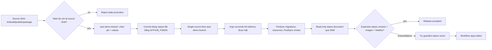

# CP15 — Promotion tuần tự, async status và phục hồi khi race

## Bài toán thực tế của Lynk

CI đã tạo release artifact theo source SHA và CP14 đã ngừng rebuild image khi chỉ đổi GitOps. Tuy nhiên Application live hiện đọc Helm chart và `values-aws-demo.yaml` từ một source revision cố định `87eb226…`. Một bot chỉ cập nhật digest file trên `main` sẽ không đổi desired state mà Argo đang đọc. Workflow deploy cũ dùng SSM `LynkDeploy` để gọi Helm trực tiếp; nó không có hợp đồng đọc trạng thái Argo, và IAM role có quyền S3 release + deploy. CP13 ghi nhận App còn manual, no-prune; lần compare khi đó là `OutOfSync/Progressing`, 12 resource, không có condition lỗi. CP15 cần xử lý các sự thật hiện tại lại trước khi tác động cluster.

Main CI CP14 run `38937815997` thành công với `image-inputs=false`; matrix/package/deploy bị skip. CP15 CI cuối `38942335764` thành công toàn bộ; lint/test, E2E, Infrastructure/Helm, GitOps, Terraform và deployment-policy đều xanh. Các lượt trước đó phát hiện rồi sửa Terraform formatting và một đường dẫn Ansible sai; follow-up checks xanh. STS xác nhận account `231136241975`. `LynkDeploy` Active v2; EC2 `i-03bb7dcb94ec8bd21` là `t3.medium` và SSM Online. State bucket bật versioning, đủ bốn public-access-block flags, mã hóa AES256; state object có VersionId. GitHub gate vẫn `LYNK_DEPLOY_MODE=paused`, environment reviewer là `ngqkhai`.

SSM read-only preflight thấy Application vẫn dùng chart revision `87eb226…`, sync `OutOfSync`, health `Progressing`; ba Deployment đều ready 1/1 với digest hiện có trong values file, Redis 1/1, Kafka topic Job thành công, ingress host `lynk.codes`, PVC `data-kafka-0` Bound. Chưa có migration hoặc PostSync smoke Job. Đây là trạng thái đọc thực tế trước thay đổi CP15; không có Argo sync nào chạy.

## Kiến thức nền

Promotion là thay đổi con trỏ desired state từ một binary đã build và kiểm tra sang một release artifact cụ thể. Nó khác build: build tạo image; package gắn commit SHA với digest; promotion chọn digest đó cho environment; reconcile mới áp desired state lên workload. Commit SHA là nguồn code, OCI digest là nội dung image, còn promotion commit SHA là phiên bản Git chứa bộ digest đã chọn. Ba định danh này có vai trò khác nhau.

Argo CD multi-source có thể gom nhiều source vào một Application, nhưng live controller v3.5.5 đã từ chối hai revision khác nhau của cùng một Git repository khi source values dùng `$values`. YAML parse và server-side dry-run không bắt được lỗi render đó. Theo lựa chọn đã xác nhận, `aws-demo` dùng branch triển khai riêng bắt đầu từ chart commit `87eb226…`; Argo theo một source duy nhất, còn bot chỉ tạo commit values trên branch. Application sync vẫn manual ở CP15.

SSM Run Command là bất đồng bộ. `SendCommand` trả command ID trước khi node thực hiện; lần `GetCommandInvocation` đầu có thể chưa thấy invocation do eventual consistency. Client phải retry đúng lỗi invocation chưa xuất hiện, poll trạng thái terminal trong deadline, và dừng ngay với lỗi quyền/API khác. Deadline ở runner, workflow và SSM document phải tương thích. `GetCommandInvocation` chỉ cho trạng thái plugin invocation; kết luận runtime cần stdout tổng hợp từ một document cố định, read-only.

Concurrency serializes promoter jobs, nhưng không tự chứng minh artifact còn mới. `cancel-in-progress: false` tránh cắt ngang tiến trình đang ghi Git; hàng đợi giữ các run chờ. Freshness guard so source SHA của release với tip `main` trước commit và trước push. Commit được tạo trên parent hiện tại của `aws-demo`; normal push từ parent chính xác bị từ chối nếu branch tiến song song. Bot commit chỉ add một đường dẫn allowlist. `GITHUB_TOKEN` không phát sinh một `push` workflow mới; Argo polling đọc commit desired state, còn workflow hiện tại tiếp tục theo dõi đúng promotion commit.

## Câu hỏi dẫn dắt

| Câu hỏi                                 | Trả lời theo Lynk                                                                                                                                             |
| --------------------------------------- | ------------------------------------------------------------------------------------------------------------------------------------------------------------- |
| What được promotion?                    | Ba repository/digest và source image tag trong đúng `values-aws-demo.yaml`.                                                                                   |
| Vì sao kế hoạch multi-source bị dừng?   | Live Argo CD v3.5.5 báo `cannot reference a different revision of the same repository`; cấu hình này không render dù YAML hợp lệ.                             |
| How ngăn release cũ ghi đè release mới? | Serialization, kiểm tra source SHA bằng tip main, commit trên parent hiện tại của `aws-demo` và push fast-forward thường.                                     |
| When gọi SSM?                           | Sau khi promotion commit thành công và chỉ khi deployment mode là `argocd`; mode paused thì không lấy AWS credentials.                                        |
| Who có quyền ghi Git/AWS?               | Job promotion có contents write tối thiểu; SSM status role riêng chỉ gửi command tới instance/document read-only và đọc invocation result.                    |
| What if Argo timeout hoặc smoke fail?   | Workflow thử khôi phục values bằng revert chỉ khi `aws-demo` vẫn đúng promotion commit và `main` vẫn đúng source SHA; run vẫn failure để cần operator review. |

## Cơ chế hoạt động dự kiến

CP15 không bật mode `argocd` và không gọi sync production. Người học chọn từ chối release stale thay vì rebase. Branch `aws-demo` bắt đầu đúng chart pin; guard so sánh toàn bộ cây file giữa pin và branch, chỉ cho phép values file khác. Freshness kiểm tra `main` trước commit và trước push; normal push không force từ chối race. Terraform plan chỉ thêm role/document status-only; ba resource đã được áp dụng thành công. Status helper được cài root-owned mode `0700`.

## Các phương án và đánh đổi

Thay đổi `Application.targetRevision` cùng values trong một commit không giải quyết được self-reference: Application cần revision trước khi commit chứa chính nó tồn tại. Multi-source cùng repo đã thất bại live comparison. Người dùng chọn branch triển khai riêng `aws-demo`, seed từ chart pin. Chi phí là branch dài hạn và drift guard; lợi ích là Argo có một source đơn giản và chart/hook content không đổi khi promote. Guard CI diff chart pin với branch để fail nếu có drift ngoài values. Repo values riêng vẫn là phương án nhưng tăng repo/token governance.

GitHub Contents API tạo commit tiện lợi nhưng endpoint file không cung cấp compare-and-swap parent cho nhiều thay đổi đồng thời. CP15 dùng Git worktree cho `aws-demo`, push fast-forward thường trên đúng parent SHA và kiểm tra `main` vẫn là source SHA. Một lần race sẽ fail thay vì replay release cũ. Chỉ một file values được stage; không dùng `git add -A`, force push hay bot commit rộng.

Status role riêng tốn thêm một IAM role và SSM document so với dùng quyền deploy hiện có, nhưng tách hoàn toàn read-status khỏi quyền S3/deploy. SSM `GetCommandInvocation` cần `Resource: *` theo API authorization; SendCommand được giới hạn vào đúng EC2 và đúng document. Status script chỉ dùng `kubectl get` trên Application, Deployment, Pod và PostSync Job; không đọc Secret objects/data.

## Kế hoạch trước implementation

1. Chờ AWS SSO mới, đọc lại profile identity, `LynkDeploy` metadata, IAM role policies, latest Helm revision/release ledger, live App source/sync/health/policy, K3s health và workload snapshot chỉ metadata. Đối chiếu GitHub deployment mode/reviewer và Terraform state. Không đọc Secret data.
2. Ghi nhận provider versions, current plan và ownership của SSM/IAM resources. Preflight fail nếu state lock/drift/plan chứa replace/delete ngoài các resource status-only đã dự kiến; không apply.
3. **Kế hoạch điều chỉnh sau preflight:** live comparison từ chối multi-source chart SHA `87eb226…` + values `main`. Người dùng chọn dedicated `aws-demo` branch. Seed branch đúng pin; đối chiếu baseline values với workload đang chạy; guard toàn cây chỉ cho phép values khác pin; cập nhật Application bằng server-side dry-run, apply riêng CR, chờ comparison branch hợp lệ và so workload snapshot. Giữ manual sync/prune off.
4. Viết promoter thuần: xác nhận release.json commit/SHA/digest/repository, sửa ba digest và `global.imageTag` trong một values file, giữ mọi settings khác, validate YAML/chart, stage đúng allowlist. Thêm test source stale, branch advance race, duplicate digest, file unexpected diff và rollback chỉ đúng file.
5. Thêm job sau package-release, chỉ hoạt động khi mode `argocd`: contents write theo job, concurrency không cancel run đang chạy, queue/promotion serialization, fetch tip freshness guard, normal fast-forward push. Không cho promotion job chạy trên branch/PR/paused.
6. Thêm SSM status document và IAM role read-only. Status invocation nhận expected values commit, release SHA, ba digest và deadline có hard bounds; poll invocation trong client xử lý eventual consistency chính xác và không retry AccessDenied.
7. Cài status script bằng Ansible với owner root/mode 0700; script trả JSON tối giản và chỉ thành công khi Argo revision/health/operation, deployment image refs/Pod imageIDs, smoke Job đều khớp. Cập nhật live App CR spec sau server-side dry-run và snapshot before/after; không sync workload.
8. Kiểm thử local stale source, race giữa check và push, SSM pending/delayed/late visibility/terminal failure/timeout, exact-release mismatch, smoke failure, successful guarded revert và revert conflict. Mọi case recovery giữ workflow exit non-zero.
9. Chạy Terraform plan review, CI/unit/Helm/YAML/workflow graph checks. Chỉ apply SSM status resources nếu plan chứa đúng additive resources/policy và không đổi workload. Delivery vẫn paused; không tạo release promotion thật hoặc chạy Argo sync.

**File/tài nguyên liên quan:** `gitops/aws-demo-application.yaml`, `infra/k8s/helm/lynk-services/values-aws-demo.yaml`, `.github/workflows/ci.yml`, `scripts/cd/` promoter/poller/tests, `infra/terraform/environments/aws-demo/{delivery,iam,outputs}.tf`, status document JSON, `infra/ansible/argocd-application-aws-demo-branch.yml`, status reader script, CP15 lesson/evidence. Dependencies gồm chart pin `87eb226…`, branch `aws-demo`, Terraform pin, GitHub `GITHUB_TOKEN`, OIDC status role, SSM Agent và `kubectl`/K3s. Tác động dự kiến không có workload; chỉ Application source spec và status-only IAM/SSM resources thay đổi.

**Tiêu chí đạt:** branch `aws-demo` giữ chart pin ngoài values; Argo resolve single-source branch; promoter chỉ sửa values file allowlist với ba digest hợp lệ; chart drift/stale/race fail closed; bot push không tạo workflow loop; status role không có S3/deploy permissions; waiter nhận đúng release/digests/smoke; timeout/rollback vẫn để workflow failed; Application sync manual/prune off và workload snapshot trước/sau bằng nhau; deployment mode paused. Promotion thật vẫn thuộc CP17.

**Phục hồi:** promotion commit có thể revert bằng normal Git commit nếu `aws-demo` còn đúng promotion parent và `main` vẫn là source SHA; không reset/force-push. Nếu Argo đã đọc values, revert chỉ phục hồi desired state, không tự khôi phục dữ liệu/schema hoặc đảm bảo workload đã rollback. Nếu SSM timeout, không resend vô điều kiện: đọc invocation ID trước; nếu rollback conflict thì dừng và để Git/Argo ở trạng thái quan sát được cho operator. Terraform status role/doc có thể remove riêng sau review, nhưng không xóa SSM deploy role/document hoặc release artifacts.

## Implementation có giải thích

Thử nghiệm multi-source dùng chart SHA `87eb226…` và values source `main` trên cùng GitHub repo. YAML validation/server-side dry-run thành công, nhưng actual Argo comparison trả condition `ComparisonError`: `cannot reference a different revision of the same repository`. Live manifest được khôi phục bằng `restore-aws-demo-single-source.yml`; Application `OutOfSync`, pin cũ, không còn comparison condition. Topology được chọn là dedicated `aws-demo` branch: một source duy nhất, branch bắt đầu từ chart pin và promoter chỉ có thể đổi values file. Recovery playbook lưu lại để khôi phục khi cần.

`promote_release.py` kiểm tra schema release, source SHA, ba repository cho phép và digest SHA-256, rồi đổi `global.imageTag` cùng ba `image.digest`. Workflow giữ scripts từ main checkout và tạo Git worktree từ `origin/aws-demo`, có base là chart pin. `promotion_guard.py` so cây branch với chart pin, buộc chỉ values file có khác biệt, so `main` với source SHA trước commit và trước push, rồi kiểm tra staged path. Commit và normal push chỉ tới `aws-demo`; branch advance đồng thời tạo non-fast-forward và làm run thất bại. Job serialized; `GITHUB_TOKEN` không sinh workflow push loop; Argo theo một source branch.

`argocd-status.sh` được cài trên host bằng Ansible; target shell check đạt, owner root và mode `0700`. SSM document `LynkArgoStatus` có parameter regex, chỉ gọi helper này. Terraform role chỉ có `SendCommand` tới đúng instance/document và `GetCommandInvocation` (API yêu cầu wildcard); không có quyền artifact S3, document deploy hay resource read khác. AWS API xác nhận document Active v1 và duy nhất inline policy `argocd-release-status-only`. `wait-argocd-status.py` retry duy nhất lỗi invocation chưa xuất hiện do eventual consistency; AccessDenied và terminal status dừng ngay. Deadline client 930 giây bao ngoài timeout document 900 giây.

Khi status verification thất bại sau promotion, workflow chỉ thử `git revert` nếu `aws-demo` vẫn ở đúng promotion commit và `main` vẫn là source SHA. Push revert là fast-forward bình thường. Dù revert thành công, job vẫn đỏ: Git desired state được khôi phục, nhưng điều đó không chứng minh runtime hoặc schema đã rollback. Nếu một branch đã tiến tiếp, workflow không ghi đè; operator xem xét Git và Argo.

Terraform `1.16.6` cùng AWS provider `6.69.1` đúng lockfile. State list có 35 tài nguyên trước apply. Plan ghi nhận 32 `no-op`, đúng ba `create` (`aws_iam_role.status`, `aws_iam_role_policy.status`, `aws_ssm_document.argocd_status`), không có update/delete/replace. Sau CI xanh plan được làm mới và xem chi tiết trust/policy/document; apply kết quả `3 added, 0 changed, 0 destroyed`.

Installer playbook cài helper `changed=1`, target `bash -n`, ownership và mode assertion đều đạt. Multi-source trial timeout sau polling; recovery JSON patch phục hồi source pin cũ và snapshot workload bằng nhau. Branch cutover lần đầu dừng ở server-side apply dry-run vì field manager `kubectl-patch` sở hữu `targetRevision`; không có CR thay đổi. Sau đó playbook kiểm tra pin rồi server-side dry-run một JSON Patch chỉ thay `/spec/source/targetRevision`, áp dụng đúng field đó, xác nhận Argo comparison hợp lệ/manual/no-prune và so workload snapshots. Kết quả là `OutOfSync`, `Progressing`, Argo revision vẫn `87eb226…` vì branch seed cùng commit; không chạy Sync.

## Verification, troubleshooting và recovery

Local checks: `npm run lint`, `npm run format:check`, `npm run build`, `npm run test` đã pass; integration suites cần database/environment bị skip như cấu hình. CP15 Python guards/waiter/automation/workflow/GitOps tests và Ansible syntax checks cũng pass. CI checkpoint run `38945208195` và main integration run `38945573726` đều success; image publish/package/deploy/promotion jobs skipped. AWS plan/apply, status helper install và branch cutover đã chạy; Application hiện single-source `aws-demo`, `OutOfSync`, health `Progressing`, no comparison condition, manual sync/no-prune. Snapshot trước/sau bằng nhau; không có workload mutation. Deployment mode vẫn `paused`, promotion/deploy chưa chạy.

Failure cụ thể: Argo render báo cùng một repo được tham chiếu ở chart SHA `87eb226…` và values `main`; controller từ chối `different revision of the same repository`. YAML parse và server-side dry-run không phát hiện hạn chế runtime này. Một server-side apply dry-run khác bị từ chối do field ownership; vì vậy cutover dùng JSON Patch đơn field, có server-side dry-run trước khi ghi. Cả recovery và branch cutover đều xác nhận snapshot workload không đổi. Đây là khác biệt giữa YAML hợp lệ, field-manager ownership và khả năng controller render thật.

Nếu workflow thất bại ở freshness guard, release đã stale và cần chờ CI build trên source tip mới. Nếu thất bại ở SSM waiter do AccessDenied, cần sửa role/credentials thay vì retry command. Nếu timeout, tìm command ID và quan sát trạng thái invocation trước khi làm gì khác; không gửi command thứ hai mù quáng. Nếu rollback bị từ chối vì main đã tiến, không force-push hoặc reset; đối chiếu commit values với Argo source revisions và tạo một commit sửa có review. Terraform rollback chỉ có thể gỡ resources status-only sau khi xem plan; không xóa `LynkDeploy`, role deploy hoặc artifacts.

## Tự học

**Dự đoán:** Nếu main advance ngay sau freshness check nhưng trước `git push`, điều gì ngăn bot ghi đè? Vì sao `GetCommandInvocation` lỗi “invocation not yet available” cần retry nhưng `AccessDenied` thì không? Vì sao workflow vẫn phải failure sau khi rollback desired values thành công?

**Bài read-only:** đọc hai source revision của Application, promotion commit và `status.operationState`; đối chiếu commit values với ba Deployment image refs và Pod imageIDs. Chỉ quan sát; không chạy Sync hoặc gửi SSM command.

Phần tự thực hành của người học chờ bạn hoàn thành.

Lời giải

Git từ chối non-fast-forward khi remote đã tiến lên, nên source cũ không được replay. Chỉ lỗi eventual visibility dự kiến mới retry; permission failure không tự khỏi và cần báo ngay. Rollback desired state không chứng minh runtime đã phục hồi, do đó workflow phải giữ thất bại để operator theo dõi deployment thực.

## Nguồn chính thức

- [Argo CD 3.5 multiple sources](https://argo-cd.readthedocs.io/en/release-3.5/user-guide/multiple_sources/) — chart và values source/revisions.
- [Argo CD 3.5 sync status and operations](https://argo-cd.readthedocs.io/en/release-3.5/user-guide/sync-kubectl/) — operation status và sync result.
- [GitHub `GITHUB_TOKEN`](https://docs.github.com/en/actions/concepts/security/github_token) — workflow-trigger suppression và giới hạn token.
- [GitHub workflow concurrency](https://docs.github.com/en/actions/how-tos/write-workflows/choose-when-workflows-run/control-workflow-concurrency) — serialization/queue behavior.
- [GitHub repository contents API](https://docs.github.com/en/rest/repos/contents) — file write permission and commit behavior.
- [AWS `GetCommandInvocation`](https://docs.aws.amazon.com/systems-manager/latest/APIReference/API_GetCommandInvocation.html) — eventual consistency, plugin invocation status.
- [AWS IAM for Systems Manager](https://docs.aws.amazon.com/systems-manager/latest/userguide/security_iam_id-based-policy-examples.html) — permission boundaries for Run Command.
