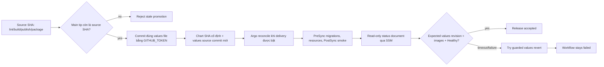

# CP15 — Promotion tuần tự, async status và phục hồi khi race

## Bài toán thực tế của Lynk

CI đã tạo release artifact theo source SHA và CP14 đã ngừng rebuild image khi chỉ đổi GitOps. Tuy nhiên Application live hiện đọc Helm chart và `values-aws-demo.yaml` từ một source revision cố định `87eb226…`. Một bot chỉ cập nhật digest file trên `main` sẽ không đổi desired state mà Argo đang đọc. Workflow deploy cũ dùng SSM `LynkDeploy` để gọi Helm trực tiếp; nó không có hợp đồng đọc trạng thái Argo, và IAM role có quyền S3 release + deploy. CP13 ghi nhận App còn manual, no-prune; lần compare khi đó là `OutOfSync/Progressing`, 12 resource, không có condition lỗi. CP15 cần xử lý các sự thật hiện tại lại trước khi tác động cluster.

Main CI CP14 run `38937815997` thành công với `image-inputs=false`; matrix/package/deploy bị skip. Run cuối chỉ ghi lesson/evidence `38938724654` cũng thành công và không publish. `LYNK_DEPLOY_MODE=paused` và reviewer environment `aws-demo=ngqkhai` đã được xác nhận ở CP14. AWS CLI preflight đầu tiên báo token SSO hết hạn; sau khi người vận hành báo đã đăng nhập lại, lời gọi STS vẫn không tới được `oidc.ap-southeast-1.amazonaws.com/token` do endpoint/network không truy cập được. Vì vậy số API AWS thành công trong CP15 vẫn là 0. Trạng thái Argo/Helm/IAM chưa được làm mới; Terraform plan/apply và cập nhật Application live bị giữ lại.

## Kiến thức nền

Promotion là thay đổi con trỏ desired state từ một binary đã build và kiểm tra sang một release artifact cụ thể. Nó khác build: build tạo image; package gắn commit SHA với digest; promotion chọn digest đó cho environment; reconcile mới áp desired state lên workload. Commit SHA là nguồn code, OCI digest là nội dung image, còn promotion commit SHA là phiên bản Git chứa bộ digest đã chọn. Ba định danh này có vai trò khác nhau.

Argo CD multi-source cho phép chart và values lấy từ hai revision riêng. Chart có thể pin vào commit đã review, còn file values của môi trường đi theo một source Git riêng. Khi file values được promotion bot cập nhật, Application có thể thấy commit mới mà chart không đổi. Vì Application sync tiếp tục manual trong CP15, thay desired values chỉ tạo diff; nó không chạy migration hay thay Pod.

SSM Run Command là bất đồng bộ. `SendCommand` trả command ID trước khi node thực hiện; lần `GetCommandInvocation` đầu có thể chưa thấy invocation do eventual consistency. Client phải retry đúng lỗi invocation chưa xuất hiện, poll trạng thái terminal trong deadline, và dừng ngay với lỗi quyền/API khác. Deadline ở runner, workflow và SSM document phải tương thích. `GetCommandInvocation` chỉ cho trạng thái plugin invocation; kết luận runtime cần stdout tổng hợp từ một document cố định, read-only.

Concurrency serializes promoter jobs, nhưng không tự chứng minh artifact còn mới. `cancel-in-progress: false` tránh cắt ngang tiến trình đang ghi Git; hàng đợi giữ các run chờ. Freshness guard so source SHA của release với tip `main` trước commit. Push thường (không force) từ parent source SHA là compare-and-swap tự nhiên: nếu main advance giữa guard và push thì Git từ chối non-fast-forward. Bot commit chỉ add một đường dẫn allowlist. `GITHUB_TOKEN` không phát sinh một `push` workflow mới; Argo polling đọc commit desired state, còn workflow hiện tại tiếp tục theo dõi đúng promotion commit.

## Câu hỏi dẫn dắt

| Câu hỏi                                 | Trả lời theo Lynk                                                                                                                                                                                                                 |
| --------------------------------------- | --------------------------------------------------------------------------------------------------------------------------------------------------------------------------------------------------------------------------------- |
| What được promotion?                    | Ba repository/digest và source image tag trong đúng `values-aws-demo.yaml`.                                                                                                                                                       |
| Why multi-source?                       | Chart source CP13 đang pin SHA nên không thể thấy commit digest mới ở `main`.                                                                                                                                                     |
| How ngăn release cũ ghi đè release mới? | Serialization, kiểm tra source SHA bằng tip main, commit trên parent chính xác và push fast-forward thường.                                                                                                                       |
| When gọi SSM?                           | Sau khi promotion commit thành công và chỉ khi deployment mode là `argocd`; mode paused thì không lấy AWS credentials.                                                                                                            |
| Who có quyền ghi Git/AWS?               | Job promotion có contents write tối thiểu; SSM status role riêng chỉ gửi command tới instance/document read-only và đọc invocation result.                                                                                        |
| What if Argo timeout hoặc smoke fail?   | Workflow thử khôi phục values file bằng commit revert có freshness guard; dù khôi phục được, run rollout vẫn failure để cần operator review. Nếu không thể revert an toàn, workflow failure giữ nguyên và yêu cầu xử lý thủ công. |

## Cơ chế hoạt động dự kiến

CP15 không bật mode `argocd` và không gọi sync production. Status waiter, rollback và race được kiểm thử bằng fake SSM/Git fixtures; live SSM document/role chỉ được tạo sau khi AWS preflight xác nhận state, ownership và không có drift ngoài dự kiến. Application spec có thể đổi sang multi-source qua một thao tác SSM/Ansible riêng, nhưng chỉ sau dry-run, giữ manual sync/no-prune và xác nhận workload snapshot bất biến.

## Các phương án và đánh đổi

Thay đổi `Application.targetRevision` cùng values trong một commit không giải quyết được self-reference: Application cần commit SHA trước khi commit chứa chính nó tồn tại. Tách chart revision và environment values revision qua multi-source bỏ vòng lặp này, đổi lại App status có nhiều source revisions và mỗi source phải được kiểm tra đúng vị trí.

GitHub Contents API tạo commit tiện lợi nhưng endpoint file không cung cấp compare-and-swap parent cho nhiều thay đổi đồng thời. CP15 dùng Git trên runner và push fast-forward thường trên đúng parent SHA. Một lần race sẽ fail thay vì retry/rebase release cũ lên main mới. Chỉ một file values được stage; không dùng `git add -A`, force push hay bot commit rộng.

Status role riêng tốn thêm một IAM role và SSM document so với dùng quyền deploy hiện có, nhưng tách hoàn toàn read-status khỏi quyền S3/deploy. SSM `GetCommandInvocation` cần `Resource: *` theo API authorization; SendCommand được giới hạn vào đúng EC2 và đúng document. Status script chỉ dùng `kubectl get` trên Application, Deployment, Pod và PostSync Job; không đọc Secret objects/data.

## Kế hoạch trước implementation

1. Chờ AWS SSO mới, đọc lại profile identity, `LynkDeploy` metadata, IAM role policies, latest Helm revision/release ledger, live App source/sync/health/policy, K3s health và workload snapshot chỉ metadata. Đối chiếu GitHub deployment mode/reviewer và Terraform state. Không đọc Secret data.
2. Ghi nhận provider versions, current plan và ownership của SSM/IAM resources. Preflight fail nếu state lock/drift/plan chứa replace/delete ngoài các resource status-only đã dự kiến; không apply.
3. Cập nhật Application manifest sang multi-source: chart giữ SHA `87eb226…`; values source riêng trỏ `main`, `ref: values`, values path explicit. Giữ manual sync/prune off. Thêm test chart render và contract test source order/revisions.
4. Viết promoter thuần: xác nhận release.json commit/SHA/digest/repository, sửa ba digest và `global.imageTag` trong một values file, giữ mọi settings khác, validate YAML/chart, stage đúng allowlist. Thêm test source stale, branch advance race, duplicate digest, file unexpected diff và rollback chỉ đúng file.
5. Thêm job sau package-release, chỉ hoạt động khi mode `argocd`: contents write theo job, concurrency không cancel run đang chạy, queue/promotion serialization, fetch tip freshness guard, normal fast-forward push. Không cho promotion job chạy trên branch/PR/paused.
6. Thêm SSM status document và IAM role read-only. Status invocation nhận expected values commit, release SHA, ba digest và deadline có hard bounds; poll invocation trong client xử lý eventual consistency chính xác và không retry AccessDenied.
7. Cài status script bằng Ansible với owner root/mode 0700; script trả JSON tối giản và chỉ thành công khi Argo revision/health/operation, deployment image refs/Pod imageIDs, smoke Job đều khớp. Cập nhật live App CR spec sau server-side dry-run và snapshot before/after; không sync workload.
8. Kiểm thử local stale source, race giữa check và push, SSM pending/delayed/late visibility/terminal failure/timeout, exact-release mismatch, smoke failure, successful guarded revert và revert conflict. Mọi case recovery giữ workflow exit non-zero.
9. Chạy Terraform plan review, CI/unit/Helm/YAML/workflow graph checks. Chỉ apply SSM status resources nếu plan chứa đúng additive resources/policy và không đổi workload. Delivery vẫn paused; không tạo release promotion thật hoặc chạy Argo sync.

**File/tài nguyên liên quan:** `gitops/aws-demo-application.yaml`, `infra/k8s/helm/lynk-services/values-aws-demo.yaml`, `.github/workflows/ci.yml`, workflow promotion/status, `scripts/cd/` promoter/poller/tests, `infra/terraform/environments/aws-demo/{delivery,iam,outputs}.tf`, status document JSON, `infra/ansible/roles/host/tasks/main.yml`, status reader script, CP15 lesson/evidence. Dependencies gồm Argo CD 3.5.5 multi-source support, Terraform pinned trong repository, GitHub `GITHUB_TOKEN`, OIDC status role, SSM Agent, `kubectl`/K3s và current App/Helm state. Tác động runtime dự kiến không có workload; App spec và IAM/SSM status resources thay đổi có kiểm soát.

**Tiêu chí đạt:** App multi-source render đúng chart SHA và current live digests; promoter chỉ sửa một values file với ba digest hợp lệ; stale/race đều fail closed; bot push không tạo workflow loop; SSM status role không có S3/deploy permissions; status waiter nhận đúng release revision + image digests + smoke success; timeout/rollback vẫn để workflow failed; Application sync manual/prune off và workload snapshot trước/sau bằng nhau; deployment mode paused.

**Phục hồi:** promotion commit có thể revert bằng normal Git commit nếu main vẫn ở đúng parent; không reset/force-push. Nếu Argo đã đọc values, revert chỉ phục hồi desired state, không tự khôi phục dữ liệu/schema hoặc đảm bảo workload đã rollback. Nếu SSM timeout, không resend vô điều kiện: đọc invocation ID trước; nếu promotion rollback conflict thì dừng và để main/GitOps ở trạng thái quan sát được cho operator. Terraform status role/doc có thể remove riêng sau review, nhưng không xóa SSM deploy role/document hoặc release artifacts.

## Implementation có giải thích

Application khai báo `sources` theo thứ tự: Helm chart và hook giữ ở commit `87eb226…`; source thứ hai có `ref: values`, `targetRevision: main`, không có `path`. Helm `valueFiles` đọc chart mặc định `values-aws.yaml` rồi override bằng `$values/infra/k8s/helm/lynk-services/values-aws-demo.yaml`. Cấu hình này đổi nơi đọc values nhưng không bật `syncPolicy.automated`, `prune` hay `selfHeal`. Test local xác nhận cả source order lẫn path; lần áp spec live chưa chạy vì AWS endpoint không truy cập được.

`promote_release.py` kiểm tra schema release, source SHA, đúng ba repository được phép và digest SHA-256, sau đó đổi `global.imageTag` cùng ba `image.digest`. Hàm yêu cầu đường dẫn file khớp chính xác allowlist và ghi file qua temporary file + atomic replace. Workflow chỉ chạy sau `package-release`, trên push main, khi mode là `argocd`; `contents: write` và OIDC chỉ nằm trong job này. `promotion_guard.py` buộc main tip trùng source SHA và staged path duy nhất là values file. Commit bắt đầu từ source SHA, push không force; nếu main đổi giữa lần guard và push, Git từ chối non-fast-forward. Job được serialize bằng concurrency queue, không hủy run đang chạy. GitHub bot push không kích hoạt một push workflow mới; Argo theo dõi branch Git.

`argocd-status.sh` chạy trên host bằng SSM document `LynkArgoStatus`. Các tham số bị giới hạn bằng regex trước khi dùng; script không truy vấn Secrets. Nó kiểm tra Application revision/sync/health, ba Deployment image refs, Pod readiness và image IDs, cùng trạng thái PostSync smoke Job. Role Terraform mới chỉ có `SendCommand` tới đúng instance/document và `GetCommandInvocation` cần wildcard theo phạm vi tài nguyên của API; role không có quyền artifact S3 hoặc document deploy. `wait-argocd-status.py` retry duy nhất lỗi invocation chưa xuất hiện do eventual consistency; AccessDenied và terminal status dừng ngay. Deadline client 930 giây bao ngoài timeout document 900 giây.

Khi status verification thất bại sau promotion, workflow chỉ thử `git revert` nếu `main` vẫn đúng tại promotion commit. Push revert là fast-forward bình thường. Dù revert thành công, job vẫn đỏ: Git desired state được khôi phục, nhưng điều đó không chứng minh runtime hoặc schema đã rollback. Nếu `main` đã tiến tiếp, workflow không ghi đè; operator cần xem xét trạng thái Git và Argo.

Thay đổi chỉ được chuẩn bị trong workspace. Terraform CLI, Ansible CLI và AWS endpoint không khả dụng trong môi trường thực thi hiện tại, do đó Terraform plan, playbook syntax check và live Application update chưa được xác minh ở lượt này. Không có SSM command, Argo sync, image promotion hoặc thay đổi AWS nào được thực hiện.

## Verification, troubleshooting và recovery

Local Python tests đạt: release manifest validation và narrow file update (3 tests), freshness/allowlist/non-fast-forward race (4 tests), SSM visibility retry/terminal errors/deadline (4 tests), workflow graph/gates (6 tests), và GitOps source contract. `bash -n` và Python bytecode compilation của helper đạt; `git diff --check` sạch. `terraform fmt -check` không chạy được vì binary `terraform` không có. Ansible syntax check và AWS API checks cũng chưa chạy được. Đây là bằng chứng đúng với phạm vi local; không phải bằng chứng của remote plan hoặc deployment health.

Nếu workflow thất bại ở freshness guard, release đã stale và cần chờ CI build trên source tip mới. Nếu thất bại ở SSM waiter do AccessDenied, cần sửa role/credentials thay vì retry command. Nếu timeout, tìm command ID và quan sát trạng thái invocation trước khi làm gì khác; không gửi command thứ hai mù quáng. Nếu rollback bị từ chối vì main đã tiến, không force-push hoặc reset; đối chiếu commit values với Argo source revisions và tạo một commit sửa có review. Terraform rollback chỉ có thể gỡ resources status-only sau khi xem plan; không xóa `LynkDeploy`, role deploy hoặc artifacts.

## Tự học

**Dự đoán:** Nếu main advance ngay sau freshness check nhưng trước `git push`, điều gì ngăn bot ghi đè? Vì sao `GetCommandInvocation` lỗi “invocation not yet available” cần retry nhưng `AccessDenied` thì không? Vì sao workflow vẫn phải failure sau khi rollback desired values thành công?

**Bài read-only:** đọc hai source revision của Application, promotion commit và `status.operationState`; đối chiếu commit values với ba Deployment image refs và Pod imageIDs. Chỉ quan sát; không chạy Sync hoặc gửi SSM command.

Phần tự thực hành của người học chờ bạn hoàn thành.

Lời giải

Git từ chối non-fast-forward khi remote đã tiến lên, nên source cũ không được replay. Chỉ lỗi eventual visibility dự kiến mới retry; permission failure không tự khỏi và cần báo ngay. Rollback desired state không chứng minh runtime đã phục hồi, do đó workflow phải giữ thất bại để operator theo dõi deployment thực.

## Nguồn chính thức

- [Argo CD 3.5 multiple sources](https://argo-cd.readthedocs.io/en/release-3.5/user-guide/multiple_sources/) — chart và values source/revisions.
- [Argo CD 3.5 sync status and operations](https://argo-cd.readthedocs.io/en/release-3.5/user-guide/sync-kubectl/) — operation status và sync result.
- [GitHub `GITHUB_TOKEN`](https://docs.github.com/en/actions/concepts/security/github_token) — workflow-trigger suppression và giới hạn token.
- [GitHub workflow concurrency](https://docs.github.com/en/actions/how-tos/write-workflows/choose-when-workflows-run/control-workflow-concurrency) — serialization/queue behavior.
- [GitHub repository contents API](https://docs.github.com/en/rest/repos/contents) — file write permission and commit behavior.
- [AWS `GetCommandInvocation`](https://docs.aws.amazon.com/systems-manager/latest/APIReference/API_GetCommandInvocation.html) — eventual consistency, plugin invocation status.
- [AWS IAM for Systems Manager](https://docs.aws.amazon.com/systems-manager/latest/userguide/security_iam_id-based-policy-examples.html) — permission boundaries for Run Command.
