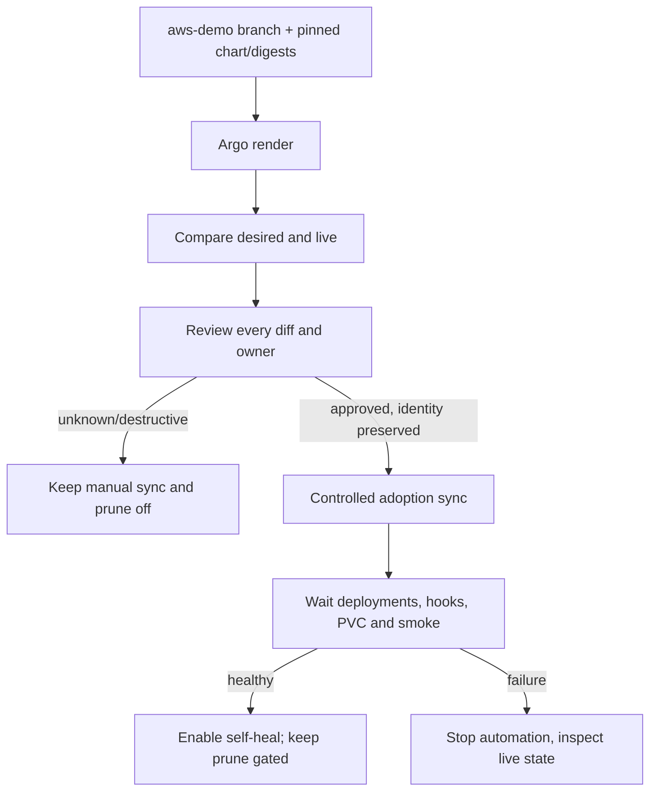

# CP16 — Adoption, tracking, drift và prune

## Bài toán thực tế của Lynk

CP15 đã chuyển Application sang branch `aws-demo`, nhưng chưa cho Argo ghi hoặc xóa workload. Preflight CP16 xác nhận Application đang dùng chart commit `87eb226…`, sync `OutOfSync`, health `Progressing`; Argo liệt kê 12 Service, Deployment, Ingress và Middleware đều `OutOfSync`. Ba Deployment dịch vụ vẫn ready 1/1 với đúng digest đang khai báo. Redis `lynk-redis` và Kafka `kafka`/PVC `data-kafka-0` đang tồn tại ngoài danh sách resources của Application. Helm release `lynk-services` đang deployed ở revision 6. Đây là ownership hỗn hợp: Helm quản lý phần lớn Lynk, Redis được tạo ngoài Helm, còn Argo hiện mới compare.

Mục tiêu là tiếp quản có kiểm soát: trước hết giải thích từng diff và tracking identity; bảo toàn resource names, PVC, Secret references và certificate storage; sau khi adoption health/smoke đạt mới cân nhắc self-heal. Prune là quyền xóa riêng và cần allowlist/historical review; nó không được bật chỉ vì auto-sync hoạt động.

## Kiến thức nền

Desired state là bản mô tả trong Git; live state là object Kubernetes đang tồn tại. Reconciliation so sánh hai trạng thái rồi có thể áp dụng thay đổi. Tracking annotation cho Argo biết object nào thuộc Application; nó không chứng minh spec giống Git, và label `app.kubernetes.io/instance` có thể do chart hoặc Helm đặt cho mục đích selector.

Adoption là lần đầu controller gắn ownership vào resource đang có. Drift là khác biệt giữa live spec/metadata và desired spec. Self-heal cho phép tự sửa drift sau adoption. Prune cho phép xóa resource đã được tracking khi nó biến mất khỏi desired state. Ba quyền này có hậu quả khác nhau: compare không sửa; sync áp object; self-heal lặp lại sync khi drift; prune xóa resource. Với database-backed workloads, `prune: false` là hàng rào độc lập cần giữ tới khi danh sách resource xóa được review.

Kubernetes PVC là yêu cầu lưu trữ; StatefulSet và PVC name/claim template quyết định Pod gắn lại volume nào. Đổi tên claim có thể tạo volume mới và để dữ liệu cũ tách rời. Vì vậy CP16 xác nhận UID, claim name, volumeName, StorageClass và mount paths trước mọi adoption. Secret values không được đọc; chỉ tên tham chiếu mới cần đối chiếu.

## Câu hỏi dẫn dắt

| Câu hỏi                                              | Trả lời cần có từ Lynk                                                                                                                                               |
| ---------------------------------------------------- | -------------------------------------------------------------------------------------------------------------------------------------------------------------------- |
| What sẽ được Argo track?                             | Chỉ resource trong rendered Application tree; Redis, Kafka và PVC ngoài tree vẫn do ownership hiện hữu quản lý cho đến checkpoint riêng.                             |
| Why phải đọc diff dù app đang Healthy?               | Health báo readiness, không chứng minh spec/ownership an toàn; `OutOfSync` của 12 resource cần giải thích trước khi reconcile.                                       |
| How nhận ra adoption an toàn?                        | UID/name giữ nguyên, diff chỉ là tracking metadata hoặc khác biệt đã duyệt, PVC/Secret refs không đổi, migration và smoke hooks có kết quả rõ ràng.                  |
| When bật self-heal?                                  | Sau adoption/sync, runtime health và public smoke xác nhận release đang phục vụ đúng digest.                                                                         |
| Who sở hữu từng resource?                            | Đối chiếu Helm release labels/annotations, Argo tracking annotation, Kubernetes managedFields và resource status; một object không được hai controller ghi cùng lúc. |
| What if một resource thiếu hoặc đổi tên trong chart? | Giữ prune off; dừng adoption tự động, sửa desired state hoặc phê duyệt xử lý resource cụ thể trước khi xóa.                                                          |

## Cơ chế hoạt động



Argo annotation tracking associates resource objects with `aws-demo`. Resource status and health are then aggregated at Application level. Automated sync changes who initiates reconciliation; self-heal controls reaction to live drift; prune controls deletions. No setting should be inferred from another.

## Các phương án và đánh đổi

Có thể dùng label tracking, annotation tracking hoặc annotation+label. CP12 đã chọn annotation tracking để không chiếm label có thể là selector. Đổi tracking method lúc adoption có thể khiến resource bị orphan hoặc nhận ownership khác; vì vậy CP16 giữ config hiện tại và xác minh từng annotation.

Một lần manual sync cho phép quan sát operation và dừng trước khi bật automation, nhưng vẫn có thể chạy PreSync migration Jobs và cập nhật live specs. Bật auto-sync ngay giảm thao tác nhưng nếu diff sai, controller liên tục áp sai desired state. Prune tiện dọn resource bỏ khỏi Git nhưng có thể xóa Service, ingress hoặc workload; PVC protection trong chart không thay thế việc kiểm tra prune set.

Chọn áp dụng theo giai đoạn: (1) review diff và owners; (2) sync/adopt có kiểm soát chỉ nếu identities và protected data pass; (3) xác nhận health/hooks/smoke; (4) bật self-heal; (5) prune chỉ cho resource allowlist sau khi dry-run/review. Nếu diff chưa giải thích được, checkpoint dừng ở compare-only.

## Kế hoạch trước implementation

1. Đọc lại profile/cluster identity, gate, Application spec/status/conditions, app resource tree, Argo tracking method, Helm release revision, deployments/pods/images, services/ingresses, Job/hooks, PVC UID/volume/mount, Redis/Kafka ownership metadata. Không đọc Secret data.
2. Render chính xác chart SHA `87eb226…` với `values-aws.yaml` và `values-aws-demo.yaml`; so sánh desired/live bằng Argo diff hoặc `kubectl diff`. Lập bảng từng object: desired/live identity, tracking annotation, manager, field diff, risk, owner.
3. Fail closed nếu diff thiếu giải thích, resource rename/replacement, image/spec changes ngoài mục đích, PVC/certificate path change, migration/smoke chưa kiểm chứng, PVC/shared-resource deletion, Argo ComparisonError, unhealthy workload hoặc source branch stale.
4. Giữ `automated` absent và `prune=false` trong lần review. Chỉ lập adoption plan cho các resource được duyệt; tách resource ngoài Application tree (Redis/Kafka/PVC) để không nhận ownership ngầm.
5. Nếu mọi precondition đạt: snapshot secret-free; server-side dry-run sync policy change; adoption theo từng resource set; quan sát operation và hooks; snapshot sau mỗi đợt; chạy readiness/public smoke và đối chiếu runtime image IDs.
6. Chỉ sau adoption health/smoke thành công mới mở self-heal. Prune phải có inventory cụ thể và kiểm tra `Delete=false`/PVC retention hoặc giữ prune tắt nếu không có deletion scope an toàn.
7. Chạy tests, Helm render/diff tests, Ansible syntax, CI. Delivery mode chỉ đổi theo checkpoint được định trước; CP16 không tạo image release.

**Tác động dự kiến:** Application policy và tracking metadata có thể đổi; một sync có thể chạy migration hooks và patch resource specs. PVC, database contents, domain, EIP, Redis/Kafka owners và digests phải giữ nguyên. **Recovery:** trước khi auto-sync bật, trở về manual policy qua Application spec patch; sau sync, policy revert chỉ ngăn reconcile tiếp, không rollback schema hoặc dữ liệu. Không xóa PVC/Secrets hoặc force-delete Job/resource.

**Tiêu chí đạt:** mọi diff có lời giải và owner; resource identity/PVC/Secret refs được giữ; adoption operation/smoke/health được quan sát; self-heal chỉ bật khi gates đạt; prune chỉ trong phạm vi được duyệt; snapshot chứng minh phần bảo vệ không đổi. Bài tập learner không chặn tiến độ.

## Implementation có giải thích

CP16 hoàn tất adoption ở chart revision `87eb22600c545ac6952d472739b0091f5bd84281`. Trước sync, Argo tree có 12 resource nền tảng đều `OutOfSync`, chưa có tracking annotation; Helm release `lynk-services` revision 6 còn deployed. `kubectl diff --server-side -n lynk-aws` cho thấy 12 Service/Deployment/Ingress/Middleware có spec khớp chart render; bốn khác biệt là ba PreSync migration Jobs và PostSync smoke Job chưa tồn tại. Không có thay đổi image, replica, CPU/RAM, routing, Service IP, PVC, Secret reference hay workload name trong diff được duyệt.

Lần sync đầu được gửi với revision cố định, hook strategy rõ ràng và `prune:false`. Ba migration hooks chạy thành công; Argo áp 12 resource hiện có, thêm tracking annotation và `kubectl.kubernetes.io/last-applied-configuration`. Deployment specs giữ nguyên nên Pods không bị thay. Tuy nhiên sync chờ mãi ở bốn Ingress: K3s Traefik để `status.loadBalancer` rỗng. Theo health check mặc định của Argo CD 3.5, Ingress chỉ Healthy khi status có IP hoặc hostname; điều kiện đó không phù hợp với Lynk, vốn đưa DNS/EIP trực tiếp tới Traefik. Task chờ 10 phút rồi dừng, còn operation Argo ở `Running`; mình không coi đây là thành công và không bật automation.

Điều chỉnh kế hoạch: thêm `resource.customizations.health.networking.k8s.io_Ingress` trong [argocd-cm.yaml](../../../infra/argocd/patches/argocd-cm.yaml). Script chỉ thay cách chấm health cho Ingress class `traefik`: yêu cầu có host, HTTP path và backend Service có tên; các class khác vẫn chờ địa chỉ LoadBalancer. Đây chỉ xác nhận cấu hình route, không tự chứng minh mạng hoạt động. Vì vậy PostSync readiness Job và một GET công khai vẫn là các bằng chứng riêng. Sau khi Argo nhận ConfigMap, operation đang chạy tiếp tục, đánh giá bốn Ingress Healthy, chạy PostSync smoke và kết thúc `Succeeded` mà không cần gửi sync thứ hai.

Phần quyết định của Lua script là giới hạn ngoại lệ theo ingress class:

```lua
if obj.spec.ingressClassName == "traefik" then
  -- require host rules, HTTP paths, and named Service backends
  hs.status = "Healthy"
  hs.message = "... verify reachability with smoke tests"
  return hs
end
```

Health rule trả trạng thái cấu hình cho Argo, không gửi request mạng. Không bỏ nhắc nhở về smoke và không gộp cấu hình hợp lệ với reachability.

Sau khi đạt health và smoke, Application bật `automated.selfHeal: true` và giữ `prune: false` trong [aws-demo-application.yaml](../../../gitops/aws-demo-application.yaml). Tự heal có thể sửa drift ngoài ý muốn; prune vẫn tắt vì chưa có allowlist xóa được review. Delivery gate GitHub vẫn `paused`. Helm labels/release metadata còn trên resource; legacy Helm release không được chạy lại để ghi các object này. Redis, Kafka và PVC tiếp tục nằm ngoài Application tree.

`argocd-status.sh` trên host khác checksum với bản trong repository và báo không thấy revision dù Application đã Synced. Mình thay helper bằng bản đã kiểm tra trong repo (nó chỉ đọc trạng thái, digest và Job); lần xác minh sau đó pass. Helper có phiên bản riêng và cần được đối chiếu như artifact, không nên lấy lỗi của bản cũ làm kết luận về release.

Các lần đọc dùng profile `ngqkhai-dev` và SSM Run Command; output chỉ gồm Application status/spec, release metadata, image refs, resource identities và Secret reference names. Secret data không được truy vấn. Một adhoc probe ban đầu thiếu `KUBECONFIG` cho Helm và không hoàn tất; không có mutation. Các lệnh thành công truyền rõ `KUBECONFIG=/etc/rancher/k3s/k3s.yaml`.

## Verification, troubleshooting và recovery

**Kết quả thực tế:** Application `Synced` và `Healthy` tại revision `87eb226…`; sync operation `Succeeded`. Ba PreSync migration Jobs và PostSync smoke Job đều `succeeded=1`; runtime verifier xác nhận release SHA `b6cc75a…` cùng ba digest đúng. Readiness nội bộ trả 200 cho cả ba service và public `GET https://lynk.codes/health/ready` trả HTTP 200. Snapshot comparator xác nhận Deployment/StatefulSet/Service/Ingress/PVC, các Pod cũ và Job Kafka giữ identity/runtime; chỉ bốn Job hooks đã review được thêm. Migration ledger sau hook vẫn khớp các file migration đã pin. Chính sách cuối cùng là `selfHeal=true`, `prune=false`; không có deletion.

**Triệu chứng và khắc phục:** task chờ operation hết 10 phút dù Argo đã `Synced`; message nói chờ Ingress Healthy. Bốn Ingress có class `traefik`, rule/backend hợp lệ, nhưng `status.loadBalancer.ingress` rỗng. Tài liệu Argo CD 3.5 xác nhận check mặc định đòi IP/hostname. Áp custom check có giới hạn theo class Traefik giúp operation đang chạy tiếp tục và PostSync hook hoàn tất. Nếu custom script lỗi cú pháp hoặc smoke fail, giữ manual/no-prune, đọc Application operation và controller logs; đừng bật self-heal. Rollback chính sách Application không khôi phục dữ liệu migration hoặc volume đã xóa.

**Lỗi kiểm chứng đã sửa:** test comparator ban đầu được gọi qua `unittest discover` nhưng tên file không khớp import; đổi module sang `compare_aws_demo_adoption.py`, thêm path import và xác nhận 5 test pass. Một Ansible assert dùng `.items` đụng method `dict.items`; chuyển sang truy cập `['items']`, rồi playbook pass. Helper trên EC2 dùng checksum cũ và báo revision mismatch; cài đúng helper trong repo rồi xác minh lại thành công.

## Tự học

**Dự đoán:** Một object có `app.kubernetes.io/instance=aws-demo` nhưng thiếu tracking annotation thì đã thuộc Argo chưa? Nếu Argo `Healthy` nhưng mọi resource `OutOfSync`, có nên bật self-heal? Prune off bảo vệ được điều gì và không bảo vệ được điều gì?

**Bài read-only:** đối chiếu một Deployment desired/live image, replicas, resource requests, Secret reference names, tracking annotation và managedFields; đọc PVC UID/volumeName. Không chạy sync hoặc thay metadata.

Phần thực hành cá nhân chờ bạn hoàn thành.

<details>
<summary>Lời giải</summary>

Với annotation tracking, label một mình không đủ để xác nhận ownership; xem Argo resource tree/tracking annotation. `Healthy` mô tả runtime health, không xóa `OutOfSync`; diff phải được hiểu trước self-heal. Prune off ngăn Argo xóa resources khỏi desired tree, nhưng không ngăn một sync patch spec, migration thay schema, hoặc operator xóa thủ công.

</details>

## Nguồn chính thức

- [Argo CD v3.5 resource health](https://argo-cd.readthedocs.io/en/release-3.5/operator-manual/health/) — điều kiện built-in cho Ingress và cấu hình health check tùy chỉnh bằng Lua trong `argocd-cm`.
- [Argo CD resource tracking](https://argo-cd.readthedocs.io/en/release-3.5/user-guide/resource_tracking/) — annotation/label identity và ownership.
- [Argo CD automated sync](https://argo-cd.readthedocs.io/en/release-3.5/user-guide/auto_sync/) — self-heal, prune và automated sync semantics.
- [Argo CD diff customization](https://argo-cd.readthedocs.io/en/release-3.5/user-guide/diffing/) — phân biệt live/desired fields và diff normalization.
- [Kubernetes Persistent Volumes](https://kubernetes.io/docs/concepts/storage/persistent-volumes/) — PVC/PV lifecycle và claim identity.
