# CP17 — Release evidence, recovery and capacity

## Bài toán thực tế của Lynk

CP16 đã chuyển Application `aws-demo` sang annotation tracking và self-heal, giữ prune tắt. CP17 phải chứng minh một source revision đi hết đường CI → image digests → release artifact → promotion sang branch `aws-demo` → Argo sync → runtime verification. GitHub `LYNK_DEPLOY_MODE` hiện đang `paused`; trạng thái thực tế cần đọc lại ngay trước mỗi lần đổi gate. Mục tiêu là phát hành có kiểm soát, truy được source SHA tới image đang chạy, biết giới hạn capacity của node `t3.medium`, và có quy trình rollback không giả định migration schema có thể đảo ngược.

Một lần chạy YAML hợp lệ không phải bằng chứng deployment. Bằng chứng cần nối commit, release manifest, digest, promotion commit, Argo operation/revision, Pod image IDs và smoke result. Nếu một mắt xích thiếu, trạng thái phát hành phải là chưa được xác minh.

## Kiến thức nền

Một **release** là bộ image bất biến được nhận diện bằng digest và đi kèm metadata source SHA. **Promotion** cập nhật desired state của môi trường để trỏ tới digest đó. **Deployment** là lúc controller biến desired state thành workload runtime. Các bước có thể thành công/thất bại độc lập, nên phải ghi riêng `source SHA`, `release SHA`, `aws-demo` Git revision và runtime digest.

Kubernetes rolling update có thể cần Pod tạm thời vượt số replica desired. Requests tham gia scheduler quyết định Pod mới có thể đặt lên node hay không; limits giới hạn mức tiêu thụ nhưng không tạo thêm capacity. `kubectl top` là ảnh chụp usage hiện tại, còn requests/allocatable cho biết scheduler budget. Cần dùng cả hai: usage thấp không đồng nghĩa requests còn đủ.

**Rollback ứng dụng** đưa chart/image về revision trước. Nó không tự đảo schema database, khôi phục dữ liệu bị xóa hay trả certificate đã rotate về trạng thái cũ. Vì vậy migration phải backward-compatible hoặc có đường forward-fix; dữ liệu cần backup/restore riêng. CP17 chỉ cho phép restore local khi kiểm thử recovery, không inject lỗi vào production.

## Câu hỏi dẫn dắt

| Câu hỏi                                             | Cách trả lời cho Lynk                                                                                                              |
| --------------------------------------------------- | ---------------------------------------------------------------------------------------------------------------------------------- |
| What chứng minh đúng release đang chạy?             | Source SHA, release manifest, ba digest, promotion revision, Argo operation và Pod `imageID` phải khớp.                            |
| Why phải đo requests lẫn usage?                     | Usage là tải tại thời điểm đo; requests/allocatable quyết định Pod surge có được schedule không.                                   |
| How biết autosync an toàn?                          | Application Synced/Healthy, PostSync smoke đạt, protected resource identities giữ nguyên và capacity còn đủ cho rollout tiếp theo. |
| When được đổi deployment gate?                      | Sau preflight fresh, review source diff, capacity, recovery và đã xác nhận branch/CI đúng.                                         |
| Who được phép promote?                              | Main workflow với `GITHUB_TOKEN`, concurrency group và `aws-demo` environment reviewers; node status role chỉ đọc.                 |
| What if release cũ hơn main hoặc promotion bị race? | `promotion_guard.py` phải từ chối; không force push, không tiếp tục chờ một revision sai.                                          |
| What if Argo health pass nhưng smoke fail?          | Giữ deployment job đỏ, dừng promotion tiếp theo và phục hồi desired values có kiểm soát; không báo thành công.                     |

## Cơ chế hoạt động

```mermaid
flowchart LR
  Main[main source SHA] --> CI[quality checks]
  CI --> Build[images tagged by SHA]
  Build --> Digest[release manifest with digests]
  Digest --> Guard[reject stale source / serialize]
  Guard --> Promote[one-file aws-demo promotion]
  Promote --> Argo[Argo sync and hooks]
  Argo --> Status[SSM read-only status]
  Status --> Smoke[PostSync + public acceptance]
  Smoke --> Evidence[SHA, revision, digest, health]
```

Image publication runs only for changes classified as image inputs. Package, promotion and deployment have separate dependencies and gates. In `argocd` mode, legacy SSM deployment remains disabled; the promotion workflow updates only `values-aws-demo.yaml`, then requests status using the least-privilege read role. Argo self-heal reconciles the promoted values; `prune:false` remains a separate deletion guard.

## Các phương án và đánh đổi

Có thể triển khai trực tiếp bằng Helm/SSM hoặc dùng CI promotion + Argo. CP17 kiểm chứng con đường Argo đã dựng ở CP13–CP16; bật `argocd` mode đồng thời giữ đường SSM deploy legacy đóng. Mỗi source commit trên main có thể build ba image và tạo release artifact, tăng thời gian CI và tạo immutable package nhưng giúp truy vết.

Capacity gate dùng requests/allocatable, usage thực, node conditions, free disk và memory/CPU budgets của surge. Nếu không đủ, không tự nâng instance, không bật Unlimited, không thêm HA; giữ delivery paused và trình bày phép tính cùng lựa chọn trong phạm vi đã duyệt. `selfHeal` có thể khôi phục drift nhưng không tự biết thao tác người vận hành có chủ đích; prune vẫn tắt.

Rollback chọn digest/chart revision trước và chạy smoke sau phục hồi. Nó chỉ khôi phục workload manifests/images. Nếu migration không tương thích ngược, rollback image có thể làm ứng dụng cũ không đọc được schema mới; khi đó phải forward-fix hoặc restore data theo runbook riêng.

## Kế hoạch trước implementation

1. Đọc lại main, `aws-demo`, CI result, `LYNK_DEPLOY_MODE`, reviewer/branch gate, Argo Application state và operation; không dựa vào CP16 snapshot cũ. **Thực tế 2026-10-16:** main là `b7f6e7c`; lần CI gần nhất thành công; gate còn `paused`; environment `aws-demo` chỉ cho branch có policy và yêu cầu reviewer `ngqkhai`.
2. Đọc node instance/type/credit mode, Ready conditions, allocatable, requests/limits hiện tại, `kubectl top` usage, free disk, Pod readiness, PVC state và public readiness. Tính requests của rollout surge theo Deployment strategy và giữ headroom cho K3s/Argo/system Pods. **Đo lúc 2026-10-16T19:16:17Z:** một node `t3.medium`, 2 CPU, 3,924,200 Ki allocatable memory; usage 500m CPU (25%) và 2,281 Mi memory (59%); disk còn 21,334,488 Ki; K3s active; `data-kafka-0` Bound; không có pressure trong node snapshot. Tổng requests node 1100m CPU/1452 Mi memory, limits 4 CPU/2538 Mi. Ba app Deployment dùng `maxSurge: 0, maxUnavailable: 1`; Redis cho phép 25% surge (một Pod 50m/64Mi request). Đây là snapshot, không phải SLO/capacity guarantee.
3. Xem source diff, release classifier, image build/publish conditions, workflow concurrency, promotion stale guard, post-promotion status waiter, public smoke và rollback tests. Xác định một thay đổi source có ích để tạo release; không tạo commit giả chỉ để kích workflow. Branch `aws-demo` ghim chart ở `87eb226`, còn promotion chỉ sửa một values file; vì vậy release SHA được đóng vào image ở build-time thay vì thay chart hoặc nới giới hạn promotion.
4. Fail closed nếu resource pressure/failed scheduling, app drift, migration hash mismatch, public smoke lỗi, gate/reviewer khác dự kiến, source stale, CI đỏ hoặc capacity không đủ. Lần đo public GET trả HTTP 200; Argo Synced/Healthy, smoke Succeeded, runtime digest hiện tại khớp; EC2 chạy `t3.medium` với credit mode `standard`.
5. Sau khi preflight đạt: tạo source change nhỏ nhưng có giá trị, chạy tất cả checks; chỉ khi CI branch xanh mới bật `LYNK_DEPLOY_MODE=argocd` rồi tích hợp main. Quan sát release SHA/digests, promotion commit, Argo revision, PostSync Job, Pod imageIDs và smoke. Không gửi lệnh deploy riêng lên node.
6. Kiểm thử race/timeout/rollback guards bằng unit tests và local fixtures. Không fault-inject production; rollback được chứng minh bằng local chart/state fixture hoặc documented previous digest path.
7. Ghi bằng chứng secret-free. Nếu release không đạt health/smoke, giữ workflow fail, giữ prune off và để promotion guard/recovery xử lý đúng revision; không giả lập success.

**Sai lệch khi thực hiện:** main run `38954573353` đã qua stale-source/allowlist guard nhưng promotion script từ chối values path. Workflow chạy từ detached worktree `/tmp/lynk-aws-demo`, trong khi script mặc định so đường dẫn với root của checkout main; khác biệt root làm path hợp lệ bị coi là sai. Lệnh dừng trước `git add`/commit/push. Kiểm tra remote xác nhận `aws-demo` vẫn ở `87eb226` và main vẫn ở source SHA của run. Sửa bằng `--repository-root`, giữ nguyên allowlist tương đối trong checkout, và thêm test subprocess chạy script trên một checkout riêng cùng test từ chối path ngoài allowlist.

**Tác động dự kiến:** source workflow có thể publish image digests và cập nhật một values file trên `aws-demo`; Argo có thể rollout Pod và chạy hook migration/smoke. Mỗi image runner nhận `RELEASE_SHA` qua Docker build argument; startup log có trường Pino `releaseSha`, và status checker sẽ yêu cầu log, image digest, Argo revision và PostSync smoke cùng khớp. Domain, EIP, database ownership, Redis/Kafka, PVC, Secrets và target `t3.medium` phải giữ nguyên. **Recovery:** nếu rollout lỗi, promotion workflow giữ job thất bại; desired values chỉ phục hồi khi source/deployment heads còn đúng cặp đã kiểm tra. Rollback image không đảo schema/data và không tự restore volume.

**Tiêu chí đạt:** release được truy từ source tới Pod; Argo Synced/Healthy; migration/smoke/runtime/public checks pass; identity của PVC/service/domain/EIP giữ; capacity/headroom được đo; race/timeout/rollback tests pass; legacy SSM path không chạy. Bài tập cá nhân không chặn tiến độ.

## Implementation có giải thích

`RELEASE_SHA` là metadata từ `github.sha`, không phải secret. Buildx truyền giá trị đó vào mỗi runner image; Dockerfile có `ARG RELEASE_SHA=local` để local build vẫn chạy, rồi lưu thành `ENV RELEASE_SHA`. Zod chấp nhận `local` hoặc đúng 40 ký tự hex nhưng từ chối `local` khi `NODE_ENV=production`, nên image thiếu build metadata dừng lúc khởi động. Startup event của Pino ghi `{ releaseSha }`; status checker lấy các log mới nhất và yêu cầu tìm thấy SHA mong đợi. Đồng thời nó đối chiếu `imageID` của Pod với digest và đọc Argo revision/smoke. Không cần đổi chart đã pin `87eb226` hay mở rộng promotion khỏi một values file. `promote_release.py --repository-root` xác định checkout chứa values; script vẫn chỉ nhận đúng đường dẫn allowlist bên trong checkout đó.

Branch CI đã xanh trước khi đổi gate. Main run `38954573353` đã build và publish ba image, đóng gói manifest cho source SHA `5615b583d72f95dcccf04ff05709c48cc11eab3b`, rồi xác minh anonymous pull thành công. Digest URL/redirect/auth lần lượt là `sha256:432a8494036a1727505153754d3f63ce082c30c527e9f4d873b14ccba400f159`, `sha256:07932cff5538a5ff41e3f8ad2a4e72eae40ae606c9e199f707bd185a4de3570c` và `sha256:488580b8e2200bb417c73068288b4560600e2301d2899872767610882c9c6abd`; checksum release archive là `5819f07c3389517bf6f455ff7c5782f07b66f0d3fe367d2ec713ca5bdb28215e`. Promotion job đã fail an toàn tại kiểm tra path, trước khi thay đổi branch `aws-demo`; remote vẫn ở chart revision `87eb226`. Bản sửa thêm root rõ ràng cho worktree và regression test; lần release mới phải build lại image từ commit source mới. Machine-readable history nằm trong `evidence/cp17-release.json`.

## Verification, troubleshooting và recovery

CI xanh, image digests và anonymous pulls chứng minh package được tạo, không chứng minh workload đã đổi. Promotion attempt đầu fail trước mọi write do path root mismatch; status checker chưa chạy cho source SHA mới. Sửa đã có unit test cho detached worktree và path allowlist. Lần chạy mới phải pass branch/main CI và lại chờ required reviewer; sau khi duyệt, workflow phải xác nhận Argo revision, imageIDs, startup `releaseSha`, PostSync smoke cùng public readiness mới được ghi deployed. Nếu rollout hoặc checker fail, workflow giữ trạng thái fail và chỉ tự revert desired values khi cả hai branch head vẫn khớp đúng release; rollback đó không đảo migration/data.

## Tự học

**Dự đoán:** `kubectl top node` báo CPU thấp nhưng tổng requests gần hết allocatable; Pod surge có schedule được không? Argo `Healthy` nhưng release SHA trong status khác CI commit thì có thể kết luận gì? Rollback chart có đảo DDL đã chạy không?

**Bài read-only:** từ CP17 evidence tính tổng requests và surge headroom; lần theo một digest từ artifact qua values tới Pod `imageID`; đọc workflow failure guard nhưng không dispatch/deploy.

Phần thực hành cá nhân chờ bạn hoàn thành.

Lời giải

Scheduler dựa requests, nên usage thấp không đảm bảo surge schedule được. SHA không khớp nghĩa là release chain chưa được chứng minh hoặc đang quan sát revision khác; không gọi là deploy thành công. Helm/Argo rollback đổi workload state, không tự rollback schema/database.

## Nguồn chính thức

- [Kubernetes resource management](https://kubernetes.io/docs/concepts/configuration/manage-resources-containers/) — requests, limits và scheduling.
- [Kubernetes Deployments](https://kubernetes.io/docs/concepts/workloads/controllers/deployment/) — rolling updates và surge/unavailable.
- [Argo CD automated sync](https://argo-cd.readthedocs.io/en/release-3.5/user-guide/auto_sync/) — reconcile, self-heal và prune semantics.
- [GitHub Actions concurrency](https://docs.github.com/en/actions/using-jobs/using-concurrency) — serialize promotion work.
- [GitHub deployment environments](https://docs.github.com/en/actions/deployment/targeting-different-environments/using-environments-for-deployment) — reviewers and branch rules.
