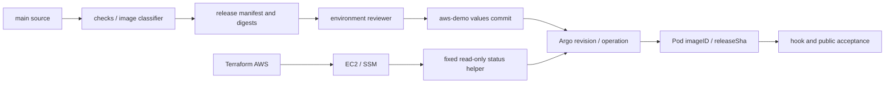

# CP18 — Vận hành bằng chuỗi bằng chứng

## Bài toán thực tế của Lynk

CP17 đã phát hành source `9673a0e` qua run `38981715213`, promotion `032e64a`, Argo và public smoke. Nhưng README và runbook cũ vẫn mô tả CloudFormation, SSM/Helm deploy và việc chờ phát hành đầu tiên. Làm theo chúng có thể gọi lại bên quản lý cũ. CP18 cần một lối đọc hiện trạng thống nhất, chỉ ra ai được thay đổi thành phần nào và giúp người học chọn phép kiểm tra phân biệt nguyên nhân lỗi.

Kết quả mong muốn là truy được release tới Pod/logs, đọc đúng plan/CI/Argo diff và biết giới hạn phục hồi. Hoàn tất tài liệu không chứng minh người học đã tự vận hành. Các bài thực hành dưới đây **chờ bạn hoàn thành**, không chặn bàn giao implementation.

## Kiến thức nền

**Desired state** là cấu hình mong muốn trong Git; **observed state** là điều API/runtime vừa báo; **evidence** là bản ghi có thời điểm, phạm vi và nguồn đủ để hỗ trợ một kết luận. Một kết luận chỉ đúng trong phạm vi phép đo: `Healthy` của Application không kiểm chứng database ownership, mọi dependency hay trải nghiệm public.

Source SHA nhận diện code và build inputs; digest nhận diện nội dung image; promotion revision nhận diện desired values của môi trường. Chúng không cần giống nhau. Docs-only commit có thể làm `main` tiến trong khi release đang chạy vẫn là source cũ. Chart pin lại cố định templates: branch `aws-demo` bắt đầu từ `87eb226`, promotion hiện chỉ sửa values, nên sửa chart trên main không tự triển khai chart mới.

Một tín hiệu thuận lợi không thay thế chuỗi bằng chứng. `Result=success` của systemd với timestamp rỗng có thể là trạng thái mặc định chưa chạy. `helm list` còn release Lynk lịch sử không có nghĩa Helm CLI là bên ghi hiện hành. IAM simulator kiểm tra một mô hình quyền; kết quả phải được đối chiếu với policy và operation thực tế, không tự nới quyền để làm mô phỏng xanh.

## Câu hỏi dẫn dắt

| Câu hỏi                                                  | Ví dụ của Lynk                                                                                                                 |
| -------------------------------------------------------- | ------------------------------------------------------------------------------------------------------------------------------ |
| What cần kiểm tra khi người dùng báo redirect lỗi?       | DNS/TLS/HTTP trước, rồi ingress, service endpoints, Pod và dependency; ghi code, timestamp và request ID không chứa token.     |
| Why CI xanh chưa đủ?                                     | Unit tests trước CP17 không thực thi shell trong worktree thiếu scripts; deployment thực dừng dù quality checks đạt.           |
| How truy release?                                        | Nối source → manifest/digests → promotion → Argo revision/operation → từng Pod imageID/startup releaseSha → smoke.             |
| When dùng Argo diff?                                     | Trước thay desired state hoặc khi thấy OutOfSync; xác định đúng branch/chart/value và phạm vi tracking trước khi sync.         |
| Who sở hữu dữ liệu?                                      | URL dùng lynk_urls; redirect dùng lynk_redirects; auth dùng lynk_auth. Không đọc chéo database để sửa triệu chứng replication. |
| What if GitOps branch hoặc main tiến trong lúc rollback? | Guard từ chối revert tự động; operator đọc diff mới và hòa giải có chủ đích, không force push.                                 |
| What if timer active nhưng chưa có backup mới?           | Đối chiếu giờ UTC, LastTrigger, service exit timestamp, journal và manifest mới; không suy ra thành công từ ActiveState.       |

## Cơ chế hoạt động



CI có quyền ghi values bằng GITHUB_TOKEN sau reviewer gate, không có quyền Helm deploy qua role legacy nữa. Role status chỉ chạy document cố định trên một instance. Bootstrap qua SSM là quyền quản trị host riêng. Argo self-heal chỉ áp dụng resources được tracking trong Application; Kafka/Redis/PVC và Traefik không nằm trong cây Application này. Prune vẫn false; đây là giới hạn quản lý được giữ có chủ đích, không phải chứng minh adoption toàn bộ nền tảng.

## Các phương án và đánh đổi

Một runbook chỉ chứa lệnh nhanh giúp thao tác nhưng dễ che sai assumption. CP18 dùng bảng ownership và cây chẩn đoán ngắn, liên kết tới bài CP chuyên sâu; người vận hành vẫn phải đọc timestamp trước quyết định. Evidence JSON giúp đối chiếu tự động, nhưng snapshot sẽ cũ và không thay monitoring liên tục.

Có thể dùng dashboard tổng hợp, nhưng chưa có nhu cầu đo được để thêm stack mới trên node 4 GiB. Dùng API/CLI hiện có giữ chi phí và phạm vi nhỏ; đổi lại cần nối nhiều nguồn thủ công. Không tăng máy, bật Unlimited hoặc HA để giải quyết giới hạn tài liệu.

## Kế hoạch trước implementation

Kế hoạch này được ghi sau preflight và trước sửa runbook/README/evidence CP18.

1. **Vấn đề/phạm vi:** sửa các chỉ dẫn current-state lỗi thời ở README, `docs/runbook/aws-cicd.md` và phần đầu `aws-deployment.md`; giữ lịch sử có nhãn. Tạo bài CP18 này cùng `evidence/cp18-operations.json`; không viết lại CP01–CP03.
2. **Dependencies/preflight:** dùng acceptance CP17 và đọc lại phiên bản, Application tree, tracking, Helm metadata, SSM port-forward, backup timers và S3 metadata. Snapshot `2026-10-16T23:44:12Z` cho Argo Synced/Healthy ở `032e64a`, selfHeal true/prune false; không dùng nó làm cam kết tương lai. CP17 branch CI xanh trước khi fast-forward main `bd886d6`.
3. **Tác động:** chỉ tài liệu và evidence đã lọc; không apply, sync, restart, backup/restore production hay thay gate/IAM. Giữ `.gitignore` và `.agents/` ngoài commit.
4. **Thực hiện:** lập ownership/version/limits; mô tả đường release và recovery hiện hành; bổ sung bài đọc plan/CI/diff và trace tới Pod/logs; đánh dấu bài cá nhân pending. Đối chiếu command với file thật, không đưa secrets vào ví dụ.
5. **Tiêu chí đạt:** liên kết local tồn tại, JSON parse được, formatter đạt, classifier docs-only false; lint/tests bắt buộc và branch CI đạt; trước push main đọc lại gate và heads, tích hợp không PR, main CI không publish/promote docs-only. Kiểm tra public readiness và Argo revision cuối, không chỉ dựa vào CI.
6. **Phục hồi:** revert commit tài liệu nếu hướng dẫn sai. Điều này không khôi phục AWS, schema, certificate hay dữ liệu. Nếu thấy runtime lỗi, dừng kết luận và dùng runbook lớp tương ứng; CP18 không tự mở rộng phạm vi sửa hệ thống.

## Implementation có giải thích

[CI/CD operations](../aws-cicd.md) nay mô tả đường GitOps đang hoạt động, giới hạn reviewer/concurrency/stale guard và những gì rollback không khôi phục. [AWS deployment](../aws-deployment.md) có current ownership ở đầu, phần cũ được giữ như execution history. README dẫn tới đây để người đọc không nhầm mô tả bootstrap với đường phát hành hiện tại.

[Evidence CP18](evidence/cp18-operations.json) tách observed metadata khỏi configured pins và acceptance CP17. K3s `v1.37.1+k3s1`, Helm `v3.21.2`, AWS CLI `2.31.18`, Argo `v3.5.5`, Traefik chart `41.5.0` được đối chiếu live; Terraform `1.16.6`/AWS provider `6.69.1` là pin repository đã dùng tại CP17. Không suy ra database server version từ CLI hoặc migration cũ.

Backup dùng S3 SSE-S3 AES256 và chặn public access; đây không phải mã hóa client-side. Timer theo UTC 02:00/02:15/02:30 cho URL/redirect/auth, giữ tối đa bảy bản thành công từng database và chỉ prune sau backup thành công. Lúc snapshot mới có 2/1/1 manifests; cả ba LastTrigger rỗng. CP11 có bằng chứng backup thủ công/restore local; CP18 chỉ đọc metadata, không kiểm chứng lại restore hay tuyên bố lịch hằng ngày đã chạy thành công.

## Verification, troubleshooting và recovery

| Triệu chứng                                    | Bằng chứng phân biệt nguyên nhân                                                      | Giới hạn và hành động                                                                                                                              |
| ---------------------------------------------- | ------------------------------------------------------------------------------------- | -------------------------------------------------------------------------------------------------------------------------------------------------- |
| CI quality xanh nhưng promotion đỏ             | Step log, source SHA, worktree root, remote aws-demo head                             | Candidate commit local chưa chứng minh push; không rerun source cũ để lấy code sửa.                                                                |
| Argo còn revision trước                        | exact requested revision và operation state                                           | Pending có thể là reconcile chưa tới; helper chờ tối đa 840s, không coi timeout SSM là polling.                                                    |
| Synced/Healthy nhưng public lỗi                | DNS/TLS, HTTP route, endpoints, Pod logs, auth/dependency                             | Application health không bao trùm Kafka/Redis hay functional auth.                                                                                 |
| Job smoke đã mất                               | exact Argo operation revision, hook phase và image digest                             | TTL xóa Job không xóa kết quả đã lưu; history này không chứng minh release khác.                                                                   |
| IAM simulator phủ nhận operation đã thành công | role/document/resource, live inline policy, principal simulation và custom simulation | CP17 ghi discrepancy Organizations; custom chỉ cô lập identity policy, không chứng minh trust/SCP/effective access tổng thể. Không tự mở rộng IAM. |
| Timer active, Result success, thiếu timestamp  | LastTrigger, ExecMainExitTimestamp, journal và manifest mới                           | Chưa đủ bằng chứng đã chạy; chờ lần lịch đầu, kiểm tra thất bại trước prune/retention.                                                             |

Acceptance runtime chi tiết nằm ở [CP17](cp17-release-evidence-and-capacity.md) và các JSON liên quan: run thành công, status helper thực sự chờ khoảng 115s, digest/identity/public smoke đạt, legacy writer đã bị deny. Snapshot RAM 2429Mi (63%) và CPU 738m (36%) chỉ là điểm đo, không phải benchmark hay bảo đảm headroom dưới tải.

Kiểm tra local CP18: lint đạt; npm test có 31 tests đạt và 14 integration tests bỏ qua vì chưa cấu hình dependency local. CI sẽ chạy integration/E2E với dependencies riêng trước khi tích hợp. JSON parse, docs-only classifier và liên kết mới/cập nhật đạt. Link README → LICENSE đã thiếu từ trước, được ghi nhận ngoài phạm vi CP18; không thêm giấy phép khi chưa có quyết định của chủ dự án. Không coi lượt local này là bằng chứng integration đầy đủ.

Quy trình recovery ưu tiên desired values có guard, kiểm chứng lại revision/digest/health/smoke; rollback values không đảo migration hay phục hồi records. Nếu tự động revert vì status fail, workflow vẫn thất bại và operator phải kiểm tra hội tụ sau revert. Không dùng Helm rollback cho app đã thuộc Argo. Dữ liệu phục hồi theo CP11, certificate theo CP10; cả hai cần phạm vi bảo trì riêng, không chạy production restore để thử bài học.

## Tự học — chờ bạn hoàn thành

Các lệnh kubectl sau là **read-only**, chạy trong phiên SSM đã xác thực trên node với kubeconfig root hiện có. Không xuất kubeconfig hoặc logs thô ra Git. Argo CLI cần đăng nhập qua tunnel riêng; không mở public endpoint.

### Đọc một plan và quyền sở hữu

Dự đoán: plan có `0 add, 1 change, 0 destroy` có đủ để approve không? Đọc `git show bd886d6 -- infra/terraform/environments/aws-demo/iam.tf` và [bằng chứng retirement](evidence/cp17-iam-retirement.json). Tìm resource address, role, before/after policy và điều không thay đổi. Không đọc/upload Terraform state đầy đủ.

<details>
<summary>Lời giải và kết quả cần quan sát</summary>

Chưa đủ: một change có thể phá quyền hoặc dữ liệu. CP17 chỉ đổi inline policy `aws_iam_role_policy.deploy` trên `lynk-github-deploy` thành explicit Deny; không đổi status/bootstrap, instance hay disk. Plan toàn phần sau apply không còn thay đổi. Principal simulator discrepancy vẫn cần được ghi riêng; không xóa bằng chứng không thuận lợi.

</details>

### Đọc CI và Argo diff

```bash
gh run view 38981715213 --json headSha,status,conclusion
git show 032e64a:infra/k8s/helm/lynk-services/values-aws-demo.yaml
# Chỉ trong phiên Argo CLI đã xác thực qua tunnel riêng:
argocd app diff aws-demo
```

Dự đoán: nếu main chỉ thêm bài học, runtime source SHA có đổi không? Xem image-inputs, publish, package và promote của run docs-only. Diff exit 1 có thể chỉ có khác biệt; đọc output trước khi kết luận CLI lỗi. Không sync như một phần bài tập.

<details>
<summary>Lời giải và kết quả cần quan sát</summary>

Source của release đã chấp nhận là `9673a0e`; desired revision `032e64a`; chart pin `87eb226`. Main docs-only tiến không build/publish/promote, nên không cần đổi release đang chạy. Argo diff phải đọc với target branch aws-demo và values đúng. Diff rỗng chỉ nói tài nguyên được Argo so sánh không khác; không nói mọi dependency ngoài Application đều khỏe.

</details>

### Truy release tới Pod và logs

```bash
sudo /usr/local/bin/kubectl --kubeconfig=/etc/rancher/k3s/k3s.yaml -n argocd get application aws-demo -o jsonpath='{.status.sync.revision}{"\n"}{.status.health.status}{"\n"}'
sudo /usr/local/bin/kubectl --kubeconfig=/etc/rancher/k3s/k3s.yaml -n lynk-aws get pods -l app=url-service -o jsonpath='{range .items[*]}{.metadata.name}{" "}{.status.containerStatuses[0].imageID}{"\n"}{end}'
# Thay POD bằng tên vừa đọc; chỉ in trường releaseSha đã parse từ JSON log:
sudo /usr/local/bin/kubectl --kubeconfig=/etc/rancher/k3s/k3s.yaml -n lynk-aws logs POD -c url-service --tail=100 | python3 -c 'import sys,json
for line in sys.stdin:
    try: row=json.loads(line)
    except ValueError: continue
    if isinstance(row,dict) and "releaseSha" in row: print(row["releaseSha"])'
```

So digest với manifest CP17 và lặp cho redirect/auth. Startup log có thể không còn trong tail=100 sau traffic dài; thiếu log cần mở rộng khoảng đọc có kiểm soát, không suy đoán code sai. Trước khi đọc logs, dự đoán digest và releaseSha nào phải xuất hiện.

<details>
<summary>Lời giải và kết quả cần quan sát</summary>

Mỗi Pod Ready phải có imageID tương ứng digest trong manifest source `9673a0e`. Startup releaseSha là source đó, không phải promotion SHA. Nếu digest sai, xem Deployment desired image và observed generation; nếu SHA log sai, kiểm tra build provenance. Không sao chép token, headers, connection strings vào báo cáo.

</details>

### Kiểm tra lần backup tự động đầu tiên

Sau giờ UTC đã định, đọc `systemctl show lynk-db-backup-url.timer -p LastTriggerUSec -p NextElapseUSecRealtime`, `systemctl show lynk-db-backup@url.service -p Result -p ExecMainExitTimestamp` và manifest mới trong prefix URL bằng quyền read-only. Làm tương tự redirect/auth. Dự đoán vì sao active timer cùng Result success chưa đủ.

<details>
<summary>Lời giải và kết quả cần quan sát</summary>

Cần LastTrigger và exit timestamp khớp lần lịch mới, service success, manifest/checksum của bản mới; số lượng tối đa bảy chỉ đánh giá sau đủ số lần thành công. CP18 snapshot chưa có lần tự động đầu tiên; bài này vẫn pending. RPO mục tiêu khoảng một ngày phụ thuộc lịch thực sự thành công; không có RTO production đã đo từ restore local.

</details>

## Nguồn chính thức

- [GitHub: viewing workflow history](https://docs.github.com/en/actions/how-tos/monitoring-and-troubleshooting-workflows/monitoring-workflows/viewing-workflow-run-history), [rerun giữ SHA/ref](https://docs.github.com/en/actions/how-tos/manage-workflow-runs/re-run-workflows-and-jobs?tool=cli).
- [Argo CD 3.5 core concepts](https://argo-cd.readthedocs.io/en/release-3.5/core_concepts/), [diffing](https://argo-cd.readthedocs.io/en/release-3.5/user-guide/diffing/), [self-heal và prune](https://argo-cd.readthedocs.io/en/release-3.5/user-guide/auto_sync/).
- [kubectl logs](https://kubernetes.io/docs/reference/kubectl/generated/kubectl_logs/), [Kubernetes logging](https://kubernetes.io/docs/concepts/cluster-administration/logging/).
- [IAM simulator limitations](https://docs.aws.amazon.com/IAM/latest/UserGuide/access_policies_testing-policies.html), [SCP scope](https://docs.aws.amazon.com/organizations/latest/userguide/orgs_manage_policies_scps.html).
- [systemd.timer](https://www.freedesktop.org/software/systemd/man/latest/systemd.timer.html), [S3 server-side encryption](https://docs.aws.amazon.com/AmazonS3/latest/userguide/UsingServerSideEncryption.html).
